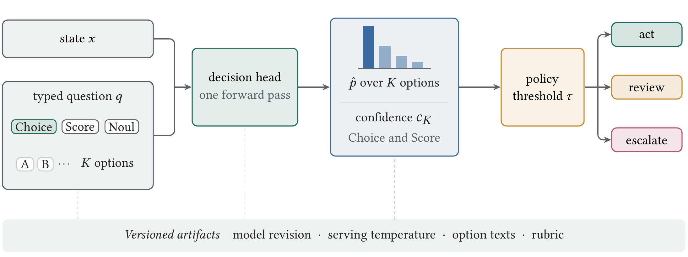
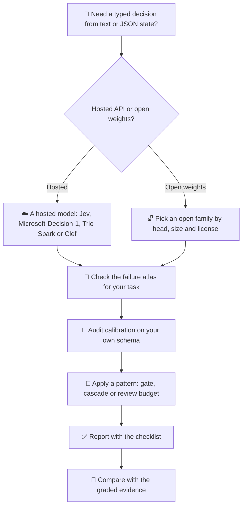
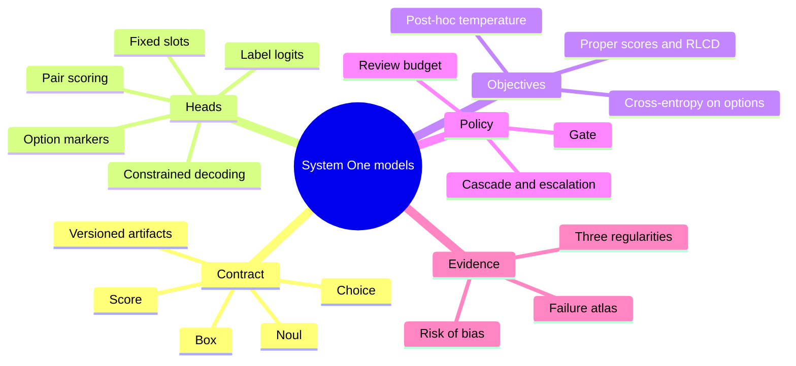
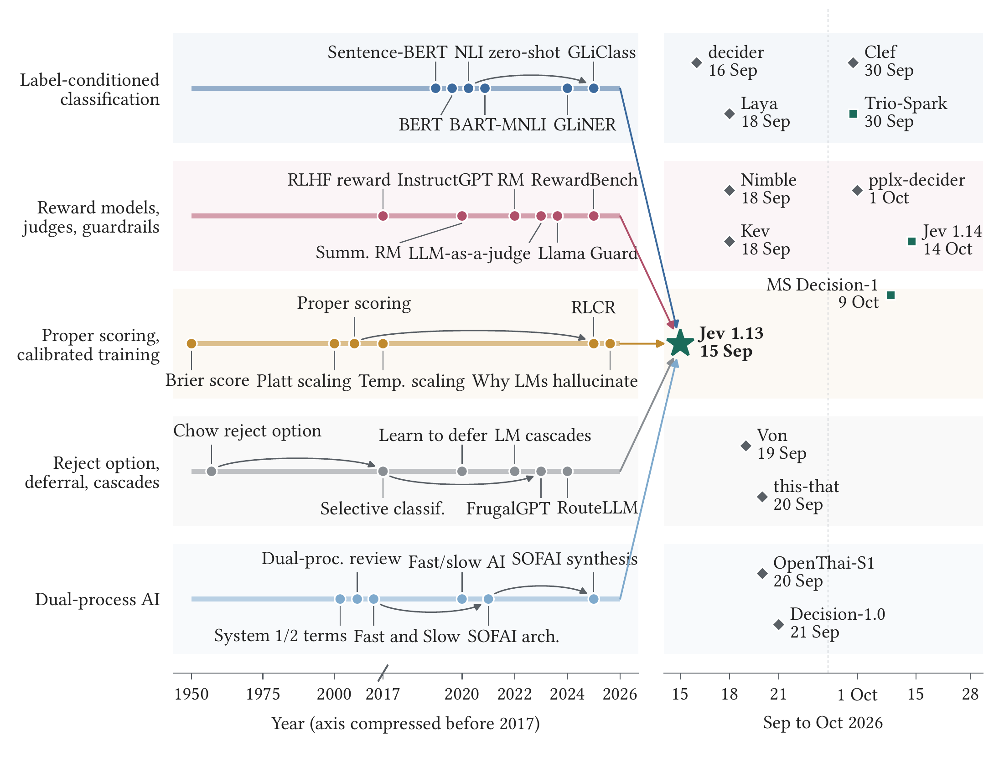
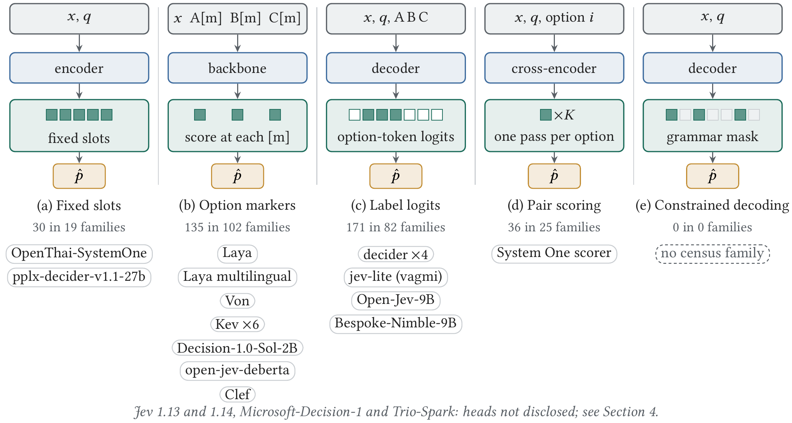

<div align="center">

# 🧭 Awesome System One Models
### *Typed probabilistic decision models: a curated, evidence-graded map of the contract, the models and the failures*

<p align="center">
  
</p>

[](https://awesome.re)
[](https://creativecommons.org/licenses/by/4.0/)
[](https://github.com/pozapas/awesome-system-one-models)
[](CONTRIBUTING.md)
[](https://github.com/pozapas/awesome-system-one-models/commits/main)
[](#-at-a-glance)
[](#-cutoff-and-versioning)

</div>

---

<div align="center">

Maintained alongside &nbsp;<strong>System One Decision Models: A Survey of the Typed Decision Contract, Its Ecosystem and Its Evidence</strong> &nbsp;·&nbsp; Rafe and Das, <em>manuscript under review</em>, with the companion benchmark <a href="https://arxiv.org/abs/2610.00346">arXiv:2610.00346</a> &nbsp; 

</div>

---

<div align="center">

### 🎯 *"A decision model is a new contract, not a new kind of intelligence."*

**214 registry-verified papers · 248 graded studies · 388 models · 246 datasets · 127 tools**  
*Organized by the survey's own structure: genealogy, anatomy, census, evidence, failures, patterns and reporting*

[🧩 Concept](#-what-is-a-system-one-model) • [🌳 Genealogy](#-genealogy) • [🤖 Models](#-models) • [🔬 Evidence](#-evidence) • [🧨 Failure atlas](#-failure-atlas) • [🧱 Patterns](#-design-patterns) • [🤝 Contribute](CONTRIBUTING.md) • [📝 Cite](#-how-to-cite)

</div>

---

## 📌 Contents

<table><tr><td valign="top">

1. [🧩 What is a System One model?](#-what-is-a-system-one-model)
2. [🚀 Quick Start](#-quick-start)
3. [📊 At a glance](#-at-a-glance)
4. [🗺️ Taxonomy](#️-taxonomy)
5. [🌳 Genealogy](#-genealogy)
6. [🤖 Models](#-models)
7. [📚 Datasets and benchmarks](#-datasets-and-benchmarks)
8. [🛠️ Harnesses and tooling](#️-harnesses-and-tooling)
9. [🔬 Evidence](#-evidence)

</td><td valign="top">

10. [🧨 Failure atlas](#-failure-atlas)
11. [🧱 Design patterns](#-design-patterns)
12. [✅ Reporting checklist in brief](#-reporting-checklist-in-brief)
13. [📖 Surveys and related resources](#-surveys-and-related-resources)
14. [🤝 Contributing](#-contributing)
15. [📝 How to cite](#-how-to-cite)
16. [🕒 Cutoff and versioning](#-cutoff-and-versioning)
17. [📜 License](#-license)

</td></tr></table>

## 🧩 What is a System One model?

A System One model, also called a typed probabilistic decision model, maps a state and a caller-declared typed question to a probability distribution over a finite answer space, in one forward pass and without generating text. The question is one of three primitives, **Choice** over named options, **Score** over ordered levels, or **Noul** for a yes-or-no judgment, and the model promises that the returned probabilities are calibrated. The survey reads this as a new contract assembled from five older research lines rather than as a new kind of intelligence, so the unit of evaluation is the contract together with the policy that consumes the probability and chooses to act, review or escalate. The versioned artifacts drawn along the bottom of the figure above (model revision, serving temperature, option texts and rubric) belong to the contract, because a change in any of them yields a different predictor.

| Primitive | Answer space | Returned | Confidence value |
| --- | --- | --- | --- |
| **Choice** | Declared options (up to 255 on the hosted model) | Distribution over the options | Yes |
| **Score** | Ordered levels (2 to 10 on the hosted model) | Distribution over the levels | Yes |
| **Noul** | Yes or no | Probability of yes | Not returned by the hosted model |

## 🚀 Quick Start



## 📊 At a glance

<details>
<summary>📊 <strong>Repository statistics</strong> (click to expand)</summary>

- **📄 Registry-verified papers**: 214, of which 166 sit in the five genealogy streams S1 36, S2 26, S3 51, S4 40, S5 13
- **☁️ Hosted and provider-released decision models**: 6 (Jev 1.13, TypeSafe AI; Jev 1.14, TypeSafe; Microsoft-Decision-1, Microsoft; Trio-Spark, MachineFi; Clef and Clef-Flash, Cloudflare; pplx-decider v1.1 (27B), Perplexity)
- **🔓 Open original implementations on Hugging Face (T1)**: 379 checkpoints, 101 in 67 recipe families at the first cutoff and 278 in 149 families added by v1.2; first releases 2026-09-16 to 2026-10-28; the first census found 15 backbone families
- **🧩 Decision heads (T1)**: fixed slots 30, option markers 135, label logits 171, pair scoring 36, constrained decoding 0, undisclosed 7
- **🧬 Derivatives (T2)**: 1,370 (format conversions 591, quantizations 110, language fine-tunes 32, domain fine-tunes 345, merges 28, other 264)
- **📚 Datasets**: 246 typed-decision datasets on Hugging Face, 8 with a full card
- **🐙 GitHub repositories screened**: 16,014 (approximate split from rules and a classifier: applications 6,492, integrations 5,228, evaluation 2,034, local servers 1,094, open-model training 875, directories 290, mirrors 1); 226 at the first cutoff
- **🔬 Evidence ledger**: 3,511 extracted values from 248 studies; risk of bias low 3, some concerns 102, high 143
- **🧨 Failure modes**: 15 · **🧱 Design patterns**: 13 · **✅ Checklist items**: 16 in 5 groups
- **🕒 Cutoff**: 2026-10-28 (v1.2)

</details>

## 🗺️ Taxonomy

The list follows the survey's conceptual structure. A decision model is described by its contract, its head and its objective. It is placed in the ecosystem by the census, judged by the graded evidence, and deployed through patterns that answer documented failure modes.



## 🌳 Genealogy

The decision contract is best read as a convergence of five older research lines rather than as an invention of September 2026. The timeline places each stream on its own lane; the right panel shows the open implementations that followed the hosted release within days. Papers marked 📖 are discussed in the survey; the others come from the same registry-verified bibliography.

<p align="center"></p>

| Stream | Contributes | Papers |
| --- | --- | --- |
| 🏷️ [Label-conditioned scoring heads](#️-s1-label-conditioned-scoring-heads) | the scoring head | 36 |
| ⚖️ [Reward models, verifiers, judges and guardrail classifiers](#️-s2-reward-models-verifiers-judges-and-guardrail-classifiers) | the verdict role | 26 |
| 🎯 [Proper scoring rules and calibrated training](#-s3-proper-scoring-rules-and-calibrated-training) | the training target | 51 |
| 🚦 [The reject option and its descendants](#-s4-the-reject-option-and-its-descendants) | the policy that acts on the probability | 40 |
| 🧠 [Dual-process architectures and the System One name](#-s5-dual-process-architectures-and-the-system-one-name) | the fast-solver role and the name | 13 |

### 🏷️ S1 Label-conditioned scoring heads

> Classification over a declared label set, from pretrained encoders to entailment-based zero-shot classification and label-in-context models. Once labels are read as text, their wording and order become part of the input.

<details>
<summary><strong>36 papers</strong>, 13 discussed in the survey</summary>

| Year | Title | First author | Venue |
| ---: | --- | --- | --- |
| 1995 | [Solving Multiclass Learning Problems via Error-Correcting Output Codes](https://doi.org/10.1613/jair.105) | Dietterich | Journal of Artificial Intelligence Research |
| 1997 | [A Decision-Theoretic Generalization of On-Line Learning and an Application to Boosting](https://doi.org/10.1006/jcss.1997.1504) | Freund | Journal of Computer and System Sciences |
| 1997 | [On the Optimality of the Simple Bayesian Classifier under Zero-One Loss](https://doi.org/10.1023/a:1007413511361) | Domingos | Machine Learning |
| 2001 | [On Discriminative vs. Generative Classifiers: A Comparison of Logistic Regression and Naive Bayes](https://proceedings.neurips.cc/paper/2001/hash/7b7a53e239400a13bd6be6c91c4f6c4e-Abstract.html) 📖 | Ng | NeurIPS |
| 2004 | [Ensemble selection from libraries of models](https://doi.org/10.1145/1015330.1015432) | Caruana | Twenty-first international conference on … |
| 2019 | [BERT: Pre-training of Deep Bidirectional Transformers for Language Understanding](https://doi.org/10.18653/v1/n19-1423) 📖 | Devlin | NAACL |
| 2019 | [Benchmarking Zero-shot Text Classification: Datasets, Evaluation and Entailment Approach](https://doi.org/10.18653/v1/d19-1404) 📖 | Yin | EMNLP |
| 2019 | [DistilBERT, a distilled version of BERT: smaller, faster, cheaper and lighter](https://arxiv.org/abs/1910.01108) | Sanh | arXiv |
| 2019 | [Passage Re-ranking with BERT](https://arxiv.org/abs/1901.04085) | Nogueira | arXiv |
| 2019 | [RoBERTa: A Robustly Optimized BERT Pretraining Approach](https://arxiv.org/abs/1907.11692) | Liu | arXiv |
| 2019 | [Sentence-BERT: Sentence Embeddings using Siamese BERT-Networks](https://doi.org/10.18653/v1/d19-1410) 📖 | Reimers | EMNLP |
| 2019 | [Zero-shot Text Classification With Generative Language Models](https://arxiv.org/abs/1912.10165) | Puri | arXiv |
| 2020 | [BART: Denoising Sequence-to-Sequence Pre-training for Natural Language Generation, Translation, and Comprehension](https://doi.org/10.18653/v1/2020.acl-main.703) 📖 | Lewis | ACL |
| 2020 | [ColBERT: Efficient and Effective Passage Search via Contextualized Late Interaction over BERT](https://doi.org/10.1145/3397271.3401075) | Khattab | Proceedings of the 43rd International ACM … |
| 2020 | [DeBERTa: Decoding-enhanced BERT with Disentangled Attention](https://arxiv.org/abs/2006.03654) | He | arXiv |
| 2020 | [Language Models are Few-Shot Learners](https://arxiv.org/abs/2005.14165) 📖 | Brown | arXiv |
| 2021 | [Calibrate Before Use: Improving Few-Shot Performance of Language Models](https://arxiv.org/abs/2102.09690) 📖 | Zhao | arXiv |
| 2021 | [Entailment as Few-Shot Learner](https://arxiv.org/abs/2104.14690) | Wang | arXiv |
| 2021 | [Exploiting Cloze-Questions for Few-Shot Text Classification and Natural Language Inference](https://doi.org/10.18653/v1/2021.eacl-main.20) 📖 | Schick | EACL |
| 2021 | [Making Pre-trained Language Models Better Few-shot Learners](https://doi.org/10.18653/v1/2021.acl-long.295) | Gao | ACL |
| 2021 | [Surface Form Competition: Why the Highest Probability Answer Isn’t Always Right](https://doi.org/10.18653/v1/2021.emnlp-main.564) | Holtzman | EMNLP |
| 2021 | [The Power of Scale for Parameter-Efficient Prompt Tuning](https://doi.org/10.18653/v1/2021.emnlp-main.243) | Lester | EMNLP |
| 2021 | [True Few-Shot Learning with Language Models](https://arxiv.org/abs/2105.11447) | Perez | arXiv |
| 2022 | [Efficient Few-Shot Learning Without Prompts](https://arxiv.org/abs/2209.11055) | Tunstall | arXiv |
| 2022 | [Leveraging Large Language Models for Multiple Choice Question Answering](https://arxiv.org/abs/2210.12353) 📖 | Robinson | arXiv |
| 2022 | [Noisy Channel Language Model Prompting for Few-Shot Text Classification](https://doi.org/10.18653/v1/2022.acl-long.365) | Min | ACL |
| 2022 | [Prompt-free and Efficient Few-shot Learning with Language Models](https://doi.org/10.18653/v1/2022.acl-long.254) | Karimi Mahabadi | ACL |
| 2023 | [Large Language Models Are Not Robust Multiple Choice Selectors](https://arxiv.org/abs/2309.03882) 📖 | Zheng | arXiv |
| 2023 | [Quantifying Language Models' Sensitivity to Spurious Features in Prompt Design or: How I learned to start worrying about prompt formatting](https://arxiv.org/abs/2310.11324) | Sclar | arXiv |
| 2024 | [GLiNER: Generalist Model for Named Entity Recognition using Bidirectional Transformer](https://doi.org/10.18653/v1/2024.naacl-long.300) 📖 | Zaratiana | NAACL |
| 2024 | [Large Language Models Sensitivity to The Order of Options in Multiple-Choice Questions](https://doi.org/10.18653/v1/2024.findings-naacl.130) | Pezeshkpour | Findings of ACL |
| 2025 | [GLiClass: Generalist Lightweight Model for Sequence Classification Tasks](https://arxiv.org/abs/2508.07662) 📖 | Stepanov | arXiv |
| 2025 | [Smarter, Better, Faster, Longer: A Modern Bidirectional Encoder for Fast, Memory Efficient, and Long Context Finetuning and Inference](https://doi.org/10.18653/v1/2025.acl-long.127) 📖 | Warner | ACL |
| 2025 | [Text Classification in the LLM Era – Where do we stand?](https://arxiv.org/abs/2502.11830) | Vajjala | arXiv |
| 2025 | [mmBERT: A Modern Multilingual Encoder with Annealed Language Learning](https://arxiv.org/abs/2509.06888) | Marone | arXiv |
| 2026 | [Large Language Models for Text Classification: From Zero-Shot Learning to Instruction-Tuning](https://doi.org/10.1177/00491241251325243) | Chae | Sociological Methods & Research |

</details>

### ⚖️ S2 Reward models, verifiers, judges and guardrail classifiers

> Scorers that map a state and a set of candidates to a probability of preference, correctness or safety, together with the catalogue of biases that sway a model reading the candidates it must choose among.

<details>
<summary><strong>26 papers</strong>, 14 discussed in the survey</summary>

| Year | Title | First author | Venue |
| ---: | --- | --- | --- |
| 2017 | [Deep reinforcement learning from human preferences](https://arxiv.org/abs/1706.03741) 📖 | Christiano | arXiv |
| 2020 | [Learning to summarize from human feedback](https://arxiv.org/abs/2009.01325) 📖 | Stiennon | arXiv |
| 2021 | [Training Verifiers to Solve Math Word Problems](https://arxiv.org/abs/2110.14168) 📖 | Cobbe | arXiv |
| 2022 | [A New Generation of Perspective API: Efficient Multilingual Character-level Transformers](https://doi.org/10.1145/3534678.3539147) | Lees | KDD |
| 2022 | [Solving math word problems with process- and outcome-based feedback](https://arxiv.org/abs/2211.14275) | Uesato | arXiv |
| 2022 | [Training Language Models to Follow Instructions with Human Feedback](https://doi.org/10.52202/068431-2011) 📖 | Ouyang | NeurIPS |
| 2022 | [Training a Helpful and Harmless Assistant with Reinforcement Learning from Human Feedback](https://arxiv.org/abs/2204.05862) | Bai | arXiv |
| 2023 | [A Holistic Approach to Undesired Content Detection in the Real World](https://doi.org/10.1609/aaai.v37i12.26752) 📖 | Markov | AAAI |
| 2023 | [Can Large Language Models Be an Alternative to Human Evaluations?](https://doi.org/10.18653/v1/2023.acl-long.870) | Chiang | ACL |
| 2023 | [Direct Preference Optimization: Your Language Model is Secretly a Reward Model](https://doi.org/10.52202/075280-2338) | Rafailov | NeurIPS |
| 2023 | [G-Eval: NLG Evaluation using Gpt-4 with Better Human Alignment](https://doi.org/10.18653/v1/2023.emnlp-main.153) 📖 | Liu | EMNLP |
| 2023 | [Judging LLM-as-a-Judge with MT-Bench and Chatbot Arena](https://doi.org/10.52202/075280-2020) 📖 | Zheng | NeurIPS |
| 2023 | [Let's Verify Step by Step](https://arxiv.org/abs/2305.20050) 📖 | Lightman | arXiv |
| 2023 | [Llama Guard: LLM-based Input-Output Safeguard for Human-AI Conversations](https://arxiv.org/abs/2312.06674) 📖 | Inan | arXiv |
| 2023 | [PandaLM: An Automatic Evaluation Benchmark for LLM Instruction Tuning Optimization](https://arxiv.org/abs/2306.05087) | Wang | arXiv |
| 2023 | [Prometheus: Inducing Fine-grained Evaluation Capability in Language Models](https://arxiv.org/abs/2310.08491) | Kim | arXiv |
| 2024 | [A Survey on LLM-as-a-Judge](https://arxiv.org/abs/2411.15594) | Gu | arXiv |
| 2024 | [Justice or Prejudice? Quantifying Biases in LLM-as-a-Judge](https://arxiv.org/abs/2410.02736) 📖 | Ye | arXiv |
| 2024 | [LLM Evaluators Recognize and Favor Their Own Generations](https://doi.org/10.52202/079017-2197) 📖 | Panickssery | NeurIPS |
| 2024 | [Large Language Models are not Fair Evaluators](https://doi.org/10.18653/v1/2024.acl-long.511) | Wang | ACL |
| 2024 | [Length-Controlled AlpacaEval: A Simple Way to Debias Automatic Evaluators](https://arxiv.org/abs/2404.04475) 📖 | Dubois | arXiv |
| 2024 | [Math-Shepherd: Verify and Reinforce LLMs Step-by-step without Human Annotations](https://doi.org/10.18653/v1/2024.acl-long.510) | Wang | ACL |
| 2024 | [Prometheus 2: An Open Source Language Model Specialized in Evaluating Other Language Models](https://doi.org/10.18653/v1/2024.emnlp-main.248) | Kim | EMNLP |
| 2024 | [ShieldGemma: Generative AI Content Moderation Based on Gemma](https://arxiv.org/abs/2407.21772) 📖 | Zeng | arXiv |
| 2025 | [RewardBench 2: Advancing Reward Model Evaluation](https://arxiv.org/abs/2506.01937) | Malik | arXiv |
| 2025 | [RewardBench: Evaluating Reward Models for Language Modeling](https://doi.org/10.18653/v1/2025.findings-naacl.96) 📖 | Lambert | Findings of ACL |

</details>

### 🎯 S3 Proper scoring rules and calibrated training

> Strictly proper scores, post-hoc calibration and calibration-aware rewards. Training against a proper score is training for calibration, which is the meaning of the decision model's promise.

<details>
<summary><strong>51 papers</strong>, 20 discussed in the survey</summary>

| Year | Title | First author | Venue |
| ---: | --- | --- | --- |
| 1950 | [Verification of Forecasts Expressed in Terms of Probability](https://doi.org/10.1175/1520-0493%281950%29078%3C0001:vofeit%3E2.0.co%3B2) 📖 | Brier | Monthly Weather Review |
| 1969 | [A Scoring System for Probability Forecasts of Ranked Categories](https://doi.org/10.1175/1520-0450%281969%29008%3C0985:assfpf%3E2.0.co%3B2) 📖 | Epstein | Journal of Applied Meteorology |
| 1973 | [A New Vector Partition of the Probability Score](https://doi.org/10.1175/1520-0450%281973%29012%3C0595:anvpot%3E2.0.co%3B2) 📖 | Murphy | Journal of Applied Meteorology |
| 1982 | [The Well-Calibrated Bayesian: Rejoinder](https://doi.org/10.2307/2287723) | Dawid | Journal of the American Statistical Association |
| 1983 | [The Comparison and Evaluation of Forecasters](https://doi.org/10.2307/2987588) | DeGroot | The Statistician |
| 1996 | [Scoring rules and the evaluation of probabilities](https://doi.org/10.1007/bf02562681) | Winkler | Test |
| 1998 | [Asymptotic calibration](https://doi.org/10.1093/biomet/85.2.379) | Foster | Biometrika |
| 2002 | [Transforming classifier scores into accurate multiclass probability estimates](https://doi.org/10.1145/775047.775151) 📖 | Zadrozny | KDD |
| 2005 | [Predicting good probabilities with supervised learning](https://doi.org/10.1145/1102351.1102430) | Niculescu-Mizil | Proceedings of the 22nd international … |
| 2006 | [An Introduction to Copulas](https://doi.org/10.1007/0-387-28678-0) 📖 |  | Springer New York |
| 2007 | [Probabilistic Forecasts, Calibration and Sharpness](https://doi.org/10.1111/j.1467-9868.2007.00587.x) | Gneiting | Journal of the Royal Statistical Society … |
| 2007 | [Strictly Proper Scoring Rules, Prediction, and Estimation](https://doi.org/10.1198/016214506000001437) 📖 | Gneiting | Journal of the American Statistical Association |
| 2009 | [Reliability, sufficiency, and the decomposition of proper scores](https://doi.org/10.1002/qj.456) | Bröcker | Quarterly Journal of the Royal Meteorological … |
| 2009 | [The Elements of Statistical Learning: Data Mining, Inference, and Prediction](https://doi.org/10.1007/978-0-387-84858-7) | Hastie | Springer |
| 2012 | [Calibrating predictive model estimates to support personalized medicine](https://doi.org/10.1136/amiajnl-2011-000291) | Jiang | Journal of the American Medical Informatics … |
| 2015 | [Dropout as a Bayesian Approximation: Representing Model Uncertainty in Deep Learning](https://arxiv.org/abs/1506.02142) | Gal | arXiv |
| 2015 | [Obtaining Well Calibrated Probabilities Using Bayesian Binning](https://doi.org/10.1609/aaai.v29i1.9602) | Pakdaman Naeini | AAAI |
| 2016 | [Simple and Scalable Predictive Uncertainty Estimation using Deep Ensembles](https://arxiv.org/abs/1612.01474) | Lakshminarayanan | arXiv |
| 2017 | [Beyond sigmoids: How to obtain well-calibrated probabilities from binary classifiers with beta calibration](https://doi.org/10.1214/17-ejs1338si) | Kull | Electronic Journal of Statistics |
| 2017 | [On Calibration of Modern Neural Networks](https://arxiv.org/abs/1706.04599) 📖 | Guo | arXiv |
| 2018 | [Accurate Uncertainties for Deep Learning Using Calibrated Regression](https://arxiv.org/abs/1807.00263) | Kuleshov | arXiv |
| 2019 | [Beyond temperature scaling: Obtaining well-calibrated multiclass probabilities with Dirichlet calibration](https://arxiv.org/abs/1910.12656) 📖 | Kull | arXiv |
| 2019 | [Calibration tests in multi-class classification: A unifying framework](https://arxiv.org/abs/1910.11385) | Widmann | arXiv |
| 2019 | [Can You Trust Your Model's Uncertainty? Evaluating Predictive Uncertainty Under Dataset Shift](https://arxiv.org/abs/1906.02530) | Ovadia | arXiv |
| 2019 | [Evaluating model calibration in classification](https://arxiv.org/abs/1902.06977) | Vaicenavicius | arXiv |
| 2019 | [Measuring Calibration in Deep Learning](https://arxiv.org/abs/1904.01685) | Nixon | arXiv |
| 2019 | [Verified Uncertainty Calibration](https://arxiv.org/abs/1909.10155) 📖 | Kumar | arXiv |
| 2020 | [Calibration of Pre-trained Transformers](https://doi.org/10.18653/v1/2020.emnlp-main.21) | Desai | EMNLP |
| 2020 | [Mitigating Bias in Calibration Error Estimation](https://arxiv.org/abs/2012.08668) | Roelofs | arXiv |
| 2020 | [Uncertainty Quantification and Deep Ensembles](https://arxiv.org/abs/2007.08792) | Rahaman | arXiv |
| 2021 | [Distribution-free calibration guarantees for histogram binning without sample splitting](https://arxiv.org/abs/2105.04656) | Gupta | arXiv |
| 2021 | [How Can We Know When Language Models Know? On the Calibration of Language Models for Question Answering](https://doi.org/10.1162/tacl_a_00407) | Jiang | TACL |
| 2021 | [Revisiting the Calibration of Modern Neural Networks](https://arxiv.org/abs/2106.07998) 📖 | Minderer | arXiv |
| 2021 | [Second opinion needed: communicating uncertainty in medical machine learning](https://doi.org/10.1038/s41746-020-00367-3) | Kompa | npj Digital Medicine |
| 2022 | [Language Models (Mostly) Know What They Know](https://arxiv.org/abs/2207.05221) 📖 | Kadavath | arXiv |
| 2022 | [Teaching Models to Express Their Uncertainty in Words](https://arxiv.org/abs/2205.14334) | Lin | arXiv |
| 2023 | [A Unifying Theory of Distance from Calibration](https://doi.org/10.1145/3564246.3585182) | Błasiok | Proceedings of the 55th Annual ACM Symposium … |
| 2023 | [Can LLMs Express Their Uncertainty? An Empirical Evaluation of Confidence Elicitation in LLMs](https://arxiv.org/abs/2306.13063) 📖 | Xiong | arXiv |
| 2023 | [Classifier calibration: a survey on how to assess and improve predicted class probabilities](https://doi.org/10.1007/s10994-023-06336-7) | Silva Filho | Machine Learning |
| 2023 | [Just Ask for Calibration: Strategies for Eliciting Calibrated Confidence Scores from Language Models Fine-Tuned with Human Feedback](https://doi.org/10.18653/v1/2023.emnlp-main.330) | Tian | EMNLP |
| 2024 | [A Survey of Confidence Estimation and Calibration in Large Language Models](https://doi.org/10.18653/v1/2024.naacl-long.366) 📖 | Geng | NAACL |
| 2024 | [Calibrated Language Models Must Hallucinate](https://doi.org/10.1145/3618260.3649777) 📖 | Kalai | Proceedings of the 56th Annual ACM Symposium … |
| 2024 | [LACIE: Listener-Aware Finetuning for Calibration in Large Language Models](https://doi.org/10.52202/079017-1364) | Stengel-Eskin | NeurIPS |
| 2024 | [Linguistic Calibration of Long-Form Generations](https://arxiv.org/abs/2404.00474) 📖 | Band | arXiv |
| 2025 | [Beyond Binary Rewards: Training LMs to Reason About Their Uncertainty](https://arxiv.org/abs/2507.16806) | Damani | arXiv |
| 2025 | [Confidence-Aware Routing for Large Language Model Reliability Enhancement: A Multi-Signal Approach to Pre-Generation Hallucination Mitigation](https://arxiv.org/abs/2510.01237) 📖 | M | arXiv |
| 2025 | [SalesRLAgent: A Reinforcement Learning Approach for Real-Time Sales Conversion Prediction and Optimization](https://arxiv.org/abs/2503.23303) 📖 | M | arXiv |
| 2025 | [Uncertainty Quantification and Confidence Calibration in Large Language Models: A Survey](https://doi.org/10.1145/3711896.3736569) 📖 | Liu | KDD |
| 2025 | [Why Language Models Hallucinate](https://arxiv.org/abs/2509.04664) 📖 | Kalai | arXiv |
| 2026 | [A Survey on Uncertainty Quantification of Large Language Models: Taxonomy, Open Research Challenges, and Future Directions](https://doi.org/10.1145/3744238) 📖 | Shorinwa | ACM Computing Surveys |
| 2026 | [Balancing Classification and Calibration Performance in Decision-Making LLMs via Calibration Aware Reinforcement Learning](https://doi.org/10.18653/v1/2026.findings-acl.610) | Yaldiz | Findings of ACL |

</details>

### 🚦 S4 The reject option and its descendants

> The reject option, selective classification, learning to defer, conformal sets and model cascades. This stream turns a returned probability into an action such as act, review or escalate.

<details>
<summary><strong>40 papers</strong>, 24 discussed in the survey</summary>

| Year | Title | First author | Venue |
| ---: | --- | --- | --- |
| 1952 | [A Generalization of Sampling Without Replacement from a Finite Universe](https://doi.org/10.1080/01621459.1952.10483446) 📖 | Horvitz | Journal of the American Statistical Association |
| 1957 | [An optimum character recognition system using decision functions](https://doi.org/10.1109/tec.1957.5222035) 📖 | Chow | IRE Transactions on Electronic Computers |
| 1970 | [On optimum recognition error and reject tradeoff](https://doi.org/10.1109/tit.1970.1054406) 📖 | Chow | IEEE Transactions on Information Theory |
| 1995 | [Active Learning with Statistical Models](https://doi.org/10.21236/ada295617) | Cohn | Defense Technical Information Center |
| 2001 | [Rapid Object Detection Using a Boosted Cascade of Simple Features](https://doi.org/10.1109/CVPR.2001.990517) 📖 | Viola | CVPR |
| 2005 | [Algorithmic Learning in a Random World](https://doi.org/10.1007/b106715) | Vovk | Springer |
| 2006 | [Classification with reject option](https://doi.org/10.1002/cjs.5550340410) | Herbei | Canadian Journal of Statistics |
| 2007 | [A tutorial on conformal prediction](https://arxiv.org/abs/0706.3188) | Shafer | arXiv |
| 2010 | [On the Foundations of Noise-free Selective Classification](https://jmlr.org/papers/v11/el-yaniv10a.html) 📖 | El-Yaniv | JMLR |
| 2011 | [Bayesian Active Learning for Classification and Preference Learning](https://arxiv.org/abs/1112.5745) | Houlsby | arXiv |
| 2013 | [Conditional validity of inductive conformal predictors](https://doi.org/10.1007/s10994-013-5355-6) | Vovk | Machine Learning |
| 2016 | [A Baseline for Detecting Misclassified and Out-of-Distribution Examples in Neural Networks](https://arxiv.org/abs/1610.02136) | Hendrycks | arXiv |
| 2016 | [Learning with Rejection](https://doi.org/10.1007/978-3-319-46379-7_5) 📖 | Cortes | Lecture Notes in Computer Science |
| 2017 | [Adaptive Classification for Prediction Under a Budget](https://arxiv.org/abs/1705.10194) | Nan | arXiv |
| 2017 | [Predict Responsibly: Improving Fairness and Accuracy by Learning to Defer](https://arxiv.org/abs/1711.06664) 📖 | Madras | arXiv |
| 2017 | [Selective Classification for Deep Neural Networks](https://arxiv.org/abs/1705.08500) 📖 | Geifman | arXiv |
| 2019 | [End to end learning and optimization on graphs](https://arxiv.org/abs/1905.13732) | Wilder | arXiv |
| 2019 | [SelectiveNet: A Deep Neural Network with an Integrated Reject Option](https://arxiv.org/abs/1901.09192) | Geifman | arXiv |
| 2020 | [Classification with Valid and Adaptive Coverage](https://arxiv.org/abs/2006.02544) 📖 | Romano | arXiv |
| 2020 | [Consistent Estimators for Learning to Defer to an Expert](https://arxiv.org/abs/2006.01862) 📖 | Mozannar | arXiv |
| 2020 | [Selective Question Answering under Domain Shift](https://doi.org/10.18653/v1/2020.acl-main.503) 📖 | Kamath | ACL |
| 2021 | [Active Testing: Sample-Efficient Model Evaluation](https://arxiv.org/abs/2103.05331) 📖 | Kossen | arXiv |
| 2021 | [Distribution-free, Risk-controlling Prediction Sets](https://doi.org/10.1145/3478535) 📖 | Bates | Journal of the ACM |
| 2022 | [Conformal Risk Control](https://arxiv.org/abs/2208.02814) 📖 | Angelopoulos | arXiv |
| 2022 | [Investigating Selective Prediction Approaches Across Several Tasks in IID, OOD, and Adversarial Settings](https://doi.org/10.18653/v1/2022.findings-acl.158) | Varshney | Findings of ACL |
| 2022 | [Language Model Cascades](https://arxiv.org/abs/2207.10342) 📖 | Dohan | arXiv |
| 2022 | [Post-Hoc Estimators for Learning to Defer to an Expert](https://doi.org/10.52202/068431-2124) | Narasimhan | NeurIPS |
| 2023 | [Conformal Language Modeling](https://arxiv.org/abs/2306.10193) | Quach | arXiv |
| 2023 | [Conformal Prediction with Large Language Models for Multi-Choice Question Answering](https://arxiv.org/abs/2305.18404) 📖 | Kumar | arXiv |
| 2023 | [Conformal Prediction: A Gentle Introduction](https://doi.org/10.1561/2200000101) 📖 | Angelopoulos | Foundations and Trends in Machine Learning |
| 2023 | [FrugalGPT: How to Use Large Language Models While Reducing Cost and Improving Performance](https://arxiv.org/abs/2305.05176) 📖 | Chen | arXiv |
| 2023 | [Large Language Model Cascades with Mixture of Thoughts Representations for Cost-efficient Reasoning](https://arxiv.org/abs/2310.03094) | Yue | arXiv |
| 2023 | [When Does Confidence-Based Cascade Deferral Suffice?](https://doi.org/10.52202/075280-0431) 📖 | Jitkrittum | NeurIPS |
| 2023 | [Who Should Predict? Exact Algorithms For Learning to Defer to Humans](https://arxiv.org/abs/2301.06197) | Mozannar | arXiv |
| 2024 | [AutoMix: Automatically Mixing Language Models](https://doi.org/10.52202/079017-4164) | Aggarwal | NeurIPS |
| 2024 | [Machine learning with a reject option: a survey](https://doi.org/10.1007/s10994-024-06534-x) 📖 | Hendrickx | Machine Learning |
| 2024 | [RouteLLM: Learning to Route LLMs with Preference Data](https://arxiv.org/abs/2406.18665) 📖 | Ong | arXiv |
| 2025 | [Learning to Defer: A Survey](https://doi.org/10.5281/zenodo.17843044) 📖 | Strong |  |
| 2026 | [Doing More with Less: A Survey on Routing Strategies for Resource Optimisation in Large Language Model-Based Systems](https://doi.org/10.1613/jair.1.19801) 📖 | Varangot-Reille | Journal of Artificial Intelligence Research |
| 2026 | [Dynamic Model Routing and Cascading for Efficient LLM Inference: A Survey](https://arxiv.org/abs/2603.04445) 📖 | Moslem | arXiv |

</details>

### 🧠 S5 Dual-process architectures and the System One name

> Dual-process accounts of reasoning and the fast and slow AI architectures that borrow them. The stream supplies the fast-solver role in a larger program and the System One label.

<details>
<summary><strong>13 papers</strong>, 8 discussed in the survey</summary>

| Year | Title | First author | Venue |
| ---: | --- | --- | --- |
| 1996 | [The empirical case for two systems of reasoning](https://doi.org/10.1037/0033-2909.119.1.3) | Sloman | Psychological Bulletin |
| 2002 | [Individual Differences in Reasoning: Implications for the Rationality Debate?](https://doi.org/10.1017/cbo9780511808098.026) 📖 | Stanovich | Heuristics and Biases |
| 2002 | [Representativeness Revisited: Attribute Substitution in Intuitive Judgment](https://doi.org/10.1017/cbo9780511808098.004) | Kahneman | Heuristics and Biases |
| 2008 | [Dual-Processing Accounts of Reasoning, Judgment, and Social Cognition](https://doi.org/10.1146/annurev.psych.59.103006.093629) 📖 | Evans | Annual Review of Psychology |
| 2010 | [Dual‐Process and Dual‐System Theories of Reasoning](https://doi.org/10.1111/j.1747-9991.2010.00330.x) | Frankish | Philosophy Compass |
| 2013 | [Dual-Process Theories of Higher Cognition: Advancing the Debate](https://doi.org/10.1177/1745691612460685) | Evans | Perspectives on Psychological Science |
| 2020 | [Thinking Fast and Slow in AI](https://arxiv.org/abs/2010.06002) 📖 | Booch | arXiv |
| 2021 | [Thinking Fast and Slow in AI: the Role of Metacognition](https://arxiv.org/abs/2110.01834) 📖 | Ganapini | arXiv |
| 2023 | [Human-like intuitive behavior and reasoning biases emerged in large language models but disappeared in ChatGPT](https://doi.org/10.1038/s43588-023-00527-x) 📖 | Hagendorff | Nature Computational Science |
| 2023 | [SwiftSage: A Generative Agent with Fast and Slow Thinking for Complex Interactive Tasks](https://doi.org/10.52202/075280-1034) 📖 | Lin | NeurIPS |
| 2025 | [Dual-process theory and decision-making in large language models](https://doi.org/10.1038/s44159-025-00506-1) | Brady | Nature Reviews Psychology |
| 2025 | [Fast, slow, and metacognitive thinking in AI](https://doi.org/10.1038/s44387-025-00027-5) 📖 | Bergamaschi Ganapini | npj Artificial Intelligence |
| 2025 | [Thinking Fast and Slow in Human and Machine Intelligence](https://doi.org/10.1145/3715709) 📖 | Fabiano | Communications of the ACM |

</details>

## 🤖 Models

### ☁️ Hosted models

**Jev 1.13** from TypeSafe AI launched on 15 September 2026 with the post that introduced the System One name. Its weights, architecture and RLCD training recipe are not published, so statements about its internals rest on the vendor's own descriptions or on black-box probing. The facts below are the vendor's, as documented for Jev 1.13 on the first access date; Jev 1.14 is listed further down, and the vendor's documentation now resolves its jev-latest alias to jev-1.14.0.

| Fact | Value | Source |
| --- | --- | --- |
| Pinned model ID | jev-1.13.0 | [link](https://docs.typesafe.ai/models) |
| jev-latest resolves to | jev-1.14.0 (from 14 October 2026) | [link](https://docs.typesafe.ai/models.md) |
| Choice options (max) | 255 | [link](https://docs.typesafe.ai/primitives/choice) |
| Score levels (min) | 2 | [link](https://docs.typesafe.ai/primitives/score) |
| Score levels (max) | 10 | [link](https://docs.typesafe.ai/primitives/score) |
| State budget | 32k tokens (state plus the longest question) | [link](https://docs.typesafe.ai/models) |
| Request budget | 64k tokens (state plus all questions) | [link](https://docs.typesafe.ai/models) |
| Input price, USD per million tokens | 0.042 | [link](https://docs.typesafe.ai/models) |
| Output price | free (not metered) | [link](https://docs.typesafe.ai/models) |
| Stated latency | 70 to 500 ms end to end (vendor claim) | [link](https://typesafe.ai/blog/introducing-system-one-models-and-jev) |
| Confidence on Noul | not returned (Choice and Score only) | [link](https://docs.typesafe.ai/confidence) |
| Jaggedness page last reviewed | 2026-09-17 | [link](https://docs.typesafe.ai/model-jaggedness/jev-1.13) |

<details>
<summary>📘 <strong>Vendor documentation and access points</strong> (17 pages)</summary>

| Page | Publisher | Page date | Accessed |
| --- | --- | --- | --- |
| [Introduction](https://docs.typesafe.ai/introduction) | TypeSafe AI | 2026-09-20 (sitemap lastmod) | 2026-09-24 |
| [System One](https://docs.typesafe.ai/concepts/system-one) | TypeSafe AI | 2026-09-17 (sitemap lastmod) | 2026-09-24 |
| [Models](https://docs.typesafe.ai/models) | TypeSafe AI | 2026-09-22 (sitemap lastmod) | 2026-09-24 |
| [Choice](https://docs.typesafe.ai/primitives/choice) | TypeSafe AI | 2026-09-20 (sitemap lastmod) | 2026-09-24 |
| [Score](https://docs.typesafe.ai/primitives/score) | TypeSafe AI | 2026-09-20 (sitemap lastmod) | 2026-09-24 |
| [Noul](https://docs.typesafe.ai/primitives/noul) | TypeSafe AI | 2026-09-20 (sitemap lastmod) | 2026-09-24 |
| [Confidence](https://docs.typesafe.ai/confidence) | TypeSafe AI | 2026-09-20 (sitemap lastmod) | 2026-09-24 |
| [API reference](https://docs.typesafe.ai/api) | TypeSafe AI | 2026-09-20 (sitemap lastmod) | 2026-09-24 |
| [Jev 1.13 jaggedness](https://docs.typesafe.ai/model-jaggedness/jev-1.13) | TypeSafe AI | last reviewed 2026-09-17 | 2026-09-24 |
| [AI primer](https://docs.typesafe.ai/introduction/machine-learning-primer) | TypeSafe AI | 2026-09-05 (sitemap lastmod) | 2026-09-24 |
| [State](https://docs.typesafe.ai/concepts/state) | TypeSafe AI | 2026-09-20 (sitemap lastmod) | 2026-09-24 |
| [Patterns](https://docs.typesafe.ai/patterns) | TypeSafe AI | 2026-08-31 / 2026-09-22 (sitemap lastmod) | 2026-09-24 |
| [Cookbooks](https://docs.typesafe.ai/cookbooks) | TypeSafe AI | 2026-08-31 / 2026-09-22 (sitemap lastmod) | 2026-09-24 |
| [Workflow evals](https://evals.typesafe.ai/) | TypeSafe AI | undated | 2026-09-24 |
| [Advanced: structure](https://docs.typesafe.ai/primitives/advanced) | TypeSafe AI | 2026-09-15 (sitemap lastmod) | 2026-09-24 |
| [Jev on OpenRouter (guide)](https://openrouter.ai/docs/guides/community/jev) | OpenRouter | undated | 2026-09-24 |
| [Jev 1.13 on OpenRouter (model page)](https://openrouter.ai/typesafe/jev-1.13) | OpenRouter | undated | 2026-09-24 |

</details>

**Released after the first cutoff.** These models appeared after 24 September 2026, and the version 1.2 census (cutoff 28 October 2026) covers them. Their entries record the publisher's documentation. A measurement shown is the publisher's own, or a result from a community leaderboard, until an independent evaluation is listed in the evidence table. An entry with no API link has no hosted API in the sources.

| Model | Provider | Released | Contract | Limits and price | Evidence | Disclosure |
| --- | --- | --- | --- | --- | --- | --- |
| [Jev 1.14](https://typesafe.ai/blog/jev-1-14) · [API](https://docs.typesafe.ai/models) | TypeSafe | 2026-10-14 | Choice, Score and Noul as in Jev 1.13, plus a fourth question type, Box, that returns the four edges of a single bounding box in an image and needs Jev 1.14; Choice and Score return probabilities and a 0 to 1 confidence, and Noul returns a probability of yes without a separate confidence | API model ID jev-1.14.0 (jev-latest and jev-preview now resolve to it); 64k tokens per request and 32k per question, as for Jev 1.13, and 262k for both with the long-context header; request body at most 32 MiB; rate limits set per organization; the vendor intends 60 days of warning before jev-1.13.0 is formally deprecated and 30 days before jev-1.14.0; 0.042 USD per million input tokens ($42 per billion), output free, unchanged from Jev 1.13 | Vendor documentation says the model was trained with RLCD to return calibrated decisions, in the same words as for Jev 1.13. Leaderboard results, not graded studies: Decision Index 0.4.1 Full score 60.2 (an accuracy index, with calibration on a separate tab) and edgeevals.ai v0.2 clinical-decision accuracy 76.8 (rank 7=) | Vendor pages accessed 2026-10-28. The models table lists text input for both Jev versions, while the images page says both accept images behind the TypeSafe-Danger-Zone-Images header, and the launch post says jev-1.13.0 was multimodal all along |
| [Microsoft-Decision-1](https://commandline.microsoft.com/microsoft-decision-1-model-foundry/) · [API](https://learn.microsoft.com/en-us/azure/foundry/foundry-models/how-to/use-foundry-models-microsoft-decision) | Microsoft | 2026-10-09 | Noul, Choice and Score through a Decision API type; a text or JSON state plus one or more typed questions; also rubric-based grading, and abstention expressed as an extra answer option such as cannot tell | text only; inputs up to 32K tokens in the Foundry catalog; deployment types DataZoneStandard in selected regions and GlobalStandard; the blog and the Learn page state no context or rate limit; catalog lifecycle Preview; 0.042 USD per million input tokens, output free | Vendor-reported: highest accuracy in its 36-benchmark comparison of nearly 150,000 questions; third on calibration, 1.5 behind Jev 1.13.0 and 0.9 behind Quyet-1.0-Large; 1.3% of decisions change on average over eight perturbations. The Learn page cautions that scores are not absolute calibrated ratings. A leaderboard result, not a graded study: edgeevals.ai v0.2 clinical-decision accuracy 78.1 (rank 6=) | Model version 1, post-trained from Qwen3.5-9B; API only, through Microsoft Foundry and OpenRouter; the blog says it will soon be rebased on other models |
| [Trio-Spark](https://huggingface.co/MachineFi/Trio-Spark) · [API](https://github.com/machinefi/trio-spark/blob/main/docs/api.md) | MachineFi | 2026-09-30 | Choice questions only, with 2 to 8 choices; returns the selected choice, a probability for each choice and a confidence equal to the probability of the selected choice, with a decide, review or abstain disposition; v1.3 of 2026-10-15 is the current release and adds visual input | 1,024 expanded input tokens including task, state, choices and any visual input; 65,536-byte request body in the v1.0 text API; at most 16 questions per request; recommended model ID trio-spark-v1.3 (older aliases route to the current model and do not pin historical weights); 0.042 USD per million billed input tokens, output free; 100 free decisions for a new account | Vendor-reported only: expected calibration error 0.019 on its own 2,977-decision text panel (10 bins); the vendor states that calibration on this panel does not guarantee calibrated confidence in a different application, and that its accuracy table is developer-run and not independently certified | Submitted by the publisher (issue #2). The model card is for a commercial API; weights and training code are not distributed. The former v1.0 card is merged into the current card, and Trio-Spark-DI is a separate research checkpoint, not the hosted model |
| [Clef and Clef-Flash](https://huggingface.co/Cloudflare/clef-flash) · [API](https://blog.cloudflare.com/clef-decision-models) | Cloudflare | 2026-10-01 | Noul, Choice and Score (types noul, choice and score) over text, JSON, images and video frames; Clef-Flash is a 9B multimodal model, and its card says the API is fully compatible with Jev and SystemOne | the launch post states a 64k context window for Clef, against 32k for Jev; the Clef-Flash code defaults to 16,384 tokens; hosted on Workers AI; no price found on the launch post | Vendor: trained with label-smoothed cross-entropy plus a Brier loss to refine calibration; the Clef-Flash card has no calibration claim and reports a vendor internal accuracy run of Decision Index 0.2.1. Leaderboard results, not graded studies: edgeevals.ai v0.2 clinical-decision accuracy 74.8 (Clef 27B, rank 8=) and 66.7 (Clef-Flash, rank 20=); Decision Index 0.4.1 Full score 54.9 (clef) and 44.4 (clef-flash) | Open weights under Apache-2.0 on Hugging Face, with Clef-Flash post-trained from Qwen3.5-9B (card created 2026-09-30), and hosted on Workers AI |
| [pplx-decider v1.1 (27B)](https://huggingface.co/perplexity-ai/pplx-decider-v1.1-27b) | Perplexity | 2026-10-05 | Choice in the card's usage example, and Choice and Noul decisions in the training pipeline of v1; images are supported | 8,192 tokens for the text and all images of a decision; about 49 GiB of weights; no hosted API in the sources; no price (open weights) | Vendor: the supplied predict applies a saved calibration temperature. The card's accuracy claim, a Decision Index score rising from 56.4 to 61.56, is on an older edition and is not a calibration result. Both leaderboards list v1.2 rather than v1.1: Decision Index 0.4.1 Full score 68.0 and edgeevals.ai v0.2 clinical-decision accuracy 83.8 (rank 3) | Open weights under Apache-2.0, base model Qwen/Qwen3.8-27B; the card calls the repository private, while the Hugging Face API showed it public and ungated on 2026-10-28 |

The official SDKs are [system-one-adapter-python](https://github.com/typesafe-ai/system-one-adapter-python), [typesafe-sdk-js](https://github.com/typesafe-ai/typesafe-sdk-js) and [typesafe-sdk-python](https://github.com/typesafe-ai/typesafe-sdk-python).

### 🔓 Open original implementations

Open label-conditioned heads on public backbones reproduced the typed contract within days of the hosted release. The table condenses the notable families with an independent card; each head badge follows the survey's five-way head taxonomy, assigned from the card's own description of its decision head.

<p align="center"></p>

<p align="center">    </p>

| Family | Author | First release | Backbone | Size | Head | License | Links |
| --- | --- | --- | --- | --- | --- | --- | --- |
| **Laya** | Convai Innovations | 2026-09-18 | ModernBERT-large 395M (English); mmBERT-base 307M (multilingual) | 0.32B to 0.42B |  | Apache-2.0 | [🤗 laya](https://huggingface.co/convaiinnovations/laya)<br>[🤗 laya-multilingual](https://huggingface.co/convaiinnovations/laya-multilingual)<br>[code](https://github.com/NandhaKishorM/laya) |
| **Kev** | Jared Palmer | 2026-09-18 | Qwen2.5, Qwen3 and Qwen3.5 backbones | 0.5B to 9B (LoRA r=16) |  | Apache-2.0 | [🤗 kev-0.5b](https://huggingface.co/jaredpalmer/kev-0.5b)<br>[🤗 kev-0.6b](https://huggingface.co/jaredpalmer/kev-0.6b)<br>[🤗 kev-0.8b](https://huggingface.co/jaredpalmer/kev-0.8b)<br>[🤗 kev-4b](https://huggingface.co/jaredpalmer/kev-4b)<br>[🤗 kev-8b](https://huggingface.co/jaredpalmer/kev-8b)<br>[🤗 kev-9b](https://huggingface.co/jaredpalmer/kev-9b)<br>[code](https://github.com/jaredpalmer/kev) |
| **Bespoke-Nimble** | Bespoke Labs | 2026-09-18 | Qwen3.5-9B | 9B (LoRA r=16) |  | Apache-2.0 | [🤗 Bespoke-Nimble-9B](https://huggingface.co/bespokelabs/Bespoke-Nimble-9B)<br>[code](https://github.com/bespokelabsai/nimble) |
| **decider** | Mapika | 2026-09-16 | Qwen3.5 backbones | 0.8B to 35B-A3B |  | Apache-2.0 | [🤗 decider-0.8b](https://huggingface.co/Mapika/decider-0.8b)<br>[🤗 decider-2b](https://huggingface.co/Mapika/decider-2b)<br>[🤗 decider-4b](https://huggingface.co/Mapika/decider-4b)<br>[🤗 decider-35b-a3b](https://huggingface.co/Mapika/decider-35b-a3b)<br>[code](https://github.com/Mapika/decider) |
| **this-that-model (fine-tune of decider-2b)** | FLock.io | 2026-09-20 | decider-2b (Qwen3.5-style hybrid) | 1.9B |  | MIT | [🤗 this-that-model-1.0](https://huggingface.co/flock-io/this-that-model-1.0)<br>[🤗 this-that-model-1.1](https://huggingface.co/flock-io/this-that-model-1.1)<br>[🤗 this-that-model-1.2](https://huggingface.co/flock-io/this-that-model-1.2)<br>[code](https://github.com/FLock-io/this-that-model) |
| **OpenThai-SystemOne** | iApp / OpenThaiGPT | 2026-09-20 | Qwen3.5-0.8B, continued pretraining on Thai text | 0.75B |  | Apache-2.0 | [🤗 OpenThai-SystemOne](https://huggingface.co/iapp/OpenThai-SystemOne) |
| **Von** | wfzyx | 2026-09-19 | ModernBERT-large | 0.40B |  | Apache-2.0 | [🤗 von-1.0](https://huggingface.co/wfzyx/von-1.0)<br>[code](https://github.com/wfzyx/von) |
| **Decision-1.0** | llm-semantic-router | 2026-09-21 | Qwen3.5-2B (Sol); Qwen3.5-4B and 9B siblings | 2B (Sol) |  | Apache-2.0 | [🤗 Decision-1.0-Sol-2B](https://huggingface.co/llm-semantic-router/Decision-1.0-Sol-2B) |
| **Open-Jev** | Zefan Cai | 2026-09-20 | Qwen3.5-9B | 9B (LoRA r=8) |  | Apache-2.0 (weights), MIT (code) | [🤗 Open-Jev-9B](https://huggingface.co/ZefanCai/Open-Jev-9B)<br>[code](https://github.com/Zefan-Cai/Open-Jev) |
| **open-jev-deberta** | kotoba-lang | 2026-09-18 | DeBERTa-v3-large | 0.43B |  | Apache-2.0 | [🤗 open-jev-deberta-v3-large](https://huggingface.co/com-kotobalabs/open-jev-deberta-v3-large)<br>[code](https://github.com/kotoba-lang/typed-decisions) |
| **System One scorer** | pngwn | 2026-09-16 | Qwen3.5-4B | 4.2B (LoRA r=16) |  | CC-BY-NC-4.0 | [🤗 system-one-qwen3.5-4b-scorer](https://huggingface.co/pngwn/system-one-qwen3.5-4b-scorer) |
| **jev-lite** | vagmi | 2026-09-19 | Gemma 4 E4B (QLoRA, 4-bit) | 8.0B total |  | Gemma license | [🤗 jev-lite](https://huggingface.co/vagmi/jev-lite) |
| **Verdict** | Heman10x-NGU | 2026-09-17 | ModernBERT plus GLiClass | 0.15B | not classified | not stated | [code](https://github.com/Heman10x-NGU/Verdict-open-jev) |
| **SemIf** | TheoLeeCJ | 2026-09-15 | MiniCPM5-2B, Qwen3.5-4B, Qwen3.8-27B | 2B to 27B | not classified | MIT | [code](https://github.com/TheoLeeCJ/SemIf-OpenJev) |
| **OpenDecision** | deepanwadhwa | 2026-09-17 | ModernBERT-large zero-shot v2.0 | 0.40B | not classified | Apache-2.0 | [code](https://github.com/deepanwadhwa/OpenDecision) |

<details>
<summary>🌡️ <strong>Calibration as shipped, per family</strong></summary>

| Family | Head as described | Primitives | Temperature or calibration as shipped |
| --- | --- | --- | --- |
| Laya | Two-layer option-marker scorer plus an act/escalate head | Choice, Score, Noul | One temperature refit per question type and option count; raw ECE 0.466 to 0.081 (English) |
| Kev | LoRA adapter plus a pointer head reading option logits | Choice, Noul, Score | T = 2.35 (0.8B) and T = 2.30 (9B), fitted per checkpoint |
| Bespoke-Nimble | LoRA adapter scoring the allowed answer tokens directly | Choice, Score, Noul | T = 2.179 as fitted on checkpoint original-2676; later revision ships at default temperature |
| decider | Letter-logit readout from the LM head, divided by a stored temperature | Noul, Choice, Score | T = 1.30 (2b, v10); other sizes store 1.03 to 1.94 |
| this-that-model (fine-tune of decider-2b) | Inherits the decider-2b letter-logit readout | Choice-style typed decisions | Not disclosed for 1.0 and 1.1; 1.2 reports 0.009 Brier on a third-party cohort |
| OpenThai-SystemOne | 256-way slot head replacing the LM head | Choice (up to 255), Score, Noul | Per-type learned temperatures (choice 1.055, noul 1.047, score 1.008) |
| Von | Option-marker head with an order-invariant attention mask (v1.2) | Choice-style, Noul | Input-conditioned calibration map; ECE 0.045 to 0.109 across difficulty tiers |
| Decision-1.0 | Shared candidate head reading candidate endpoints and the query vector | Choice (2 to 255), Noul, Score | Not disclosed |
| Open-Jev | Scalar head initialized from a Yes-minus-No readout | Choice, Noul, Score | T = 1.897 on 512 calibration rows; test ECE 0.0077 |
| open-jev-deberta | Three-layer scoring head over pooled question and option representations | Choice (up to 255), Score, Noul | Post-hoc temperature on a validation split; in-domain ECE 0.022 |
| System One scorer | Sequence-classification head scoring each (state, question, option) triple | Noul, Choice, Score | T = 1.75; ECE 0.135 to 0.044 as served |
| jev-lite | Label-token readout at the option-letter positions | Choice-style | See card |
| Verdict | Non-autoregressive typed-question scorer (GitHub only) | Choice, Score, Noul | Not disclosed as a scalar |
| SemIf | Reads option probabilities from a frozen backbone (GitHub only) | Choice, Noul | Per-workload temperature calibration |
| OpenDecision | Zero-shot classification head behind a vendor-compatible endpoint (GitHub only) | Choice, Noul, Score, Relation | Not disclosed |

</details>

<details>
<summary>🧾 <strong>Full census of open original implementations</strong> (379 Hugging Face checkpoints, tier T1)</summary>

Each checkpoint is coded by decision head from its own card or code; 7 cards do not say how the distribution is read and are marked undisclosed. The first census (101 checkpoints) runs to 24 September 2026, and version 1.2 adds 278 more up to 28 October 2026.

| Checkpoint | Created | Base model | Params | License | Head |
| --- | --- | --- | --- | --- | --- |
| [llm-semantic-router/Decision-1.0-Eos-0.8B](https://huggingface.co/llm-semantic-router/Decision-1.0-Eos-0.8B) |  | not stated | n/a | not stated |  |
| [llm-semantic-router/Decision-1.0-Kai-0.6B](https://huggingface.co/llm-semantic-router/Decision-1.0-Kai-0.6B) |  | not stated | n/a | not stated |  |
| [llm-semantic-router/Decision-1.0-Lex-0.6B](https://huggingface.co/llm-semantic-router/Decision-1.0-Lex-0.6B) |  | not stated | n/a | not stated |  |
| [DavidHatley/system-one-mini](https://huggingface.co/DavidHatley/system-one-mini) | 2026-09-16 | distilbert/distilbert-base-uncased | 69M | apache-2.0 |  |
| [Mapika/decider-2b](https://huggingface.co/Mapika/decider-2b) | 2026-09-16 | Qwen/Qwen3.5-2B-Base | 1.9B | apache-2.0 |  |
| [Mapika/decider-2b-vision](https://huggingface.co/Mapika/decider-2b-vision) | 2026-09-16 | Qwen/Qwen3.5-2B-Base | 2.2B | apache-2.0 |  |
| [pngwn/nanodiff-350m-typed-decisions-lam1](https://huggingface.co/pngwn/nanodiff-350m-typed-decisions-lam1) | 2026-09-16 | Sebasdi/nanodiff-350m-base | n/a | mit |  |
| [pngwn/system-one-qwen3.5-4b-scorer](https://huggingface.co/pngwn/system-one-qwen3.5-4b-scorer) | 2026-09-16 | Qwen/Qwen3.5-4B-Base | n/a | cc-by-nc-4.0 |  |
| [mobarmg/jev-schema-scorer-deberta-v3-large](https://huggingface.co/mobarmg/jev-schema-scorer-deberta-v3-large) | 2026-09-17 | microsoft/deberta-v3-large | 435M | mit |  |
| [bespokelabs/Bespoke-Nimble-9B](https://huggingface.co/bespokelabs/Bespoke-Nimble-9B) | 2026-09-18 | Qwen/Qwen3.5-9B | n/a | apache-2.0 |  |
| [com-kotobalabs/open-jev-deberta-v3-large](https://huggingface.co/com-kotobalabs/open-jev-deberta-v3-large) | 2026-09-18 | microsoft/deberta-v3-large | 434M | apache-2.0 |  |
| [convaiinnovations/laya](https://huggingface.co/convaiinnovations/laya) | 2026-09-18 | not stated | 421M | apache-2.0 |  |
| [jaredpalmer/kev-0.5b](https://huggingface.co/jaredpalmer/kev-0.5b) | 2026-09-18 | Qwen/Qwen2.5-0.5B | n/a | apache-2.0 |  |
| [larkooo/gemma-e2b-rlcd](https://huggingface.co/larkooo/gemma-e2b-rlcd) | 2026-09-18 | google/gemma-4-E2B-it | n/a | apache-2.0 |  |
| [Mannedood/local-system-one-student](https://huggingface.co/Mannedood/local-system-one-student) | 2026-09-18 | answerdotai/ModernBERT-base | 149M | mit |  |
| [SargeDev/jev-distill-corpus](https://huggingface.co/SargeDev/jev-distill-corpus) | 2026-09-18 | not stated | n/a | apache-2.0 |  |
| [AndeyTait/JevForge-0.8B](https://huggingface.co/AndeyTait/JevForge-0.8B) | 2026-09-19 | Qwen/Qwen3.5-0.8B | n/a | apache-2.0 |  |
| [anthonym21/qwen3-0.6b-rlcd-decision](https://huggingface.co/anthonym21/qwen3-0.6b-rlcd-decision) | 2026-09-19 | Qwen/Qwen3-0.6B-Base | n/a | apache-2.0 |  |
| [argos1111/modernbert-ja-310m-jev](https://huggingface.co/argos1111/modernbert-ja-310m-jev) | 2026-09-19 | sbintuitions/modernbert-ja-310m | 315M | cc-by-sa-4.0 |  |
| [convaiinnovations/laya-multilingual](https://huggingface.co/convaiinnovations/laya-multilingual) | 2026-09-19 | not stated | 322M | apache-2.0 |  |
| [dwidlee/systemone-lite-0.5b](https://huggingface.co/dwidlee/systemone-lite-0.5b) | 2026-09-19 | Qwen/Qwen2.5-0.5B-Instruct | 494M | apache-2.0 |  |
| [jaredpalmer/kev-0.6b](https://huggingface.co/jaredpalmer/kev-0.6b) | 2026-09-19 | Qwen/Qwen3-0.6B-Base | n/a | apache-2.0 |  |
| [jaredpalmer/kev-4b](https://huggingface.co/jaredpalmer/kev-4b) | 2026-09-19 | Qwen/Qwen3.5-4B-Base | n/a | apache-2.0 |  |
| [jaredpalmer/kev-8b](https://huggingface.co/jaredpalmer/kev-8b) | 2026-09-19 | Qwen/Qwen3-8B-Base | n/a | apache-2.0 |  |
| [lafalce/system-one-model](https://huggingface.co/lafalce/system-one-model) | 2026-09-19 | answerdotai/ModernBERT-base | n/a | apache-2.0 |  |
| [lewislululu/jevon](https://huggingface.co/lewislululu/jevon) | 2026-09-19 | not stated | n/a | agpl-3.0 |  |
| [Mapika/decider-0.8b](https://huggingface.co/Mapika/decider-0.8b) | 2026-09-19 | Qwen/Qwen3.5-0.8B-Base | 752M | apache-2.0 |  |
| [shreyanbr/system-one-distilled](https://huggingface.co/shreyanbr/system-one-distilled) | 2026-09-19 | MoritzLaurer/deberta-v3-xsmall-zeroshot-v1.1-all-33 | 71M | apache-2.0 |  |
| [shreyanbr/system-one-gold](https://huggingface.co/shreyanbr/system-one-gold) | 2026-09-19 | MoritzLaurer/deberta-v3-xsmall-zeroshot-v1.1-all-33 | 71M | apache-2.0 |  |
| [shreyanbr/system-one-zeroshot](https://huggingface.co/shreyanbr/system-one-zeroshot) | 2026-09-19 | MoritzLaurer/deberta-v3-xsmall-zeroshot-v1.1-all-33 | 71M | apache-2.0 |  |
| [vagmi/jev-lite](https://huggingface.co/vagmi/jev-lite) | 2026-09-19 | google/gemma-4-E4B-it | n/a | gemma |  |
| [wfzyx/von-1.0](https://huggingface.co/wfzyx/von-1.0) | 2026-09-19 | answerdotai/ModernBERT-large | 395M | apache-2.0 |  |
| [akhilaaa3/Jev-Omni](https://huggingface.co/akhilaaa3/Jev-Omni) | 2026-09-20 | google/gemma-4-12B-it | n/a | apache-2.0 |  |
| [altslate/certo-decision-model](https://huggingface.co/altslate/certo-decision-model) | 2026-09-20 | not stated | n/a | mit |  |
| [AstroHan/decision-head-qwen3.5-4b-rlcd-32k](https://huggingface.co/AstroHan/decision-head-qwen3.5-4b-rlcd-32k) | 2026-09-20 | Qwen/Qwen3.5-4B | n/a | apache-2.0 |  |
| [azharmo/build-jev-from-scratch](https://huggingface.co/azharmo/build-jev-from-scratch) | 2026-09-20 | not stated | n/a | mit |  |
| [iapp/OpenThai-SystemOne](https://huggingface.co/iapp/OpenThai-SystemOne) | 2026-09-20 | Qwen/Qwen3.5-0.8B-Base | 753M | apache-2.0 |  |
| [jaredpalmer/kev-0.8b](https://huggingface.co/jaredpalmer/kev-0.8b) | 2026-09-20 | Qwen/Qwen3.5-0.8B-Base | n/a | apache-2.0 |  |
| [jaredpalmer/kev-9b](https://huggingface.co/jaredpalmer/kev-9b) | 2026-09-20 | Qwen/Qwen3.5-9B-Base | n/a | apache-2.0 |  |
| [Mapika/decider-35b-a3b](https://huggingface.co/Mapika/decider-35b-a3b) | 2026-09-20 | Qwen/Qwen3.5-35B-A3B-Base | 34.7B | apache-2.0 |  |
| [Nebulaw1/jev-qwen3.5-0.8b-legal-lora](https://huggingface.co/Nebulaw1/jev-qwen3.5-0.8b-legal-lora) | 2026-09-20 | Qwen/Qwen3.5-0.8B-Base | n/a | apache-2.0 |  |
| [Nebulaw1/jev-qwen3.5-4b-legal-lora](https://huggingface.co/Nebulaw1/jev-qwen3.5-4b-legal-lora) | 2026-09-20 | Qwen/Qwen3.5-4B-Base | n/a | apache-2.0 |  |
| [ZefanCai/Open-Jev-2B](https://huggingface.co/ZefanCai/Open-Jev-2B) | 2026-09-20 | Qwen/Qwen3.5-2B | n/a | apache-2.0 |  |
| [ZefanCai/Open-Jev-9B](https://huggingface.co/ZefanCai/Open-Jev-9B) | 2026-09-20 | Qwen/Qwen3.5-9B | n/a | apache-2.0 |  |
| [abidlabs/jev-typed-decisions-causal-0.6b](https://huggingface.co/abidlabs/jev-typed-decisions-causal-0.6b) | 2026-09-21 | Qwen/Qwen3-0.6B-Base | n/a | apache-2.0 |  |
| [aimeigaoshou/agent-jev](https://huggingface.co/aimeigaoshou/agent-jev) | 2026-09-21 | not stated | 598M | apache-2.0 |  |
| [kaivoss/system-one-270m](https://huggingface.co/kaivoss/system-one-270m) | 2026-09-21 | unsloth/gemma-3-270m-it | 268M | gemma |  |
| [llm-semantic-router/Decision-1.0-Nox-4B](https://huggingface.co/llm-semantic-router/Decision-1.0-Nox-4B) | 2026-09-21 | Qwen/Qwen3.5-4B | n/a | apache-2.0 |  |
| [llm-semantic-router/Decision-1.0-Sol-2B](https://huggingface.co/llm-semantic-router/Decision-1.0-Sol-2B) | 2026-09-21 | Qwen/Qwen3.5-2B | n/a | apache-2.0 |  |
| [lostargon/Tiny-Jev](https://huggingface.co/lostargon/Tiny-Jev) | 2026-09-21 | Qwen/Qwen3-0.6B | 596M | apache-2.0 |  |
| [marcmagn1/kev-08b-typed-v1](https://huggingface.co/marcmagn1/kev-08b-typed-v1) | 2026-09-21 | not stated | n/a | not stated |  |
| [mogita/jev-decider-qwen3-4b](https://huggingface.co/mogita/jev-decider-qwen3-4b) | 2026-09-21 | Qwen/Qwen3-4B | n/a | apache-2.0 |  |
| [Pdbz199/local-decision-model](https://huggingface.co/Pdbz199/local-decision-model) | 2026-09-21 | answerdotai/ModernBERT-base | n/a | cc-by-nc-4.0 |  |
| [Praveenrajus/jevify-qwen3-vl-2b](https://huggingface.co/Praveenrajus/jevify-qwen3-vl-2b) | 2026-09-21 | Qwen/Qwen3-VL-2B-Instruct | n/a | apache-2.0 |  |
| [Praveenrajus/jevify-qwen3.5-2b](https://huggingface.co/Praveenrajus/jevify-qwen3.5-2b) | 2026-09-21 | Qwen/Qwen3.5-2B | n/a | apache-2.0 |  |
| [Praveenrajus/jevify-qwen3.5-4b](https://huggingface.co/Praveenrajus/jevify-qwen3.5-4b) | 2026-09-21 | Qwen/Qwen3.5-4B | n/a | apache-2.0 |  |
| [samatv256/mini-Jev](https://huggingface.co/samatv256/mini-Jev) | 2026-09-21 | Qwen/Qwen3-0.6B | 0M | apache-2.0 |  |
| [SargeDev/jev-gate-student-b](https://huggingface.co/SargeDev/jev-gate-student-b) | 2026-09-21 | not stated | n/a | apache-2.0 |  |
| [SeanLiu/Jev-Vision](https://huggingface.co/SeanLiu/Jev-Vision) | 2026-09-21 | Qwen/Qwen3-VL-8B-Instruct | n/a | apache-2.0 |  |
| [ait-hf/certus-jev-like-v0007](https://huggingface.co/ait-hf/certus-jev-like-v0007) | 2026-09-22 | Qwen/Qwen2.5-1.5B-Instruct | n/a | apache-2.0 |  |
| [alibiserikbay/JevK5](https://huggingface.co/alibiserikbay/JevK5) | 2026-09-22 | Qwen/Qwen3.5-4B | 4.2B | apache-2.0 |  |
| [FluidInference/kev-0-5b-coreml](https://huggingface.co/FluidInference/kev-0-5b-coreml) | 2026-09-22 | not stated | n/a | apache-2.0 |  |
| [IJyad/jeb-typed-decisions](https://huggingface.co/IJyad/jeb-typed-decisions) | 2026-09-22 | IJyad/jeb | 178M | apache-2.0 |  |
| [jaswanthsanjay88/rev-decision-model](https://huggingface.co/jaswanthsanjay88/rev-decision-model) | 2026-09-22 | not stated | 421M | apache-2.0 |  |
| [llm-semantic-router/Decision-1.0-Lux-9B](https://huggingface.co/llm-semantic-router/Decision-1.0-Lux-9B) | 2026-09-22 | Qwen/Qwen3.5-9B | n/a | apache-2.0 |  |
| [Mapika/decider-4b](https://huggingface.co/Mapika/decider-4b) | 2026-09-22 | Qwen/Qwen3.5-4B-Base | 4.2B | apache-2.0 |  |
| [mghafiri/qwen3.5-0.8B-decision-model](https://huggingface.co/mghafiri/qwen3.5-0.8B-decision-model) | 2026-09-22 | Qwen/Qwen3.5-0.8B-Base | 752M | apache-2.0 |  |
| [olafura/gemma4-12b-system-one](https://huggingface.co/olafura/gemma4-12b-system-one) | 2026-09-22 | google/gemma-4-12B-it-qat-w4a16-ct | n/a | apache-2.0 | undisclosed |
| [Praveenrajus/jevify-qwen3-vl-2b-t2](https://huggingface.co/Praveenrajus/jevify-qwen3-vl-2b-t2) | 2026-09-22 | Qwen/Qwen3-VL-2B-Instruct | n/a | apache-2.0 |  |
| [Praveenrajus/jevify-qwen3.5-4b-t2](https://huggingface.co/Praveenrajus/jevify-qwen3.5-4b-t2) | 2026-09-22 | Qwen/Qwen3.5-4B | n/a | apache-2.0 |  |
| [Praveenrajus/jevify-qwen3.5-4b-t2-lowlr](https://huggingface.co/Praveenrajus/jevify-qwen3.5-4b-t2-lowlr) | 2026-09-22 | Qwen/Qwen3.5-4B | n/a | apache-2.0 |  |
| [shreyanbr/nev-lite-systemone](https://huggingface.co/shreyanbr/nev-lite-systemone) | 2026-09-22 | sentence-transformers/all-MiniLM-L6-v2 | n/a | apache-2.0 |  |
| [sshalimov04/open-jev-base](https://huggingface.co/sshalimov04/open-jev-base) | 2026-09-22 | jhu-clsp/mmBERT-small | n/a | mit |  |
| [tasksource/modernbert-tasksource-jev](https://huggingface.co/tasksource/modernbert-tasksource-jev) | 2026-09-22 | not stated | 153M | apache-2.0 |  |
| [tianxinwei/JevAny-27B-RLCR](https://huggingface.co/tianxinwei/JevAny-27B-RLCR) | 2026-09-22 | Qwen/Qwen3.8-27B | n/a | apache-2.0 |  |
| [tianxinwei/JevAny-27B-SFT](https://huggingface.co/tianxinwei/JevAny-27B-SFT) | 2026-09-22 | Qwen/Qwen3.8-27B | n/a | apache-2.0 |  |
| [top7777/jev-schema-scorer-deberta-v3-large](https://huggingface.co/top7777/jev-schema-scorer-deberta-v3-large) | 2026-09-22 | microsoft/deberta-v3-large | 435M | mit |  |
| [vigneshlabs/ballot-jev-0.5b](https://huggingface.co/vigneshlabs/ballot-jev-0.5b) | 2026-09-22 | Qwen/Qwen2.5-0.5B | n/a | apache-2.0 |  |
| [ZefanCai/Open-Jev-27B-v1.1](https://huggingface.co/ZefanCai/Open-Jev-27B-v1.1) | 2026-09-22 | Qwen/Qwen3.8-27B | n/a | apache-2.0 |  |
| [0xSojalSec/Jev-Omni](https://huggingface.co/0xSojalSec/Jev-Omni) | 2026-09-23 | google/gemma-4-12B-it | n/a | apache-2.0 |  |
| [alibiserikbay/JevK5-2B](https://huggingface.co/alibiserikbay/JevK5-2B) | 2026-09-23 | Qwen/Qwen3.5-2B | 1.9B | apache-2.0 |  |
| [asjson/jevson-4b-01](https://huggingface.co/asjson/jevson-4b-01) | 2026-09-23 | Qwen/Qwen3-4B | n/a | apache-2.0 | undisclosed |
| [autotrust/JEV](https://huggingface.co/autotrust/JEV) | 2026-09-23 | Qwen/Qwen3.5-9B | 7.9B | apache-2.0 |  |
| [autotrust/JEV-9B](https://huggingface.co/autotrust/JEV-9B) | 2026-09-23 | Qwen/Qwen3.5-9B | n/a | apache-2.0 |  |
| [bespokelabs/Bespoke-Nimble-9B-v2](https://huggingface.co/bespokelabs/Bespoke-Nimble-9B-v2) | 2026-09-23 | Qwen/Qwen3.5-9B | n/a | apache-2.0 |  |
| [chaoliangUNSW/Jev-Style-Qwen3.5-2B-Decision-v2](https://huggingface.co/chaoliangUNSW/Jev-Style-Qwen3.5-2B-Decision-v2) | 2026-09-23 | Qwen/Qwen3.5-2B-Base | 1.9B | apache-2.0 |  |
| [DawoodKMasood/jev-gemma-3-270m](https://huggingface.co/DawoodKMasood/jev-gemma-3-270m) | 2026-09-23 | google/gemma-3-270m-it | n/a | not stated |  |
| [DKNTZMN/gan8-vs-jev](https://huggingface.co/DKNTZMN/gan8-vs-jev) | 2026-09-23 | not stated | n/a | apache-2.0 |  |
| [guanxuyu/visual-jev-4b-answer-sft](https://huggingface.co/guanxuyu/visual-jev-4b-answer-sft) | 2026-09-23 | Qwen/Qwen3-VL-4B-Instruct | n/a | apache-2.0 |  |
| [JohnP1/kev-gemma4-e2b](https://huggingface.co/JohnP1/kev-gemma4-e2b) | 2026-09-23 | google/gemma-4-E2B | n/a | apache-2.0 |  |
| [lostargon/Tiny-Jev-1.7B](https://huggingface.co/lostargon/Tiny-Jev-1.7B) | 2026-09-23 | Qwen/Qwen3-1.7B | 1.7B | apache-2.0 |  |
| [soyrsoyr/jev-playground-rlcd](https://huggingface.co/soyrsoyr/jev-playground-rlcd) | 2026-09-23 | MoritzLaurer/deberta-v3-large-zeroshot-v2.0 | n/a | mit |  |
| [SUPER321/jevflash-doom-basic-0.6b](https://huggingface.co/SUPER321/jevflash-doom-basic-0.6b) | 2026-09-23 | Qwen/Qwen3-0.6B-Base | n/a | apache-2.0 |  |
| [TokenRhythm/NeoHorse-Jev-4B](https://huggingface.co/TokenRhythm/NeoHorse-Jev-4B) | 2026-09-23 | TokenRhythm/NeoHorse-1-4B | n/a | apache-2.0 |  |
| [wwydmanski/bielik-minitron-jev-v0.1](https://huggingface.co/wwydmanski/bielik-minitron-jev-v0.1) | 2026-09-23 | speakleash/Bielik-Minitron-7B-v3.0-Instruct | n/a | apache-2.0 |  |
| [wwydmanski/bielik-minitron-jev-v0.2](https://huggingface.co/wwydmanski/bielik-minitron-jev-v0.2) | 2026-09-23 | speakleash/Bielik-Minitron-7B-v3.0-Instruct | n/a | apache-2.0 |  |
| [xuhaodev/Qwen3-1.7B-Jev](https://huggingface.co/xuhaodev/Qwen3-1.7B-Jev) | 2026-09-23 | Qwen/Qwen3-1.7B | n/a | apache-2.0 |  |
| [chaoliangUNSW/Jev-Style-0.8B-Decision-v3](https://huggingface.co/chaoliangUNSW/Jev-Style-0.8B-Decision-v3) | 2026-09-24 | Qwen/Qwen3.5-0.8B | n/a | apache-2.0 |  |
| [divyanshx11/JEVision](https://huggingface.co/divyanshx11/JEVision) | 2026-09-24 | Qwen/Qwen3.5-0.8B-Base | n/a | apache-2.0 |  |
| [Fr0zencr4nE/jev-spatial](https://huggingface.co/Fr0zencr4nE/jev-spatial) | 2026-09-24 | allenai/Molmo2-ER | n/a | apache-2.0 |  |
| [guoan1/jev-qwen35-08b](https://huggingface.co/guoan1/jev-qwen35-08b) | 2026-09-24 | Qwen/Qwen3.5-0.8B-Base | n/a | apache-2.0 |  |
| [jaredpalmer/kev-27b](https://huggingface.co/jaredpalmer/kev-27b) | 2026-09-24 | Qwen/Qwen3.8-27B | n/a | apache-2.0 |  |
| [joyfox/Qwen3.5-0.8B-JEV](https://huggingface.co/joyfox/Qwen3.5-0.8B-JEV) | 2026-09-24 | Qwen/Qwen3.5-0.8B | n/a | apache-2.0 |  |
| [Quazim0t0/Byrne-Jev-79M](https://huggingface.co/Quazim0t0/Byrne-Jev-79M) | 2026-09-24 | not stated | n/a | apache-2.0 |  |
| [Rckflr/kev-gemma-270m-experimental](https://huggingface.co/Rckflr/kev-gemma-270m-experimental) | 2026-09-24 | google/gemma-3-270m | n/a | other |  |
| [Rydward98/Jev-Omni](https://huggingface.co/Rydward98/Jev-Omni) | 2026-09-24 | google/gemma-4-12B-it | n/a | apache-2.0 |  |
| [SargeDev/Jev_Qwen3.8-27B](https://huggingface.co/SargeDev/Jev_Qwen3.8-27B) | 2026-09-24 | huihui-ai/Huihui-Qwen3.8-27B-abliterated | 26.9B | apache-2.0 | undisclosed |
| [shgao/rsi-jev-v1.0-qwen3.5-0.8b](https://huggingface.co/shgao/rsi-jev-v1.0-qwen3.5-0.8b) | 2026-09-24 | Qwen/Qwen3.5-0.8B-Base | n/a | apache-2.0 |  |
| [VTXAI/VTX-JEV-1](https://huggingface.co/VTXAI/VTX-JEV-1) | 2026-09-24 | not stated | 7M | apache-2.0 |  |
| [wwydmanski/bielik-minitron-jev-v0.3](https://huggingface.co/wwydmanski/bielik-minitron-jev-v0.3) | 2026-09-24 | speakleash/Bielik-Minitron-7B-v3.0-Instruct | n/a | apache-2.0 |  |
| [alibiserikbay/JevK5-9B](https://huggingface.co/alibiserikbay/JevK5-9B) | 2026-09-25 | Qwen/Qwen3.5-9B | n/a | apache-2.0 |  |
| [flymy-ai/decision-4b-v1.1](https://huggingface.co/flymy-ai/decision-4b-v1.1) | 2026-09-25 | Qwen/Qwen3.5-4B | n/a | apache-2.0 |  |
| [flymy-ai/decision-4b-v1.2](https://huggingface.co/flymy-ai/decision-4b-v1.2) | 2026-09-25 | Qwen/Qwen3.5-4B | n/a | apache-2.0 |  |
| [HIT-TMG/JevEmbed-KaLM-Embedding-V2.5](https://huggingface.co/HIT-TMG/JevEmbed-KaLM-Embedding-V2.5) | 2026-09-25 | KaLM-Embedding/KaLM-embedding-multilingual-mini-instruct-v2.5 | n/a | apache-2.0 |  |
| [NAME0x0/Jevlet](https://huggingface.co/NAME0x0/Jevlet) | 2026-09-25 | BAAI/bge-small-en-v1.5 | n/a | mit |  |
| [nouton/jev-ru-4b-lora-v2](https://huggingface.co/nouton/jev-ru-4b-lora-v2) | 2026-09-25 | Qwen/Qwen3.5-4B | n/a | cc-by-nc-4.0 |  |
| [Praveenrajus/jevify-gemma-4-e4b-it-readout](https://huggingface.co/Praveenrajus/jevify-gemma-4-e4b-it-readout) | 2026-09-25 | google/gemma-4-E4B-it | n/a | apache-2.0 |  |
| [Praveenrajus/jevify-gemma-4-e4b-it-readout-coh](https://huggingface.co/Praveenrajus/jevify-gemma-4-e4b-it-readout-coh) | 2026-09-25 | google/gemma-4-E4B-it | n/a | apache-2.0 |  |
| [Praveenrajus/jevify-gemma-4-e4b-readout](https://huggingface.co/Praveenrajus/jevify-gemma-4-e4b-readout) | 2026-09-25 | google/gemma-4-E4B | n/a | apache-2.0 |  |
| [Praveenrajus/jevify-qwen3.5-2b-base-readout](https://huggingface.co/Praveenrajus/jevify-qwen3.5-2b-base-readout) | 2026-09-25 | Qwen/Qwen3.5-2B-Base | n/a | apache-2.0 |  |
| [Praveenrajus/jevify-qwen3.5-2b-base-readout-coh](https://huggingface.co/Praveenrajus/jevify-qwen3.5-2b-base-readout-coh) | 2026-09-25 | Qwen/Qwen3.5-2B-Base | n/a | apache-2.0 |  |
| [Praveenrajus/jevify-qwen3.5-2b-readout](https://huggingface.co/Praveenrajus/jevify-qwen3.5-2b-readout) | 2026-09-25 | Qwen/Qwen3.5-2B | n/a | apache-2.0 |  |
| [Praveenrajus/jevify-qwen3.5-2b-readout-coh](https://huggingface.co/Praveenrajus/jevify-qwen3.5-2b-readout-coh) | 2026-09-25 | Qwen/Qwen3.5-2B | n/a | apache-2.0 |  |
| [Praveenrajus/jevify-qwen3.5-4b-base-readout](https://huggingface.co/Praveenrajus/jevify-qwen3.5-4b-base-readout) | 2026-09-25 | Qwen/Qwen3.5-4B-Base | n/a | apache-2.0 |  |
| [Praveenrajus/jevify-qwen3.5-4b-base-readout-coh](https://huggingface.co/Praveenrajus/jevify-qwen3.5-4b-base-readout-coh) | 2026-09-25 | Qwen/Qwen3.5-4B-Base | n/a | apache-2.0 |  |
| [Praveenrajus/jevify-qwen3.5-4b-readout](https://huggingface.co/Praveenrajus/jevify-qwen3.5-4b-readout) | 2026-09-25 | Qwen/Qwen3.5-4B | n/a | apache-2.0 |  |
| [Praveenrajus/jevify-qwen3.5-4b-readout-coh](https://huggingface.co/Praveenrajus/jevify-qwen3.5-4b-readout-coh) | 2026-09-25 | Qwen/Qwen3.5-4B | n/a | apache-2.0 |  |
| [Praveenrajus/jevify-qwen3.5-9b-readout](https://huggingface.co/Praveenrajus/jevify-qwen3.5-9b-readout) | 2026-09-25 | Qwen/Qwen3.5-9B | n/a | apache-2.0 |  |
| [Praveenrajus/jevify-qwen3.5-9b-readout-coh](https://huggingface.co/Praveenrajus/jevify-qwen3.5-9b-readout-coh) | 2026-09-25 | Qwen/Qwen3.5-9B | n/a | apache-2.0 |  |
| [Praveenrajus/jevify-smollm3-3b-apo-readout](https://huggingface.co/Praveenrajus/jevify-smollm3-3b-apo-readout) | 2026-09-25 | HuggingFaceTB/SmolLM3-3B-checkpoints | n/a | apache-2.0 |  |
| [Praveenrajus/jevify-smollm3-3b-apo-readout-coh](https://huggingface.co/Praveenrajus/jevify-smollm3-3b-apo-readout-coh) | 2026-09-25 | HuggingFaceTB/SmolLM3-3B-checkpoints | n/a | apache-2.0 |  |
| [Praveenrajus/jevify-smollm3-3b-sft-readout](https://huggingface.co/Praveenrajus/jevify-smollm3-3b-sft-readout) | 2026-09-25 | HuggingFaceTB/SmolLM3-3B-checkpoints | n/a | apache-2.0 |  |
| [Praveenrajus/jevify-smollm3-3b-sft-readout-coh](https://huggingface.co/Praveenrajus/jevify-smollm3-3b-sft-readout-coh) | 2026-09-25 | HuggingFaceTB/SmolLM3-3B-checkpoints | n/a | apache-2.0 |  |
| [Praveenrajus/Llama-3.1-Tulu-3-8B-DPO-jevify-readout](https://huggingface.co/Praveenrajus/Llama-3.1-Tulu-3-8B-DPO-jevify-readout) | 2026-09-25 | allenai/Llama-3.1-Tulu-3-8B-DPO | n/a | llama3.1 |  |
| [Praveenrajus/Llama-3.1-Tulu-3-8B-DPO-jevify-readout-coh](https://huggingface.co/Praveenrajus/Llama-3.1-Tulu-3-8B-DPO-jevify-readout-coh) | 2026-09-25 | allenai/Llama-3.1-Tulu-3-8B-DPO | n/a | llama3.1 |  |
| [Praveenrajus/Llama-3.1-Tulu-3-8B-SFT-jevify-readout](https://huggingface.co/Praveenrajus/Llama-3.1-Tulu-3-8B-SFT-jevify-readout) | 2026-09-25 | allenai/Llama-3.1-Tulu-3-8B-SFT | n/a | llama3.1 |  |
| [Praveenrajus/Llama-3.1-Tulu-3-8B-SFT-jevify-readout-coh](https://huggingface.co/Praveenrajus/Llama-3.1-Tulu-3-8B-SFT-jevify-readout-coh) | 2026-09-25 | allenai/Llama-3.1-Tulu-3-8B-SFT | n/a | llama3.1 |  |
| [ryandcunha/mmbu-jev-qwen3-0.6b-closed](https://huggingface.co/ryandcunha/mmbu-jev-qwen3-0.6b-closed) | 2026-09-25 | Qwen/Qwen3-0.6B | n/a | apache-2.0 |  |
| [sdmlai/nano-jev](https://huggingface.co/sdmlai/nano-jev) | 2026-09-25 | microsoft/MiniLM-L12-H384-uncased | n/a | mit |  |
| [sidman007/jev-vlm-4b-lite-gguf](https://huggingface.co/sidman007/jev-vlm-4b-lite-gguf) | 2026-09-25 | Qwen/Qwen3.5-4B-Base | n/a | apache-2.0 |  |
| [skundu42/kev](https://huggingface.co/skundu42/kev) | 2026-09-25 | jhu-clsp/ettin-encoder-400m | n/a | not stated |  |
| [sunziqin/millennium-jev-0.5b](https://huggingface.co/sunziqin/millennium-jev-0.5b) | 2026-09-25 | Qwen/Qwen2.5-0.5B-Instruct | n/a | apache-2.0 |  |
| [sunziqin/millennium-jev-1.5b](https://huggingface.co/sunziqin/millennium-jev-1.5b) | 2026-09-25 | Qwen/Qwen2.5-1.5B-Instruct | n/a | apache-2.0 |  |
| [aravind1706/decider-ettin](https://huggingface.co/aravind1706/decider-ettin) | 2026-09-26 | jhu-clsp/ettin-encoder-68m | n/a | apache-2.0 |  |
| [HIT-TMG/JevEmbed-Qwen3-Embedding-0.6B](https://huggingface.co/HIT-TMG/JevEmbed-Qwen3-Embedding-0.6B) | 2026-09-26 | Qwen/Qwen3-Embedding-0.6B | n/a | apache-2.0 |  |
| [hiteshluke/zyot-decider-12b-adapter](https://huggingface.co/hiteshluke/zyot-decider-12b-adapter) | 2026-09-26 | not stated | n/a | apache-2.0 | undisclosed |
| [jaluus/jevpertus-8B-Instruct-2509](https://huggingface.co/jaluus/jevpertus-8B-Instruct-2509) | 2026-09-26 | swiss-ai/Apertus-8B-Instruct-2509 | n/a | not stated |  |
| [jaluus/jevpertus-v1.5-8B](https://huggingface.co/jaluus/jevpertus-v1.5-8B) | 2026-09-26 | swiss-ai/Apertus-v1.5-8B | n/a | not stated |  |
| [per2021/kev-2b-qwen3.5](https://huggingface.co/per2021/kev-2b-qwen3.5) | 2026-09-26 | Qwen/Qwen3.5-2B-Base | n/a | apache-2.0 |  |
| [shgao/rsi-jev-v2.0-qwen3.5-2b](https://huggingface.co/shgao/rsi-jev-v2.0-qwen3.5-2b) | 2026-09-26 | Qwen/Qwen3.5-2B-Base | n/a | apache-2.0 |  |
| [abhishek085/jev-control-core](https://huggingface.co/abhishek085/jev-control-core) | 2026-09-27 | Qwen/Qwen3.5-0.8B-Base | n/a | apache-2.0 |  |
| [abhishek085/jev-control-es](https://huggingface.co/abhishek085/jev-control-es) | 2026-09-27 | answerdotai/ModernBERT-base | n/a | apache-2.0 |  |
| [chaoliangUNSW/Jev-Style-2B-Decision-v3](https://huggingface.co/chaoliangUNSW/Jev-Style-2B-Decision-v3) | 2026-09-27 | Qwen/Qwen3.5-2B | n/a | apache-2.0 |  |
| [dr3x1/jevsec](https://huggingface.co/dr3x1/jevsec) | 2026-09-27 | XHToken/Spark-X2.5-4B | n/a | apache-2.0 | undisclosed |
| [Quazim0t0/On-Fly-Jev](https://huggingface.co/Quazim0t0/On-Fly-Jev) | 2026-09-27 | not stated | n/a | apache-2.0 |  |
| [shgao/rsi-jev-v2.1-qwen3.5-2b](https://huggingface.co/shgao/rsi-jev-v2.1-qwen3.5-2b) | 2026-09-27 | Qwen/Qwen3.5-2B-Base | n/a | apache-2.0 |  |
| [avbiswas/bev-decider-0.4B](https://huggingface.co/avbiswas/bev-decider-0.4B) | 2026-09-28 | Qwen/Qwen3-0.6B | n/a | cc-by-nc-4.0 |  |
| [BricksDisplay/jevling-0.8b-v0.1](https://huggingface.co/BricksDisplay/jevling-0.8b-v0.1) | 2026-09-28 | Qwen/Qwen3.5-0.8B | n/a | cc-by-nc-4.0 |  |
| [BricksDisplay/jevling-e2b-v0.1](https://huggingface.co/BricksDisplay/jevling-e2b-v0.1) | 2026-09-28 | google/gemma-4-E2B-it | n/a | gemma |  |
| [flymy-ai/decision-4b-v1.4](https://huggingface.co/flymy-ai/decision-4b-v1.4) | 2026-09-28 | Qwen/Qwen3.5-4B | n/a | apache-2.0 |  |
| [MSGEncrypted/ocf-typed-decisions-mbert-base](https://huggingface.co/MSGEncrypted/ocf-typed-decisions-mbert-base) | 2026-09-28 | answerdotai/ModernBERT-base | n/a | apache-2.0 |  |
| [rongxinzy/LightJev-0.6B-typed-decisions](https://huggingface.co/rongxinzy/LightJev-0.6B-typed-decisions) | 2026-09-28 | Qwen/Qwen3-0.6B | n/a | apache-2.0 |  |
| [sainath/tiny-jev-support-v03-supervised](https://huggingface.co/sainath/tiny-jev-support-v03-supervised) | 2026-09-28 | Qwen/Qwen3-1.7B | n/a | apache-2.0 |  |
| [shgao/rsi-jev-v3.0-qwen3.5-2b](https://huggingface.co/shgao/rsi-jev-v3.0-qwen3.5-2b) | 2026-09-28 | Qwen/Qwen3.5-2B-Base | n/a | apache-2.0 |  |
| [tasksource/tasksource-decider-nano](https://huggingface.co/tasksource/tasksource-decider-nano) | 2026-09-28 | cross-encoder/ettin-reranker-150m-v1 | n/a | apache-2.0 |  |
| [ytbai/MiniCPM5-2B-Jev](https://huggingface.co/ytbai/MiniCPM5-2B-Jev) | 2026-09-28 | openbmb/MiniCPM5-2B | n/a | apache-2.0 |  |
| [autotrust/JEV-Gemma4-26B-A4B](https://huggingface.co/autotrust/JEV-Gemma4-26B-A4B) | 2026-09-29 | google/gemma-4-26B-A4B-it | n/a | apache-2.0 |  |
| [flymy-ai/decision-4b-v1.5](https://huggingface.co/flymy-ai/decision-4b-v1.5) | 2026-09-29 | Qwen/Qwen3.5-4B | n/a | apache-2.0 |  |
| [hotchpotch/bekko-system-one-v0-17m](https://huggingface.co/hotchpotch/bekko-system-one-v0-17m) | 2026-09-29 | cross-encoder/ettin-reranker-17m-v1 | n/a | not stated |  |
| [Mapika/decider-12b](https://huggingface.co/Mapika/decider-12b) | 2026-09-29 | google/gemma-4-12B-it | n/a | apache-2.0 |  |
| [Mapika/decider-chat-gemma4-31b](https://huggingface.co/Mapika/decider-chat-gemma4-31b) | 2026-09-29 | google/gemma-4-31B-it | n/a | apache-2.0 |  |
| [Mapika/decider-chat-qwen3.6-27b](https://huggingface.co/Mapika/decider-chat-qwen3.6-27b) | 2026-09-29 | Qwen/Qwen3.6-27B | n/a | apache-2.0 |  |
| [mohdyaser/jev-multimodal](https://huggingface.co/mohdyaser/jev-multimodal) | 2026-09-29 | mlx-community/gemma-4-e4b-it-4bit | n/a | not stated |  |
| [startlux-models/StartLux-Decision-v1-0.8B](https://huggingface.co/startlux-models/StartLux-Decision-v1-0.8B) | 2026-09-29 | not stated | n/a | cc-by-nc-4.0 |  |
| [startlux-models/StartLux-Decision-v1-27B](https://huggingface.co/startlux-models/StartLux-Decision-v1-27B) | 2026-09-29 | not stated | n/a | cc-by-nc-4.0 |  |
| [startlux-models/StartLux-Decision-v1-2B](https://huggingface.co/startlux-models/StartLux-Decision-v1-2B) | 2026-09-29 | not stated | n/a | cc-by-nc-4.0 |  |
| [startlux-models/StartLux-Decision-v1-4B](https://huggingface.co/startlux-models/StartLux-Decision-v1-4B) | 2026-09-29 | not stated | n/a | cc-by-nc-4.0 |  |
| [startlux-models/StartLux-Decision-v1-9B](https://huggingface.co/startlux-models/StartLux-Decision-v1-9B) | 2026-09-29 | not stated | n/a | cc-by-nc-4.0 |  |
| [vincentzhou/jev-student-4b-yizao](https://huggingface.co/vincentzhou/jev-student-4b-yizao) | 2026-09-29 | Qwen/Qwen3.5-4B-Base | n/a | apache-2.0 |  |
| [autotrust/JEV-27B-VL](https://huggingface.co/autotrust/JEV-27B-VL) | 2026-09-30 | Qwen/Qwen3.8-27B | n/a | apache-2.0 |  |
| [bespokelabs/Bespoke-Nimble-9B-v3](https://huggingface.co/bespokelabs/Bespoke-Nimble-9B-v3) | 2026-09-30 | Qwen/Qwen3.5-9B | n/a | cc-by-nc-4.0 |  |
| [BricksDisplay/jevling-0.8b-v1](https://huggingface.co/BricksDisplay/jevling-0.8b-v1) | 2026-09-30 | Qwen/Qwen3.5-0.8B | n/a | apache-2.0 |  |
| [Cloudflare/clef](https://huggingface.co/Cloudflare/clef) | 2026-09-30 | Qwen/Qwen3.8-27B | n/a | apache-2.0 |  |
| [Cloudflare/clef-flash](https://huggingface.co/Cloudflare/clef-flash) | 2026-09-30 | Qwen/Qwen3.5-9B | n/a | apache-2.0 |  |
| [CVLTAI/s1-jev-cvltist](https://huggingface.co/CVLTAI/s1-jev-cvltist) | 2026-09-30 | Qwen/Qwen3.5-4B | n/a | apache-2.0 |  |
| [jevhome/jevhome-B](https://huggingface.co/jevhome/jevhome-B) | 2026-09-30 | answerdotai/ModernBERT-base | n/a | cc-by-nc-4.0 |  |
| [jevhome/jevhome-E](https://huggingface.co/jevhome/jevhome-E) | 2026-09-30 | ibm-granite/granite-embedding-small-english-r2 | n/a | cc-by-nc-4.0 |  |
| [jevhome/jevhome-ettin-1b](https://huggingface.co/jevhome/jevhome-ettin-1b) | 2026-09-30 | jhu-clsp/ettin-encoder-1b | n/a | cc-by-nc-4.0 |  |
| [jevhome/jevhome-L](https://huggingface.co/jevhome/jevhome-L) | 2026-09-30 | answerdotai/ModernBERT-Large-Instruct | n/a | cc-by-nc-4.0 |  |
| [Maincode/Matilda-Jev-v1](https://huggingface.co/Maincode/Matilda-Jev-v1) | 2026-09-30 | Qwen/Qwen3.8-27B | n/a | apache-2.0 |  |
| [seongyeon1/dlm-jev-tickets-lora](https://huggingface.co/seongyeon1/dlm-jev-tickets-lora) | 2026-09-30 | mlx-community/diffusiongemma-26B-A4B-it-4bit | n/a | apache-2.0 |  |
| [StrandsAgents/strands-decider-2B-hobson-v19](https://huggingface.co/StrandsAgents/strands-decider-2B-hobson-v19) | 2026-09-30 | Qwen/Qwen3.5-2B-Base | n/a | apache-2.0 |  |
| [TerryGao9/zh-decision-mmbert-v1b](https://huggingface.co/TerryGao9/zh-decision-mmbert-v1b) | 2026-09-30 | jhu-clsp/mmBERT-base | n/a | cc-by-sa-4.0 |  |
| [hiteshluke/zyot-decider-v3-verbalizer-4b](https://huggingface.co/hiteshluke/zyot-decider-v3-verbalizer-4b) | 2026-10-01 | unsloth/gemma-3-4b-it | n/a | apache-2.0 |  |
| [muhammadnoman76/jev-urdu](https://huggingface.co/muhammadnoman76/jev-urdu) | 2026-10-01 | jhu-clsp/mmBERT-base | n/a | apache-2.0 |  |
| [perplexity-ai/pplx-decider-v1-27b](https://huggingface.co/perplexity-ai/pplx-decider-v1-27b) | 2026-10-01 | Qwen/Qwen3.8-27B | n/a | apache-2.0 |  |
| [sennaLLMLearner/qwen3-4b-system-one-lora](https://huggingface.co/sennaLLMLearner/qwen3-4b-system-one-lora) | 2026-10-01 | Qwen/Qwen3-4B-Instruct-2507 | n/a | apache-2.0 |  |
| [shgao/rsi-jev-v4.0-vl-qwen3.5-2b](https://huggingface.co/shgao/rsi-jev-v4.0-vl-qwen3.5-2b) | 2026-10-01 | Qwen/Qwen3.5-2B-Base | n/a | apache-2.0 |  |
| [startlux-models/StartLux-Decision-v1-35B-A3B](https://huggingface.co/startlux-models/StartLux-Decision-v1-35B-A3B) | 2026-10-01 | not stated | n/a | cc-by-nc-4.0 |  |
| [xuhaodev/Qwen3.5-4B-Jev](https://huggingface.co/xuhaodev/Qwen3.5-4B-Jev) | 2026-10-01 | Qwen/Qwen3.5-4B | n/a | apache-2.0 |  |
| [carrtesy/EXAONE-4.0-1.2B-JEV](https://huggingface.co/carrtesy/EXAONE-4.0-1.2B-JEV) | 2026-10-02 | LGAI-EXAONE/EXAONE-4.0-1.2B | n/a | other |  |
| [nickprock/archai-jev-qwen-1.5b](https://huggingface.co/nickprock/archai-jev-qwen-1.5b) | 2026-10-02 | Qwen/Qwen2.5-1.5B-Instruct | n/a | not stated |  |
| [Praveenrajus/jevify-qwen-agentworld-35b-a3b-readout-coh](https://huggingface.co/Praveenrajus/jevify-qwen-agentworld-35b-a3b-readout-coh) | 2026-10-02 | Qwen/Qwen-AgentWorld-35B-A3B | n/a | apache-2.0 |  |
| [smha1012/jev-27b](https://huggingface.co/smha1012/jev-27b) | 2026-10-02 | Qwen/Qwen3.8-27B | n/a | cc-by-nc-4.0 |  |
| [torchcast-ai/torchcast-decision-12b](https://huggingface.co/torchcast-ai/torchcast-decision-12b) | 2026-10-02 | google/gemma-4-12B-it | n/a | cc-by-nc-4.0 |  |
| [BricksDisplay/jevling-e2b-v1](https://huggingface.co/BricksDisplay/jevling-e2b-v1) | 2026-10-03 | google/gemma-4-E2B-it | n/a | apache-2.0 |  |
| [Kestrelyn/kestrel-decider-230m](https://huggingface.co/Kestrelyn/kestrel-decider-230m) | 2026-10-03 | LiquidAI/LFM2.5-230M-Base | n/a | other |  |
| [nickprock/archai-jev-zagreus-0.4b-ita](https://huggingface.co/nickprock/archai-jev-zagreus-0.4b-ita) | 2026-10-03 | mii-llm/zagreus-0.4B-ita | n/a | not stated |  |
| [projectj/Flight-Autopilot-Decision-Model-Maverick1.0](https://huggingface.co/projectj/Flight-Autopilot-Decision-Model-Maverick1.0) | 2026-10-03 | Qwen/Qwen3-0.6B | n/a | apache-2.0 |  |
| [shgao/rsi-jev-v5.0-vl-3b](https://huggingface.co/shgao/rsi-jev-v5.0-vl-3b) | 2026-10-03 | Qwen/Qwen3.5-4B-Base | n/a | apache-2.0 |  |
| [systemonedev/kenning-large-v0.4](https://huggingface.co/systemonedev/kenning-large-v0.4) | 2026-10-03 | MoritzLaurer/deberta-v3-large-zeroshot-v2.0-c | n/a | apache-2.0 |  |
| [AmirBraham/jevstral-8b](https://huggingface.co/AmirBraham/jevstral-8b) | 2026-10-04 | mistralai/Ministral-3-8B-Base-2512 | n/a | apache-2.0 |  |
| [decision-tune/decisiontune-1.0](https://huggingface.co/decision-tune/decisiontune-1.0) | 2026-10-04 | answerdotai/ModernBERT-large | n/a | apache-2.0 |  |
| [knowlet/Gemma-4-12B-Unified-System-One](https://huggingface.co/knowlet/Gemma-4-12B-Unified-System-One) | 2026-10-04 | google/gemma-4-12B-it | n/a | apache-2.0 |  |
| [ParallaxOpen/Vela-Decision-170M](https://huggingface.co/ParallaxOpen/Vela-Decision-170M) | 2026-10-04 | not stated | n/a | apache-2.0 |  |
| [weihongliang/jevtrainer-qwen35-0.8b-2026-10-02](https://huggingface.co/weihongliang/jevtrainer-qwen35-0.8b-2026-10-02) | 2026-10-04 | Qwen/Qwen3.5-0.8B | n/a | apache-2.0 |  |
| [yuanphd/jevmark](https://huggingface.co/yuanphd/jevmark) | 2026-10-04 | Qwen/Qwen3-0.6B-Base | n/a | apache-2.0 |  |
| [AlephFunk/jev-qwen](https://huggingface.co/AlephFunk/jev-qwen) | 2026-10-05 | Qwen/Qwen3.5-4B-Base | n/a | apache-2.0 |  |
| [chendren/cx-decider-applied-v1](https://huggingface.co/chendren/cx-decider-applied-v1) | 2026-10-05 | Qwen/Qwen3.5-2B-Base | n/a | apache-2.0 |  |
| [cribl-ai/cribl-decision-1.0](https://huggingface.co/cribl-ai/cribl-decision-1.0) | 2026-10-05 | Qwen/Qwen3.5-4B-Base | n/a | apache-2.0 |  |
| [gabrielfior/decider-q2b-1.1b](https://huggingface.co/gabrielfior/decider-q2b-1.1b) | 2026-10-05 | Qwen/Qwen3.5-2B-Base | n/a | apache-2.0 |  |
| [perplexity-ai/pplx-decider-v1.1-27b](https://huggingface.co/perplexity-ai/pplx-decider-v1.1-27b) | 2026-10-05 | Qwen/Qwen3.8-27B | n/a | apache-2.0 |  |
| [StrandsAgents/strands-decider-2B-hobson-v21](https://huggingface.co/StrandsAgents/strands-decider-2B-hobson-v21) | 2026-10-05 | Qwen/Qwen3.5-2B-Base | n/a | apache-2.0 |  |
| [theshekslaw/clinical-jev-qwen3.5-2b-mtsamples](https://huggingface.co/theshekslaw/clinical-jev-qwen3.5-2b-mtsamples) | 2026-10-05 | Qwen/Qwen3.5-2B-Base | n/a | apache-2.0 |  |
| [weihongliang/jevtrainer-qwen35-2b-2026-10-05](https://huggingface.co/weihongliang/jevtrainer-qwen35-2b-2026-10-05) | 2026-10-05 | Qwen/Qwen3.5-2B | n/a | apache-2.0 |  |
| [ZhangPY/kev-snake-vision-grpo](https://huggingface.co/ZhangPY/kev-snake-vision-grpo) | 2026-10-05 | Qwen/Qwen3.5-4B-Base | n/a | apache-2.0 |  |
| [odunola/lfm2.5_jev_style](https://huggingface.co/odunola/lfm2.5_jev_style) | 2026-10-06 | LiquidAI/LFM2.5-350M | n/a | not stated |  |
| [sgaseretto/diffcider-typed-decisions](https://huggingface.co/sgaseretto/diffcider-typed-decisions) | 2026-10-06 | dllm-hub/Qwen3-0.6B-diffusion-mdlm-v0.1 | n/a | not stated |  |
| [shgao/rsi-jev-v6.0-vl-4b](https://huggingface.co/shgao/rsi-jev-v6.0-vl-4b) | 2026-10-06 | Qwen/Qwen3.5-4B-Base | n/a | apache-2.0 |  |
| [shunmoridev/llm-jp-4.1-33b-systemone-experimental](https://huggingface.co/shunmoridev/llm-jp-4.1-33b-systemone-experimental) | 2026-10-06 | llm-jp/llm-jp-4.1-33b-thinking | n/a | other |  |
| [systemonedev/kenning-large-v0.5](https://huggingface.co/systemonedev/kenning-large-v0.5) | 2026-10-06 | MoritzLaurer/deberta-v3-large-zeroshot-v2.0-c | n/a | apache-2.0 |  |
| [systemonedev/kenning-xl-v0.6](https://huggingface.co/systemonedev/kenning-xl-v0.6) | 2026-10-06 | Qwen/Qwen3-1.7B | n/a | apache-2.0 |  |
| [thinkingdbx/DECISIONx-1.5B](https://huggingface.co/thinkingdbx/DECISIONx-1.5B) | 2026-10-06 | Qwen/Qwen2.5-1.5B-Instruct | n/a | other |  |
| [j-raghavan/s1-gemma4-26b-decision](https://huggingface.co/j-raghavan/s1-gemma4-26b-decision) | 2026-10-07 | google/gemma-4-26B-A4B-it | n/a | apache-2.0 |  |
| [LMDHQ-0420/vision-jev](https://huggingface.co/LMDHQ-0420/vision-jev) | 2026-10-07 | Qwen/Qwen3.5-0.8B | n/a | apache-2.0 |  |
| [Mapika/decider-31b](https://huggingface.co/Mapika/decider-31b) | 2026-10-07 | google/gemma-4-31B-it | n/a | apache-2.0 |  |
| [shgao/rsi-jev-v6.1-vl-4b](https://huggingface.co/shgao/rsi-jev-v6.1-vl-4b) | 2026-10-07 | Qwen/Qwen3.5-4B-Base | n/a | apache-2.0 |  |
| [UlkuTuncerKucuktas/vistalab-system-one-12b](https://huggingface.co/UlkuTuncerKucuktas/vistalab-system-one-12b) | 2026-10-07 | not stated | n/a | cc-by-nc-4.0 |  |
| [UlkuTuncerKucuktas/vistalab-system-one-e4b](https://huggingface.co/UlkuTuncerKucuktas/vistalab-system-one-e4b) | 2026-10-07 | google/gemma-4-E4B-it | n/a | cc-by-nc-4.0 |  |
| [chenz53/Jev-alpha-26B-A4B](https://huggingface.co/chenz53/Jev-alpha-26B-A4B) | 2026-10-08 | google/gemma-4-26B-A4B-it | n/a | apache-2.0 |  |
| [ksonny4/modernbert-jev-v2](https://huggingface.co/ksonny4/modernbert-jev-v2) | 2026-10-08 | not stated | n/a | apache-2.0 |  |
| [shgao/rsi-jev-v6.1-vl-27b](https://huggingface.co/shgao/rsi-jev-v6.1-vl-27b) | 2026-10-08 | Qwen/Qwen3.8-27B | n/a | apache-2.0 |  |
| [systemonedev/kenning-large-v0.6](https://huggingface.co/systemonedev/kenning-large-v0.6) | 2026-10-08 | tasksource/ModernBERT-large-nli | n/a | apache-2.0 |  |
| [bespokelabs/Bespoke-Nimble-27B-v3](https://huggingface.co/bespokelabs/Bespoke-Nimble-27B-v3) | 2026-10-09 | not stated | n/a | cc-by-nc-4.0 | undisclosed |
| [Cloudflare/clef-omni](https://huggingface.co/Cloudflare/clef-omni) | 2026-10-09 | Qwen/Qwen3-Omni-30B-A3B-Instruct | n/a | apache-2.0 |  |
| [cribl-ai/cribl-decision-1.0-0.8B](https://huggingface.co/cribl-ai/cribl-decision-1.0-0.8B) | 2026-10-09 | Qwen/Qwen3.5-0.8B | n/a | apache-2.0 |  |
| [HanWangTJU/haidass1.5-143m-jev](https://huggingface.co/HanWangTJU/haidass1.5-143m-jev) | 2026-10-09 | DALabCommunity/Haidass1.5-143M | n/a | apache-2.0 |  |
| [lxls/typed-decider-150m-v1](https://huggingface.co/lxls/typed-decider-150m-v1) | 2026-10-09 | jhu-clsp/ettin-encoder-150m | n/a | cc-by-nc-4.0 |  |
| [Maincode/Matilda-Jev-v1.5](https://huggingface.co/Maincode/Matilda-Jev-v1.5) | 2026-10-09 | Qwen/Qwen3.8-27B | n/a | apache-2.0 |  |
| [SargeDev/Solar-JEV-Gemma-embed-2](https://huggingface.co/SargeDev/Solar-JEV-Gemma-embed-2) | 2026-10-09 | google/embeddinggemma-2 | n/a | apache-2.0 |  |
| [StrandsAgents/strands-decider-12B-gemma4-v1-2610](https://huggingface.co/StrandsAgents/strands-decider-12B-gemma4-v1-2610) | 2026-10-09 | google/gemma-4-12B-it | n/a | apache-2.0 |  |
| [StrandsAgents/strands-decider-26B-A4B-gemma4-v1-2610](https://huggingface.co/StrandsAgents/strands-decider-26B-A4B-gemma4-v1-2610) | 2026-10-09 | google/gemma-4-26B-A4B-it | n/a | apache-2.0 |  |
| [StrandsAgents/strands-decider-2B-qwen3.5-v1-2610](https://huggingface.co/StrandsAgents/strands-decider-2B-qwen3.5-v1-2610) | 2026-10-09 | Qwen/Qwen3.5-2B-Base | n/a | apache-2.0 |  |
| [StrandsAgents/strands-decider-E2B-gemma4-v1-2610](https://huggingface.co/StrandsAgents/strands-decider-E2B-gemma4-v1-2610) | 2026-10-09 | google/gemma-4-E2B-it | n/a | apache-2.0 |  |
| [StrandsAgents/strands-decider-E4B-gemma4-v1-2610](https://huggingface.co/StrandsAgents/strands-decider-E4B-gemma4-v1-2610) | 2026-10-09 | google/gemma-4-E4B-it | n/a | apache-2.0 |  |
| [weihongliang/jevtrainer-qwen35-2b-agent-2026-10-08](https://huggingface.co/weihongliang/jevtrainer-qwen35-2b-agent-2026-10-08) | 2026-10-09 | Qwen/Qwen3.5-2B | n/a | apache-2.0 |  |
| [AstitwaAgarwal/multimodal-jev](https://huggingface.co/AstitwaAgarwal/multimodal-jev) | 2026-10-10 | Qwen/Qwen3-VL-2B-Instruct | n/a | apache-2.0 |  |
| [leinenterprises/jev-vision-27b](https://huggingface.co/leinenterprises/jev-vision-27b) | 2026-10-10 | Qwen/Qwen3.8-27B | n/a | apache-2.0 |  |
| [startlux-models/StartLux-Decision-v1.1-0.8B-Instant](https://huggingface.co/startlux-models/StartLux-Decision-v1.1-0.8B-Instant) | 2026-10-10 | not stated | n/a | cc-by-nc-4.0 |  |
| [startlux-models/StartLux-Decision-v1.1-27B-AutoThink](https://huggingface.co/startlux-models/StartLux-Decision-v1.1-27B-AutoThink) | 2026-10-10 | not stated | n/a | cc-by-nc-4.0 |  |
| [startlux-models/StartLux-Decision-v1.1-2B-Instant](https://huggingface.co/startlux-models/StartLux-Decision-v1.1-2B-Instant) | 2026-10-10 | not stated | n/a | cc-by-nc-4.0 |  |
| [startlux-models/StartLux-Decision-v1.1-4B-AutoThink](https://huggingface.co/startlux-models/StartLux-Decision-v1.1-4B-AutoThink) | 2026-10-10 | not stated | n/a | cc-by-nc-4.0 |  |
| [startlux-models/StartLux-Decision-v1.1-4B-Instant](https://huggingface.co/startlux-models/StartLux-Decision-v1.1-4B-Instant) | 2026-10-10 | not stated | n/a | cc-by-nc-4.0 |  |
| [startlux-models/StartLux-Decision-v1.1-9B-AutoThink](https://huggingface.co/startlux-models/StartLux-Decision-v1.1-9B-AutoThink) | 2026-10-10 | not stated | n/a | cc-by-nc-4.0 |  |
| [startlux-models/StartLux-Decision-v1.1-9B-Instant](https://huggingface.co/startlux-models/StartLux-Decision-v1.1-9B-Instant) | 2026-10-10 | not stated | n/a | cc-by-nc-4.0 |  |
| [wozniakos10/Qwen3.5-4B-typed-decisions](https://huggingface.co/wozniakos10/Qwen3.5-4B-typed-decisions) | 2026-10-10 | unsloth/Qwen3.5-4B | n/a | apache-2.0 |  |
| [autotrust/JEV-35B](https://huggingface.co/autotrust/JEV-35B) | 2026-10-11 | Qwen/Qwen3.5-35B-A3B | n/a | apache-2.0 |  |
| [faizaltkl/qdec-lay-decision-model](https://huggingface.co/faizaltkl/qdec-lay-decision-model) | 2026-10-11 | unsloth/Qwen3.5-4B | n/a | other |  |
| [flymy-ai/decision-4b-v1.6](https://huggingface.co/flymy-ai/decision-4b-v1.6) | 2026-10-11 | Qwen/Qwen3.5-4B | n/a | apache-2.0 |  |
| [J33-AI/j33-jev](https://huggingface.co/J33-AI/j33-jev) | 2026-10-11 | google/embeddinggemma-2 | n/a | apache-2.0 |  |
| [Jahirrrr/Klyra-Decision-16M](https://huggingface.co/Jahirrrr/Klyra-Decision-16M) | 2026-10-11 | not stated | n/a | not stated |  |
| [joebumodels/JevFinetune](https://huggingface.co/joebumodels/JevFinetune) | 2026-10-11 | Qwen/Qwen3.5-4B | n/a | not stated |  |
| [Louiskq/jev-class-9b-sft](https://huggingface.co/Louiskq/jev-class-9b-sft) | 2026-10-11 | Qwen/Qwen3.5-9B-Base | n/a | apache-2.0 |  |
| [mrm8488/embeddinggemma-2-ft-typed-decision](https://huggingface.co/mrm8488/embeddinggemma-2-ft-typed-decision) | 2026-10-11 | google/embeddinggemma-2 | n/a | apache-2.0 |  |
| [Nikunjgoyal07/jev-deberta-decider](https://huggingface.co/Nikunjgoyal07/jev-deberta-decider) | 2026-10-11 | microsoft/deberta-v3-base | n/a | not stated |  |
| [Nikunjgoyal07/jev-qwen-decider](https://huggingface.co/Nikunjgoyal07/jev-qwen-decider) | 2026-10-11 | Qwen/Qwen3-0.6B | n/a | not stated |  |
| [Ruivalim/exu-qwen3.5-2b-typed-decisions](https://huggingface.co/Ruivalim/exu-qwen3.5-2b-typed-decisions) | 2026-10-11 | Qwen/Qwen3.5-2B | n/a | apache-2.0 |  |
| [Skyl4r-Ai/Skylar-980M-Cobol-Decider](https://huggingface.co/Skyl4r-Ai/Skylar-980M-Cobol-Decider) | 2026-10-11 | Skyl4r-Ai/Skylar-980M-Cobol-Base | n/a | apache-2.0 |  |
| [startlux-models/StartLux-Decision-v1.1-27B-Instant](https://huggingface.co/startlux-models/StartLux-Decision-v1.1-27B-Instant) | 2026-10-11 | not stated | n/a | cc-by-nc-4.0 |  |
| [thealper2/qwen3.5-0.8b-open-jev-decision](https://huggingface.co/thealper2/qwen3.5-0.8b-open-jev-decision) | 2026-10-11 | unsloth/Qwen3.5-0.8B | n/a | apache-2.0 |  |
| [TurkishCodeMan/KUTUP-1-Decision-2B](https://huggingface.co/TurkishCodeMan/KUTUP-1-Decision-2B) | 2026-10-11 | Qwen/Qwen3.5-2B-Base | n/a | apache-2.0 |  |
| [workmagicio/workmagic-jev-decision](https://huggingface.co/workmagicio/workmagic-jev-decision) | 2026-10-11 | Qwen/Qwen3-4B | n/a | apache-2.0 |  |
| [ejbejaranos/JEV-HRI-Qwen3-VL-2B](https://huggingface.co/ejbejaranos/JEV-HRI-Qwen3-VL-2B) | 2026-10-12 | Qwen/Qwen3-VL-2B-Instruct | n/a | apache-2.0 |  |
| [ejbejaranos/JEV-HRI-Qwen3-VL-4B](https://huggingface.co/ejbejaranos/JEV-HRI-Qwen3-VL-4B) | 2026-10-12 | Qwen/Qwen3-VL-4B-Instruct | n/a | apache-2.0 |  |
| [ejbejaranos/JEV-HRI-Qwen3-VL-8B](https://huggingface.co/ejbejaranos/JEV-HRI-Qwen3-VL-8B) | 2026-10-12 | Qwen/Qwen3-VL-8B-Instruct | n/a | apache-2.0 |  |
| [haohan84/v-jev](https://huggingface.co/haohan84/v-jev) | 2026-10-12 | Qwen/Qwen3.5-4B | n/a | apache-2.0 |  |
| [rony/gemma3-270m-typed-decisions](https://huggingface.co/rony/gemma3-270m-typed-decisions) | 2026-10-12 | google/gemma-3-270m-it | n/a | gemma |  |
| [Steerix-org/robo-jev-2b-lora](https://huggingface.co/Steerix-org/robo-jev-2b-lora) | 2026-10-12 | Qwen/Qwen3.5-2B | n/a | apache-2.0 |  |
| [berkay123001/turnike-jev-4b](https://huggingface.co/berkay123001/turnike-jev-4b) | 2026-10-13 | Qwen/Qwen3.5-4B | n/a | apache-2.0 |  |
| [ejbejaranos/JEV-HRI-LFM2-VL-450M](https://huggingface.co/ejbejaranos/JEV-HRI-LFM2-VL-450M) | 2026-10-13 | LiquidAI/LFM2-VL-450M | n/a | other |  |
| [ejbejaranos/JEV-HRI-SmolVLM2-256M](https://huggingface.co/ejbejaranos/JEV-HRI-SmolVLM2-256M) | 2026-10-13 | HuggingFaceTB/SmolVLM2-256M-Video-Instruct | n/a | apache-2.0 |  |
| [itsdevice/xlm-roberta-systemone](https://huggingface.co/itsdevice/xlm-roberta-systemone) | 2026-10-13 | FacebookAI/xlm-roberta-base | n/a | mit |  |
| [johannhartmann/gemma-4-E4B-it-unsloth-bnb-4bit_qlora_typed-decisions-de](https://huggingface.co/johannhartmann/gemma-4-E4B-it-unsloth-bnb-4bit_qlora_typed-decisions-de) | 2026-10-13 | google/gemma-4-E4B-it | n/a | apache-2.0 |  |
| [myeongcheol/decision-lfm2.5-1.2b](https://huggingface.co/myeongcheol/decision-lfm2.5-1.2b) | 2026-10-13 | LiquidAI/LFM2.5-1.2B-Instruct | n/a | other |  |
| [rony/ministral3-3b-reasoning-typed-decisions](https://huggingface.co/rony/ministral3-3b-reasoning-typed-decisions) | 2026-10-13 | mistralai/Ministral-3-3B-Reasoning-2512 | n/a | apache-2.0 |  |
| [Singularity-Compute/super-decider](https://huggingface.co/Singularity-Compute/super-decider) | 2026-10-13 | google/diffusiongemma-26B-A4B-it | n/a | apache-2.0 |  |
| [siriusyiyi/my_jev-hr9](https://huggingface.co/siriusyiyi/my_jev-hr9) | 2026-10-13 | Qwen/Qwen3-0.6B-Base | n/a | apache-2.0 |  |
| [workmagicio/workmagic-jev-churn-distill-qwen3-8b-v1](https://huggingface.co/workmagicio/workmagic-jev-churn-distill-qwen3-8b-v1) | 2026-10-13 | Qwen/Qwen3-8B | n/a | apache-2.0 |  |
| [berkay123001/turnike-jev-0.8b](https://huggingface.co/berkay123001/turnike-jev-0.8b) | 2026-10-14 | Qwen/Qwen3.5-0.8B | n/a | apache-2.0 |  |
| [berkay123001/turnike-jev-9b](https://huggingface.co/berkay123001/turnike-jev-9b) | 2026-10-14 | Qwen/Qwen3.5-9B | n/a | apache-2.0 |  |
| [Danny-Dasilva/embeddinggemma-2-multimodal-typed-decision](https://huggingface.co/Danny-Dasilva/embeddinggemma-2-multimodal-typed-decision) | 2026-10-14 | google/embeddinggemma-2 | n/a | apache-2.0 |  |
| [xmutly/OmniMed-Jev-4B](https://huggingface.co/xmutly/OmniMed-Jev-4B) | 2026-10-14 | google/medgemma-1.5-4b-it | n/a | apache-2.0 |  |
| [zhangjiaxin2012/SRF-Jev-Qwen3.5-4B-Historical-8876](https://huggingface.co/zhangjiaxin2012/SRF-Jev-Qwen3.5-4B-Historical-8876) | 2026-10-14 | Qwen/Qwen3.5-4B | n/a | apache-2.0 |  |
| [assix-research/jev-system1-gemma4-26b-decide](https://huggingface.co/assix-research/jev-system1-gemma4-26b-decide) | 2026-10-15 | google/gemma-4-26B-A4B-it | n/a | apache-2.0 |  |
| [decisionmodels/s1-llm-auto-router](https://huggingface.co/decisionmodels/s1-llm-auto-router) | 2026-10-15 | jhu-clsp/mmBERT-small | n/a | mit |  |
| [j-llm/jevlite](https://huggingface.co/j-llm/jevlite) | 2026-10-15 | answerdotai/ModernBERT-base | n/a | apache-2.0 |  |
| [JevAgentHarness/AgentDecision-4B](https://huggingface.co/JevAgentHarness/AgentDecision-4B) | 2026-10-15 | Qwen/Qwen3-4B | n/a | cc-by-nc-4.0 |  |
| [JevAgentHarness/AgentDecision-4B-v1](https://huggingface.co/JevAgentHarness/AgentDecision-4B-v1) | 2026-10-15 | Qwen/Qwen3-4B | n/a | cc-by-nc-4.0 |  |
| [MachineFi/Trio-Spark](https://huggingface.co/MachineFi/Trio-Spark) | 2026-10-15 | not stated | n/a | other | undisclosed |
| [Maincode/Matilda-Decision-v1](https://huggingface.co/Maincode/Matilda-Decision-v1) | 2026-10-15 | Qwen/Qwen3.8-27B | n/a | apache-2.0 |  |
| [Nefelim584/jev-lite-stage-a](https://huggingface.co/Nefelim584/jev-lite-stage-a) | 2026-10-15 | answerdotai/ModernBERT-large | n/a | apache-2.0 |  |
| [perplexity-ai/pplx-decider-flash-v1.2](https://huggingface.co/perplexity-ai/pplx-decider-flash-v1.2) | 2026-10-15 | Qwen/Qwen3.5-4B | n/a | apache-2.0 |  |
| [perplexity-ai/pplx-decider-v1.2](https://huggingface.co/perplexity-ai/pplx-decider-v1.2) | 2026-10-15 | Qwen/Qwen3.8-27B | n/a | apache-2.0 |  |
| [Rology/rad-decider](https://huggingface.co/Rology/rad-decider) | 2026-10-15 | Qwen/Qwen3.5-0.8B | n/a | apache-2.0 |  |
| [SlayerLab/Slayer-149M-Decision-v1](https://huggingface.co/SlayerLab/Slayer-149M-Decision-v1) | 2026-10-15 | not stated | n/a | apache-2.0 |  |
| [gyanbhambhani/oss-jev-qwen05-decision-10k](https://huggingface.co/gyanbhambhani/oss-jev-qwen05-decision-10k) | 2026-10-16 | Qwen/Qwen2.5-0.5B-Instruct | n/a | apache-2.0 |  |
| [gyanbhambhani/oss-jev-qwen05-decision-noul-bin](https://huggingface.co/gyanbhambhani/oss-jev-qwen05-decision-noul-bin) | 2026-10-16 | Qwen/Qwen2.5-0.5B-Instruct | n/a | apache-2.0 |  |
| [shibing624/train-jev-27b-lora](https://huggingface.co/shibing624/train-jev-27b-lora) | 2026-10-16 | Qwen/Qwen3.8-27B | n/a | apache-2.0 |  |
| [shibing624/train-jev-4b-lora](https://huggingface.co/shibing624/train-jev-4b-lora) | 2026-10-16 | Qwen/Qwen3.5-4B | n/a | apache-2.0 |  |
| [modelfaces/granite-4.1-30b-decision](https://huggingface.co/modelfaces/granite-4.1-30b-decision) | 2026-10-17 | ibm-granite/granite-4.1-30b-base | n/a | apache-2.0 |  |
| [wiiiktor/bielik-minitron-jev-pl](https://huggingface.co/wiiiktor/bielik-minitron-jev-pl) | 2026-10-17 | speakleash/Bielik-Minitron-7B-v3.0-Instruct | n/a | apache-2.0 |  |
| [bespokelabs/Nimble-v4-max](https://huggingface.co/bespokelabs/Nimble-v4-max) | 2026-10-18 | Qwen/Qwen3.8-27B | n/a | cc-by-nc-4.0 |  |
| [cribl-ai/cribl-decision-1.0-9B](https://huggingface.co/cribl-ai/cribl-decision-1.0-9B) | 2026-10-18 | Qwen/Qwen3.5-9B | n/a | apache-2.0 |  |
| [Elfsong/jev-flan-t5-large-20261017-public-v2](https://huggingface.co/Elfsong/jev-flan-t5-large-20261017-public-v2) | 2026-10-18 | google/flan-t5-large | n/a | not stated |  |
| [Elythros/elythros-decider-0.6b](https://huggingface.co/Elythros/elythros-decider-0.6b) | 2026-10-18 | Qwen/Qwen3-0.6B | n/a | apache-2.0 |  |
| [SnowGemma/Qwen3.5-0.8B-Typed-Decisions](https://huggingface.co/SnowGemma/Qwen3.5-0.8B-Typed-Decisions) | 2026-10-18 | Qwen/Qwen3.5-0.8B | n/a | apache-2.0 |  |
| [sp1d5r/video-jev](https://huggingface.co/sp1d5r/video-jev) | 2026-10-18 | Qwen/Qwen3-Omni-30B-A3B-Instruct | n/a | cc-by-nc-sa-4.0 |  |
| [bizhmans/krasivo-jev-bf16](https://huggingface.co/bizhmans/krasivo-jev-bf16) | 2026-10-19 | Qwen/Qwen3.5-2B-Base | n/a | not stated |  |
| [bizhmans/krasivo-jev-no-bench-bf16](https://huggingface.co/bizhmans/krasivo-jev-no-bench-bf16) | 2026-10-19 | Qwen/Qwen3.5-2B-Base | n/a | not stated |  |
| [cribl-ai/cribl-decision-1.0-27B](https://huggingface.co/cribl-ai/cribl-decision-1.0-27B) | 2026-10-19 | Qwen/Qwen3.5-27B | n/a | apache-2.0 |  |
| [ronith128/969M-Decisions-CPU](https://huggingface.co/ronith128/969M-Decisions-CPU) | 2026-10-19 | LiquidAI/LFM2.5-1.2B-Instruct | n/a | other |  |
| [scairesearch/kieve-jev](https://huggingface.co/scairesearch/kieve-jev) | 2026-10-19 | not stated | n/a | apache-2.0 |  |
| [zhangjiaxin2012/SRF-Jev-Gemma4-12B-LoRA](https://huggingface.co/zhangjiaxin2012/SRF-Jev-Gemma4-12B-LoRA) | 2026-10-19 | google/gemma-4-12B-it | n/a | apache-2.0 |  |
| [zhangjiaxin2012/SRF-Jev-Gemma4-26B-A4B-LoRA](https://huggingface.co/zhangjiaxin2012/SRF-Jev-Gemma4-26B-A4B-LoRA) | 2026-10-19 | google/gemma-4-26B-A4B-it | n/a | apache-2.0 |  |
| [zhangjiaxin2012/SRF-Jev-Gemma4-31B-LoRA](https://huggingface.co/zhangjiaxin2012/SRF-Jev-Gemma4-31B-LoRA) | 2026-10-19 | google/gemma-4-31B-it | n/a | apache-2.0 |  |
| [Mapika/decider-12b-vision](https://huggingface.co/Mapika/decider-12b-vision) | 2026-10-20 | google/gemma-4-12B-it | n/a | apache-2.0 |  |
| [NeelContractor/jev-decider-0.4B](https://huggingface.co/NeelContractor/jev-decider-0.4B) | 2026-10-20 | Qwen/Qwen3-0.6B | n/a | cc-by-nc-4.0 |  |
| [scairesearch/kieve-jev-100m](https://huggingface.co/scairesearch/kieve-jev-100m) | 2026-10-20 | not stated | n/a | apache-2.0 |  |
| [Elythros/elythros-decider-1.7b](https://huggingface.co/Elythros/elythros-decider-1.7b) | 2026-10-21 | Qwen/Qwen3-1.7B | n/a | apache-2.0 |  |
| [Futurix-AI/FxAI-decision-model](https://huggingface.co/Futurix-AI/FxAI-decision-model) | 2026-10-21 | not stated | n/a | apache-2.0 |  |
| [HallD/Yev-Decision-1](https://huggingface.co/HallD/Yev-Decision-1) | 2026-10-21 | Qwen/Qwen3.5-4B-Base | n/a | apache-2.0 |  |
| [MaziyarPanahi/Qwen3.5-4B-Jev-Judge](https://huggingface.co/MaziyarPanahi/Qwen3.5-4B-Jev-Judge) | 2026-10-21 | Qwen/Qwen3.5-4B | n/a | apache-2.0 |  |
| [SargeDev/Solar-JEV-27B](https://huggingface.co/SargeDev/Solar-JEV-27B) | 2026-10-21 | huihui-ai/Huihui-Qwen3.8-27B-abliterated | n/a | apache-2.0 |  |
| [forward-metric/sysone-typed-decisions-0.4B](https://huggingface.co/forward-metric/sysone-typed-decisions-0.4B) | 2026-10-22 | jhu-clsp/ettin-encoder-400m | n/a | not stated |  |
| [IntelligenceLab/Jev-Vision-0.8B](https://huggingface.co/IntelligenceLab/Jev-Vision-0.8B) | 2026-10-22 | Qwen/Qwen3.5-0.8B | n/a | other |  |
| [IntelligenceLab/Jev-Vision-2B](https://huggingface.co/IntelligenceLab/Jev-Vision-2B) | 2026-10-22 | Qwen/Qwen3.5-2B | n/a | other |  |
| [jmrenouard/microllm-rlcd2-decision-head](https://huggingface.co/jmrenouard/microllm-rlcd2-decision-head) | 2026-10-22 | not stated | n/a | apache-2.0 |  |
| [scairesearch/kieve-jev-large](https://huggingface.co/scairesearch/kieve-jev-large) | 2026-10-22 | not stated | n/a | apache-2.0 |  |
| [scairesearch/kieve-jev-v0.7](https://huggingface.co/scairesearch/kieve-jev-v0.7) | 2026-10-22 | not stated | n/a | apache-2.0 |  |
| [tensorninja2/decision-1](https://huggingface.co/tensorninja2/decision-1) | 2026-10-22 | Qwen/Qwen3.8-27B | n/a | apache-2.0 |  |
| [turion-ai/turion-jev-31b](https://huggingface.co/turion-ai/turion-jev-31b) | 2026-10-22 | google/gemma-4-31B-it | n/a | apache-2.0 |  |
| [0xBrandon/Decision-WAF-V1-0.8B](https://huggingface.co/0xBrandon/Decision-WAF-V1-0.8B) | 2026-10-23 | Qwen/Qwen3.5-0.8B-Base | n/a | apache-2.0 |  |
| [Elfsong/jev-ettin-150m-v16](https://huggingface.co/Elfsong/jev-ettin-150m-v16) | 2026-10-23 | cross-encoder/ettin-reranker-150m-v1 | n/a | apache-2.0 |  |
| [Jahirrrr/Klyra-Decision-2B-V1](https://huggingface.co/Jahirrrr/Klyra-Decision-2B-V1) | 2026-10-23 | openbmb/MiniCPM5-2B-Midtrain | n/a | not stated |  |
| [sparrow-decider/sparrow-nano-general](https://huggingface.co/sparrow-decider/sparrow-nano-general) | 2026-10-23 | minishlab/potion-base-8M | n/a | apache-2.0 |  |
| [sparrow-decider/sparrow-nano-robot](https://huggingface.co/sparrow-decider/sparrow-nano-robot) | 2026-10-23 | minishlab/potion-base-8M | n/a | apache-2.0 |  |
| [sparrow-decider/sparrow-small-general](https://huggingface.co/sparrow-decider/sparrow-small-general) | 2026-10-23 | jhu-clsp/ettin-encoder-68m | n/a | apache-2.0 |  |
| [sparrow-decider/sparrow-tiny-general](https://huggingface.co/sparrow-decider/sparrow-tiny-general) | 2026-10-23 | jhu-clsp/ettin-encoder-32m | n/a | apache-2.0 |  |
| [zhangjiaxin2012/SRF-Jev-Gemma4-12B-Stage1-SFT1024-Think4K-v2](https://huggingface.co/zhangjiaxin2012/SRF-Jev-Gemma4-12B-Stage1-SFT1024-Think4K-v2) | 2026-10-23 | google/gemma-4-12B-it | n/a | apache-2.0 |  |
| [zhangjiaxin2012/SRF-Jev-Gemma4-12B-Stage2-Causal-LoRA4096-Think4K-v2](https://huggingface.co/zhangjiaxin2012/SRF-Jev-Gemma4-12B-Stage2-Causal-LoRA4096-Think4K-v2) | 2026-10-23 | google/gemma-4-12B-it | n/a | apache-2.0 |  |
| [zhangjiaxin2012/SRF-Jev-Gemma4-12B-Stage3-Legacy-LoRA-RL16-Train4K-Think4K-v2](https://huggingface.co/zhangjiaxin2012/SRF-Jev-Gemma4-12B-Stage3-Legacy-LoRA-RL16-Train4K-Think4K-v2) | 2026-10-23 | google/gemma-4-12B-it | n/a | apache-2.0 |  |
| [zhangjiaxin2012/SRF-Jev-Gemma4-12B-Stage3-Legacy-Reasoning-SFT128-Think4K-v2](https://huggingface.co/zhangjiaxin2012/SRF-Jev-Gemma4-12B-Stage3-Legacy-Reasoning-SFT128-Think4K-v2) | 2026-10-23 | google/gemma-4-12B-it | n/a | apache-2.0 |  |
| [zhangjiaxin2012/SRF-Jev-Gemma4-31B-Stage1-SFT1024-Think4K-v2](https://huggingface.co/zhangjiaxin2012/SRF-Jev-Gemma4-31B-Stage1-SFT1024-Think4K-v2) | 2026-10-23 | google/gemma-4-31B-it | n/a | apache-2.0 |  |
| [zhangjiaxin2012/SRF-Jev-Gemma4-31B-Stage2-Causal-LoRA1024-Think4K-v2](https://huggingface.co/zhangjiaxin2012/SRF-Jev-Gemma4-31B-Stage2-Causal-LoRA1024-Think4K-v2) | 2026-10-23 | google/gemma-4-31B-it | n/a | apache-2.0 |  |
| [zhangjiaxin2012/SRF-Jev-Gemma4-31B-Stage3-Reasoning-SFT1024-Think4K-v2](https://huggingface.co/zhangjiaxin2012/SRF-Jev-Gemma4-31B-Stage3-Reasoning-SFT1024-Think4K-v2) | 2026-10-23 | google/gemma-4-31B-it | n/a | apache-2.0 |  |
| [zhangjiaxin2012/SRF-Jev-Gemma4-31B-Stage3-Reasoning-SFT128-Think4K-v2](https://huggingface.co/zhangjiaxin2012/SRF-Jev-Gemma4-31B-Stage3-Reasoning-SFT128-Think4K-v2) | 2026-10-23 | google/gemma-4-31B-it | n/a | apache-2.0 |  |
| [zhangjiaxin2012/SRF-Jev-Gemma4-12B-Stage3-Full-RLCD2-16-Train4K-Think4K-v2](https://huggingface.co/zhangjiaxin2012/SRF-Jev-Gemma4-12B-Stage3-Full-RLCD2-16-Train4K-Think4K-v2) | 2026-10-24 | google/gemma-4-12B-it | n/a | apache-2.0 |  |
| [zhangjiaxin2012/SRF-Jev-Gemma4-26B-A4B-Stage2-Causal-LoRA1024-Think4K-v2](https://huggingface.co/zhangjiaxin2012/SRF-Jev-Gemma4-26B-A4B-Stage2-Causal-LoRA1024-Think4K-v2) | 2026-10-24 | google/gemma-4-26B-A4B-it | n/a | apache-2.0 |  |
| [zhangjiaxin2012/SRF-Jev-Gemma4-26B-A4B-Stage3-Reasoning-SFT1024-Think4K-v2](https://huggingface.co/zhangjiaxin2012/SRF-Jev-Gemma4-26B-A4B-Stage3-Reasoning-SFT1024-Think4K-v2) | 2026-10-24 | google/gemma-4-26B-A4B-it | n/a | apache-2.0 |  |
| [zhangjiaxin2012/SRF-Jev-Gemma4-26B-A4B-Stage3-Reasoning-SFT128-Think4K-v2](https://huggingface.co/zhangjiaxin2012/SRF-Jev-Gemma4-26B-A4B-Stage3-Reasoning-SFT128-Think4K-v2) | 2026-10-24 | google/gemma-4-26B-A4B-it | n/a | apache-2.0 |  |
| [0xBrandon/Decision-WAF-V1-0.1B](https://huggingface.co/0xBrandon/Decision-WAF-V1-0.1B) | 2026-10-25 | AxiomicLabs/GPT-X3-150M | n/a | apache-2.0 |  |
| [0xBrandon/Decision-WAF-V1.1-0.8B](https://huggingface.co/0xBrandon/Decision-WAF-V1.1-0.8B) | 2026-10-25 | Qwen/Qwen3.5-0.8B-Base | n/a | apache-2.0 |  |
| [scairesearch/kieve-jev-fractal-300m](https://huggingface.co/scairesearch/kieve-jev-fractal-300m) | 2026-10-25 | not stated | n/a | apache-2.0 |  |
| [scairesearch/kieve-jev-moe-300m](https://huggingface.co/scairesearch/kieve-jev-moe-300m) | 2026-10-25 | not stated | n/a | apache-2.0 |  |
| [q-project/N-Q-26M-JEV](https://huggingface.co/q-project/N-Q-26M-JEV) | 2026-10-26 | q-project/N-Q-26M-Chat | n/a | apache-2.0 |  |
| [scairesearch/kieve-jev-curriculum-300m](https://huggingface.co/scairesearch/kieve-jev-curriculum-300m) | 2026-10-26 | not stated | n/a | apache-2.0 |  |
| [chaoliangUNSW/Jev-Style-2B-Decision-v4](https://huggingface.co/chaoliangUNSW/Jev-Style-2B-Decision-v4) | 2026-10-27 | Qwen/Qwen3.5-2B | n/a | apache-2.0 |  |
| [Maincode/Matilda-Decision-v1-Edge](https://huggingface.co/Maincode/Matilda-Decision-v1-Edge) | 2026-10-27 | Qwen/Qwen3.5-0.8B | n/a | apache-2.0 |  |
| [Sagicc/nanoGentzen-Jev-v3](https://huggingface.co/Sagicc/nanoGentzen-Jev-v3) | 2026-10-28 | not stated | n/a | mit |  |

</details>

<details>
<summary>🧬 <strong>Derivatives</strong> (1370 tier-T2 repositories)</summary>

| Kind | Count |
| --- | --- |
| Format conversions (GGUF, ONNX, MLX and similar) | 591 |
| Quantizations | 110 |
| Language fine-tunes | 32 |
| Domain fine-tunes | 345 |
| Merges | 28 |
| Other | 264 |

Most-derived parents:

| Parent | Derivatives |
| --- | --- |
| [convaiinnovations/laya](https://huggingface.co/convaiinnovations/laya) | 386 |
| [convaiinnovations/laya-multilingual](https://huggingface.co/convaiinnovations/laya-multilingual) | 113 |
| [Cloudflare/clef-flash](https://huggingface.co/Cloudflare/clef-flash) | 78 |
| [Cloudflare/clef](https://huggingface.co/Cloudflare/clef) | 62 |
| [jaredpalmer/kev-4b](https://huggingface.co/jaredpalmer/kev-4b) | 48 |
| [jaredpalmer/kev-0.8b](https://huggingface.co/jaredpalmer/kev-0.8b) | 35 |
| [convaiinnovations/laya-typed-decisions](https://huggingface.co/convaiinnovations/laya-typed-decisions) | 31 |
| [Mapika/decider-2b](https://huggingface.co/Mapika/decider-2b) | 28 |
| [Mapika/decider-4b](https://huggingface.co/Mapika/decider-4b) | 19 |
| [jaredpalmer/kev-9b](https://huggingface.co/jaredpalmer/kev-9b) | 17 |

</details>

## 📚 Datasets and benchmarks

Typed-decision datasets appeared alongside the models. Label construction differs sharply between them, from human gold labels to teacher-model labels and synthetic generation, so reference-label provenance should be read before any number.

| Dataset | Author | License | Purpose (from the card) |
| --- | --- | --- | --- |
| [AirsideLabs/notam-typed-decisions](https://huggingface.co/datasets/AirsideLabs/notam-typed-decisions) | AirsideLabs | cc-by-4.0 | Frozen, hashed evaluation suites for typed decisions about NOTAMs (aviation notices), so any model can be scored on the same rows with the same per-class breakdown |
| [LocalLLaMA/typed-decisions](https://huggingface.co/datasets/LocalLLaMA/typed-decisions) | LocalLLaMA (independent) | Apache-2.0 | Benchmark for typed probabilistic decisions over shared state; primitives follow TypeSafe's noul/choice/score |
| [Luni/laya-jev-benchmark](https://huggingface.co/datasets/Luni/laya-jev-benchmark) | Luni (independent) | Apache-2.0 | Independent third-party re-measurement of Laya against Jev's own published numbers, run on the author's own hardware, to check whether Laya's card comparisons (measured on different benchmarks) hold up on shared … |
| [com-kotobalabs/typed-decisions-code-holes](https://huggingface.co/datasets/com-kotobalabs/typed-decisions-code-holes) | com-kotobalabs | apache-2.0 | Single-token substitutions mined from git history of 64 public kotoba-lang repositories, each a choice question with a gold answer (the token the commit actually put there) |
| [limberc/this-that-spatial-bench](https://huggingface.co/datasets/limberc/this-that-spatial-bench) | limberc | mit | The benchmark named on the this-that-model 1.0/1.1 cards; spatial and logical two-option decision families, each label-balanced by construction |
| [n4ze3m/typed-decisions-synth](https://huggingface.co/datasets/n4ze3m/typed-decisions-synth) | n4ze3m | mit | Synthetic dataset built for Hmm (a small open model answering questions about data with probabilities instead of text) |
| [pngwn/typed-decisions](https://huggingface.co/datasets/pngwn/typed-decisions) | pngwn | cc-by-sa-4.0 | Typed-decision corpus for training a masked-diffusion LM (the LLaDA recipe, nanodiff-350m-base) to emit calibrated discrete decisions instead of text |
| [tasksource/tasksource-jev-typed-decisions](https://huggingface.co/datasets/tasksource/tasksource-jev-typed-decisions) | tasksource | other | One million decisions from 500+ Tasksource tasks across 300+ dataset families, in a single typed-decision format |

<details>
<summary>🗃️ <strong>All typed-decision datasets in the census</strong> (246)</summary>

| Dataset | Created | License |
| --- | --- | --- |
| [DavidHatley/system-one-mini-data](https://huggingface.co/datasets/DavidHatley/system-one-mini-data) | 2026-09-16 | apache-2.0 |
| [LocalLLaMA/typed-decisions](https://huggingface.co/datasets/LocalLLaMA/typed-decisions) | 2026-09-16 | apache-2.0 |
| [pngwn/typed-decisions](https://huggingface.co/datasets/pngwn/typed-decisions) | 2026-09-16 | cc-by-sa-4.0 |
| [pngwn/typed-decisions-v2](https://huggingface.co/datasets/pngwn/typed-decisions-v2) | 2026-09-16 | cc-by-sa-4.0 |
| [reachjalil/jev-luna-pagerduty-trigger](https://huggingface.co/datasets/reachjalil/jev-luna-pagerduty-trigger) | 2026-09-17 | mit |
| [reachjalil/jevlogs-log-triage-benchmark](https://huggingface.co/datasets/reachjalil/jevlogs-log-triage-benchmark) | 2026-09-17 | other |
| [FaroukMoc2/jev-stage2-image-beans-pilot](https://huggingface.co/datasets/FaroukMoc2/jev-stage2-image-beans-pilot) | 2026-09-18 | mit |
| [Mikhail/mini-jev-runs](https://huggingface.co/datasets/Mikhail/mini-jev-runs) | 2026-09-18 | mit |
| [reachjalil/jev-tree-choice-cap](https://huggingface.co/datasets/reachjalil/jev-tree-choice-cap) | 2026-09-18 | mit |
| [AndeyTait/JevForge-Mind2Web](https://huggingface.co/datasets/AndeyTait/JevForge-Mind2Web) | 2026-09-19 | cc-by-4.0 |
| [com-kotobalabs/typed-decisions-code-holes](https://huggingface.co/datasets/com-kotobalabs/typed-decisions-code-holes) | 2026-09-19 | apache-2.0 |
| [com-kotobalabs/typed-decisions-repo-governance](https://huggingface.co/datasets/com-kotobalabs/typed-decisions-repo-governance) | 2026-09-19 | apache-2.0 |
| [ctaxnagomi/DGUI_HYPERMEM-JEV](https://huggingface.co/datasets/ctaxnagomi/DGUI_HYPERMEM-JEV) | 2026-09-19 | mit |
| [ctaxnagomi/INSTRUCT_JEV](https://huggingface.co/datasets/ctaxnagomi/INSTRUCT_JEV) | 2026-09-19 | mit |
| [dwidlee/systemone-lite-general](https://huggingface.co/datasets/dwidlee/systemone-lite-general) | 2026-09-19 | mit |
| [limberc/this-that-spatial-bench](https://huggingface.co/datasets/limberc/this-that-spatial-bench) | 2026-09-19 | mit |
| [Luni/laya-jev-benchmark](https://huggingface.co/datasets/Luni/laya-jev-benchmark) | 2026-09-19 | apache-2.0 |
| [roskosmos19/SystemOne](https://huggingface.co/datasets/roskosmos19/SystemOne) | 2026-09-19 | not stated |
| [shreyanbr/system-one-training-pairs](https://huggingface.co/datasets/shreyanbr/system-one-training-pairs) | 2026-09-19 | apache-2.0 |
| [dwidlee/systemone-lite-phase2](https://huggingface.co/datasets/dwidlee/systemone-lite-phase2) | 2026-09-20 | apache-2.0 |
| [emretheus/jev-rag-benchmark](https://huggingface.co/datasets/emretheus/jev-rag-benchmark) | 2026-09-20 | mit |
| [n4ze3m/typed-decisions-synth](https://huggingface.co/datasets/n4ze3m/typed-decisions-synth) | 2026-09-20 | mit |
| [Praveenrajus/jev-bench](https://huggingface.co/datasets/Praveenrajus/jev-bench) | 2026-09-20 | other |
| [SamuelChien821/typed-decision-bench](https://huggingface.co/datasets/SamuelChien821/typed-decision-bench) | 2026-09-20 | other |
| [vagmi/jevlite_dataset](https://huggingface.co/datasets/vagmi/jevlite_dataset) | 2026-09-20 | cc-by-sa-4.0 |
| [ZefanCai/Open-Jev](https://huggingface.co/datasets/ZefanCai/Open-Jev) | 2026-09-20 | cc0-1.0 |
| [clduab11/jev-calibration-statistics](https://huggingface.co/datasets/clduab11/jev-calibration-statistics) | 2026-09-21 | mit |
| [dylantom2012/open-system-one-bench](https://huggingface.co/datasets/dylantom2012/open-system-one-bench) | 2026-09-21 | mit |
| [egetheengineer/jevcraft](https://huggingface.co/datasets/egetheengineer/jevcraft) | 2026-09-21 | cc-by-sa-4.0 |
| [JonusNattapong/jev-my-bro-dataset](https://huggingface.co/datasets/JonusNattapong/jev-my-bro-dataset) | 2026-09-21 | other |
| [kaivoss/system-one-270m-data](https://huggingface.co/datasets/kaivoss/system-one-270m-data) | 2026-09-21 | apache-2.0 |
| [SargeDev/jev-distill-corpus](https://huggingface.co/datasets/SargeDev/jev-distill-corpus) | 2026-09-21 | apache-2.0 |
| [SargeDev/jev-distill-corpus-v3](https://huggingface.co/datasets/SargeDev/jev-distill-corpus-v3) | 2026-09-21 | apache-2.0 |
| [annelo/laya-marker-corpus](https://huggingface.co/datasets/annelo/laya-marker-corpus) | 2026-09-22 | other |
| [mghafiri/decision-model-scenarios](https://huggingface.co/datasets/mghafiri/decision-model-scenarios) | 2026-09-22 | mit |
| [pranaysuyash/laya-formatting-fragility](https://huggingface.co/datasets/pranaysuyash/laya-formatting-fragility) | 2026-09-22 | apache-2.0 |
| [tasksource/tasksource-jev-typed-decisions](https://huggingface.co/datasets/tasksource/tasksource-jev-typed-decisions) | 2026-09-22 | other |
| [telepatia-ai/typed-decisions-pt-es](https://huggingface.co/datasets/telepatia-ai/typed-decisions-pt-es) | 2026-09-22 | apache-2.0 |
| [TuringCorp/poe-decider-recorded-cases](https://huggingface.co/datasets/TuringCorp/poe-decider-recorded-cases) | 2026-09-22 | cc-by-4.0 |
| [ZefanCai/Open-Jev-v1.1](https://huggingface.co/datasets/ZefanCai/Open-Jev-v1.1) | 2026-09-22 | other |
| [AIMultiple/aimultiple-decision-models-browser](https://huggingface.co/datasets/AIMultiple/aimultiple-decision-models-browser) | 2026-09-23 | cc-by-nc-nd-4.0 |
| [AirsideLabs/notam-typed-decisions](https://huggingface.co/datasets/AirsideLabs/notam-typed-decisions) | 2026-09-23 | cc-by-4.0 |
| [dnagpt/laya-bio](https://huggingface.co/datasets/dnagpt/laya-bio) | 2026-09-23 | other |
| [gdelatournelle/laya-onnx-bench](https://huggingface.co/datasets/gdelatournelle/laya-onnx-bench) | 2026-09-23 | apache-2.0 |
| [samatv256/jev-decisions-v1](https://huggingface.co/datasets/samatv256/jev-decisions-v1) | 2026-09-23 | cc-by-4.0 |
| [soyrsoyr/jev-playground-rlcd-v0](https://huggingface.co/datasets/soyrsoyr/jev-playground-rlcd-v0) | 2026-09-23 | mit |
| [tasksource/procedural-typed-decisions](https://huggingface.co/datasets/tasksource/procedural-typed-decisions) | 2026-09-23 | apache-2.0 |
| [yehor-oleksiuk/bonzi-vs-jev-wanli256](https://huggingface.co/datasets/yehor-oleksiuk/bonzi-vs-jev-wanli256) | 2026-09-23 | not stated |
| [Aadharsh/cats-bench-kev](https://huggingface.co/datasets/Aadharsh/cats-bench-kev) | 2026-09-24 | mit |
| [ahmetege/turkish_jev_noul](https://huggingface.co/datasets/ahmetege/turkish_jev_noul) | 2026-09-24 | cc-by-sa-4.0 |
| [caiovicentino1/eikos-decisions](https://huggingface.co/datasets/caiovicentino1/eikos-decisions) | 2026-09-24 | cc-by-4.0 |
| [chaoliangUNSW/MacJev-0.8B-Decision-Data](https://huggingface.co/datasets/chaoliangUNSW/MacJev-0.8B-Decision-Data) | 2026-09-24 | not stated |
| [HIT-TMG/JevEmbed-Data](https://huggingface.co/datasets/HIT-TMG/JevEmbed-Data) | 2026-09-24 | ['apache-2.0', 'cc0-1.0', 'cc-by-4.0'] |
| [JanerasGate/jev-distill-corpus-v3](https://huggingface.co/datasets/JanerasGate/jev-distill-corpus-v3) | 2026-09-24 | apache-2.0 |
| [JonesLin/next-jev-choice-cot-200k](https://huggingface.co/datasets/JonesLin/next-jev-choice-cot-200k) | 2026-09-24 | not stated |
| [KikiNLP/CanITrustYou-Jev](https://huggingface.co/datasets/KikiNLP/CanITrustYou-Jev) | 2026-09-24 | cc-by-nc-4.0 |
| [kishida/jev-bench](https://huggingface.co/datasets/kishida/jev-bench) | 2026-09-24 | cc-by-sa-4.0 |
| [mlboydaisuke/coreai-decision-models-public231](https://huggingface.co/datasets/mlboydaisuke/coreai-decision-models-public231) | 2026-09-24 | mit |
| [anthonym21/rlcd-decision-v1](https://huggingface.co/datasets/anthonym21/rlcd-decision-v1) | 2026-09-25 | cc-by-4.0 |
| [blazeofchi/system-one-eval](https://huggingface.co/datasets/blazeofchi/system-one-eval) | 2026-09-25 | cc-by-4.0 |
| [hayriyigit/jev-bench-tr](https://huggingface.co/datasets/hayriyigit/jev-bench-tr) | 2026-09-25 | other |
| [OpenAGILab/Jev-dataset](https://huggingface.co/datasets/OpenAGILab/Jev-dataset) | 2026-09-25 | cc0-1.0 |
| [Hangtao/JevAdvBench](https://huggingface.co/datasets/Hangtao/JevAdvBench) | 2026-09-26 | cc-by-nc-4.0 |
| [helmo/synthetic-typed-decisions](https://huggingface.co/datasets/helmo/synthetic-typed-decisions) | 2026-09-26 | mit |
| [MaziyarPanahi/Jev-RAG-Claim-Verification-130K](https://huggingface.co/datasets/MaziyarPanahi/Jev-RAG-Claim-Verification-130K) | 2026-09-26 | other |
| [MaziyarPanahi/Jev-Safety-Refusal-Decisions-150K](https://huggingface.co/datasets/MaziyarPanahi/Jev-Safety-Refusal-Decisions-150K) | 2026-09-26 | other |
| [skjortan/code-jev](https://huggingface.co/datasets/skjortan/code-jev) | 2026-09-26 | other |
| [sky9262/laya-jd-resume-ranking-enja](https://huggingface.co/datasets/sky9262/laya-jd-resume-ranking-enja) | 2026-09-26 | cc-by-4.0 |
| [FINAL-Bench/Darwin-27B-JEV-decision-index](https://huggingface.co/datasets/FINAL-Bench/Darwin-27B-JEV-decision-index) | 2026-09-27 | other |
| [mghafiri/decision-model-scenarios-v2](https://huggingface.co/datasets/mghafiri/decision-model-scenarios-v2) | 2026-09-27 | mit |
| [morrenhale/decision-benchmark-jev-laya-julia](https://huggingface.co/datasets/morrenhale/decision-benchmark-jev-laya-julia) | 2026-09-27 | cc-by-4.0 |
| [najdresearch/system-one](https://huggingface.co/datasets/najdresearch/system-one) | 2026-09-27 | other |
| [autotrust/jev-decision-index-results](https://huggingface.co/datasets/autotrust/jev-decision-index-results) | 2026-09-28 | apache-2.0 |
| [hotchpotch/bekko-system-one-dataset-v0](https://huggingface.co/datasets/hotchpotch/bekko-system-one-dataset-v0) | 2026-09-28 | not stated |
| [lisonallen/jev-ai-benchmark](https://huggingface.co/datasets/lisonallen/jev-ai-benchmark) | 2026-09-28 | mit |
| [raxITLabs/decision-models-as-guardrails](https://huggingface.co/datasets/raxITLabs/decision-models-as-guardrails) | 2026-09-28 | other |
| [SearchJev/search_jev_unified_v2_release_20260928](https://huggingface.co/datasets/SearchJev/search_jev_unified_v2_release_20260928) | 2026-09-28 | not stated |
| [Aditharavind/laya-neuro-decisions](https://huggingface.co/datasets/Aditharavind/laya-neuro-decisions) | 2026-09-29 | cc-by-4.0 |
| [Aditharavind/swarm-laya-decisions](https://huggingface.co/datasets/Aditharavind/swarm-laya-decisions) | 2026-09-29 | apache-2.0 |
| [danielpedrozo/vestbench-jev](https://huggingface.co/datasets/danielpedrozo/vestbench-jev) | 2026-09-29 | not stated |
| [GeneLab/typed-decisions-ja](https://huggingface.co/datasets/GeneLab/typed-decisions-ja) | 2026-09-29 | apache-2.0 |
| [Leanmcp/jevbench](https://huggingface.co/datasets/Leanmcp/jevbench) | 2026-09-29 | other |
| [pyuvraj/bfcl-v1-jev-routing](https://huggingface.co/datasets/pyuvraj/bfcl-v1-jev-routing) | 2026-09-29 | apache-2.0 |
| [yyhlm/typed-decisions-ru](https://huggingface.co/datasets/yyhlm/typed-decisions-ru) | 2026-09-29 | apache-2.0 |
| [jevhome/jevhome-decisions](https://huggingface.co/datasets/jevhome/jevhome-decisions) | 2026-09-30 | cc-by-nc-4.0 |
| [jtatman/kev-code-verify-data](https://huggingface.co/datasets/jtatman/kev-code-verify-data) | 2026-09-30 | other |
| [pyuvraj/bfcl-v4-jev-routing](https://huggingface.co/datasets/pyuvraj/bfcl-v4-jev-routing) | 2026-09-30 | apache-2.0 |
| [rao254/laya-manual-decisions-v2](https://huggingface.co/datasets/rao254/laya-manual-decisions-v2) | 2026-09-30 | not stated |
| [zchee/system-one-datasets](https://huggingface.co/datasets/zchee/system-one-datasets) | 2026-09-30 | other |
| [daviestechlabs/laya-homelab-decisions](https://huggingface.co/datasets/daviestechlabs/laya-homelab-decisions) | 2026-10-01 | apache-2.0 |
| [mertkayacs/jevalt-bench](https://huggingface.co/datasets/mertkayacs/jevalt-bench) | 2026-10-01 | other |
| [mertkayacs/jevalt-data](https://huggingface.co/datasets/mertkayacs/jevalt-data) | 2026-10-01 | other |
| [seungminh/jev-distill-corpus-v3](https://huggingface.co/datasets/seungminh/jev-distill-corpus-v3) | 2026-10-01 | apache-2.0 |
| [SimpleJev/JevAny-Multimodal-agentic-Public](https://huggingface.co/datasets/SimpleJev/JevAny-Multimodal-agentic-Public) | 2026-10-01 | other |
| [tasksource/synthetic-typed-decisions](https://huggingface.co/datasets/tasksource/synthetic-typed-decisions) | 2026-10-01 | apache-2.0 |
| [carlosxiang/JEVal](https://huggingface.co/datasets/carlosxiang/JEVal) | 2026-10-02 | not stated |
| [GhostScientist/jev-decisions-v1](https://huggingface.co/datasets/GhostScientist/jev-decisions-v1) | 2026-10-02 | apache-2.0 |
| [trapstreet/jev-class-cve-bench](https://huggingface.co/datasets/trapstreet/jev-class-cve-bench) | 2026-10-02 | other |
| [DaehanKim/korean-jev-benchmark](https://huggingface.co/datasets/DaehanKim/korean-jev-benchmark) | 2026-10-03 | other |
| [felhen-ai/ptbr-typed-decisions-bench](https://huggingface.co/datasets/felhen-ai/ptbr-typed-decisions-bench) | 2026-10-03 | cc-by-4.0 |
| [hagsmand1/laya-thai-decisions](https://huggingface.co/datasets/hagsmand1/laya-thai-decisions) | 2026-10-03 | other |
| [amyrmahdy/decima-system-one-tasks](https://huggingface.co/datasets/amyrmahdy/decima-system-one-tasks) | 2026-10-04 | cc-by-4.0 |
| [hotchpotch/bekko-system-one-v0-decision-index-results](https://huggingface.co/datasets/hotchpotch/bekko-system-one-v0-decision-index-results) | 2026-10-04 | not stated |
| [m-lagnajit/calibrated-typed-decisions](https://huggingface.co/datasets/m-lagnajit/calibrated-typed-decisions) | 2026-10-04 | cc-by-4.0 |
| [benchmarkheaven/jevbench](https://huggingface.co/datasets/benchmarkheaven/jevbench) | 2026-10-05 | cc-by-4.0 |
| [JevBench/jevbench](https://huggingface.co/datasets/JevBench/jevbench) | 2026-10-05 | apache-2.0 |
| [SimpleJev/JevAny-Robotics-Public](https://huggingface.co/datasets/SimpleJev/JevAny-Robotics-Public) | 2026-10-05 | other |
| [slow-stack/laya-nli-conflict-eval](https://huggingface.co/datasets/slow-stack/laya-nli-conflict-eval) | 2026-10-05 | not stated |
| [gw0/jobfit-jevbench](https://huggingface.co/datasets/gw0/jobfit-jevbench) | 2026-10-06 | agpl-3.0 |
| [kshitijthakkar/nirnaya-jevstyle-tasksource-v1](https://huggingface.co/datasets/kshitijthakkar/nirnaya-jevstyle-tasksource-v1) | 2026-10-06 | apache-2.0 |
| [kshitijthakkar/nirnaya-jevstyle-tasksource-v2](https://huggingface.co/datasets/kshitijthakkar/nirnaya-jevstyle-tasksource-v2) | 2026-10-06 | apache-2.0 |
| [olaverse/african-typed-decisions](https://huggingface.co/datasets/olaverse/african-typed-decisions) | 2026-10-06 | apache-2.0 |
| [devops-thiago/classone-system-one-curriculum](https://huggingface.co/datasets/devops-thiago/classone-system-one-curriculum) | 2026-10-07 | cc-by-nc-sa-4.0 |
| [UlkuTuncerKucuktas/vistalab-system-one-synthetic](https://huggingface.co/datasets/UlkuTuncerKucuktas/vistalab-system-one-synthetic) | 2026-10-07 | cc-by-nc-4.0 |
| [aaung/laya-tetris-decisions](https://huggingface.co/datasets/aaung/laya-tetris-decisions) | 2026-10-08 | apache-2.0 |
| [kshitijthakkar/nirnaya-jevbench-public-eval-v1](https://huggingface.co/datasets/kshitijthakkar/nirnaya-jevbench-public-eval-v1) | 2026-10-08 | mit |
| [Risethagain/rippy-kev-data](https://huggingface.co/datasets/Risethagain/rippy-kev-data) | 2026-10-08 | cc-by-4.0 |
| [tasksource/jevbench](https://huggingface.co/datasets/tasksource/jevbench) | 2026-10-08 | other |
| [amiralifirouzi/jev-data-persian](https://huggingface.co/datasets/amiralifirouzi/jev-data-persian) | 2026-10-09 | other |
| [Anay2010/laya-trading-decisions](https://huggingface.co/datasets/Anay2010/laya-trading-decisions) | 2026-10-09 | apache-2.0 |
| [bespokelabs/bespoke-nimble-27b-v3-decision-index](https://huggingface.co/datasets/bespokelabs/bespoke-nimble-27b-v3-decision-index) | 2026-10-09 | cc-by-nc-4.0 |
| [HanWangTJU/haidass-jev-synthetic-v1](https://huggingface.co/datasets/HanWangTJU/haidass-jev-synthetic-v1) | 2026-10-09 | apache-2.0 |
| [atmem/atmem-laya-formation-v1](https://huggingface.co/datasets/atmem/atmem-laya-formation-v1) | 2026-10-10 | apache-2.0 |
| [biggraph-ai/Open-Jev](https://huggingface.co/datasets/biggraph-ai/Open-Jev) | 2026-10-10 | cc0-1.0 |
| [daudaudinang/edgebench-bilingual-jev](https://huggingface.co/datasets/daudaudinang/edgebench-bilingual-jev) | 2026-10-10 | apache-2.0 |
| [MindrLabs/typed-decision-game-arena](https://huggingface.co/datasets/MindrLabs/typed-decision-game-arena) | 2026-10-10 | mit |
| [Nikunjgoyal07/jev-diverse-v1](https://huggingface.co/datasets/Nikunjgoyal07/jev-diverse-v1) | 2026-10-10 | other |
| [faizaltkl/decision-model-dataset](https://huggingface.co/datasets/faizaltkl/decision-model-dataset) | 2026-10-11 | other |
| [mondk/Jev-Decisions-EN-Vi-Vietnamese](https://huggingface.co/datasets/mondk/Jev-Decisions-EN-Vi-Vietnamese) | 2026-10-11 | mit |
| [mondk/Jev-Decisions-Sft](https://huggingface.co/datasets/mondk/Jev-Decisions-Sft) | 2026-10-11 | mit |
| [SargeDev/jev-system1-union-train](https://huggingface.co/datasets/SargeDev/jev-system1-union-train) | 2026-10-11 | apache-2.0 |
| [cnfeichen/jev-rag-zh-bench](https://huggingface.co/datasets/cnfeichen/jev-rag-zh-bench) | 2026-10-12 | mit |
| [ejbejaranos/jev-hri-distill-coco](https://huggingface.co/datasets/ejbejaranos/jev-hri-distill-coco) | 2026-10-12 | cc-by-4.0 |
| [jaeyong2/jev-decision-claude-distill](https://huggingface.co/datasets/jaeyong2/jev-decision-claude-distill) | 2026-10-12 | apache-2.0 |
| [johannhartmann/typed-decisions-de](https://huggingface.co/datasets/johannhartmann/typed-decisions-de) | 2026-10-13 | apache-2.0 |
| [ML-Intern-lab/typed-decisions-benchmark](https://huggingface.co/datasets/ML-Intern-lab/typed-decisions-benchmark) | 2026-10-13 | not stated |
| [pengchao1587/Open-Jev](https://huggingface.co/datasets/pengchao1587/Open-Jev) | 2026-10-13 | cc0-1.0 |
| [xiq/jevweb](https://huggingface.co/datasets/xiq/jevweb) | 2026-10-13 | other |
| [Joakimpalm-Zen/Xyntetik-Typed-Decisions-record](https://huggingface.co/datasets/Joakimpalm-Zen/Xyntetik-Typed-Decisions-record) | 2026-10-14 | apache-2.0 |
| [kangjwme/jev-opentwbench-results](https://huggingface.co/datasets/kangjwme/jev-opentwbench-results) | 2026-10-14 | cc-by-4.0 |
| [Mahi2305/Open-Jev](https://huggingface.co/datasets/Mahi2305/Open-Jev) | 2026-10-14 | cc0-1.0 |
| [yashengsun/JevGPT-runs](https://huggingface.co/datasets/yashengsun/JevGPT-runs) | 2026-10-14 | cc-by-4.0 |
| [decisionmodels/sn92-specialists](https://huggingface.co/datasets/decisionmodels/sn92-specialists) | 2026-10-15 | cc-by-4.0 |
| [JevAgentHarness/AgentDecision-train](https://huggingface.co/datasets/JevAgentHarness/AgentDecision-train) | 2026-10-15 | cc-by-nc-4.0 |
| [JevAgentHarness/AgentDecisionBench](https://huggingface.co/datasets/JevAgentHarness/AgentDecisionBench) | 2026-10-15 | cc-by-4.0 |
| [arunp0/laya-indic-synthetic](https://huggingface.co/datasets/arunp0/laya-indic-synthetic) | 2026-10-16 | apache-2.0 |
| [arunp0/laya-indic-real-text](https://huggingface.co/datasets/arunp0/laya-indic-real-text) | 2026-10-17 | cc-by-4.0 |
| [azox-ai/synthetic-typed-decisions](https://huggingface.co/datasets/azox-ai/synthetic-typed-decisions) | 2026-10-18 | other |
| [Elfsong/jev-decision-index-20261017-public-v2](https://huggingface.co/datasets/Elfsong/jev-decision-index-20261017-public-v2) | 2026-10-18 | not stated |
| [suryatmodulus/Jev-RAG-Claim-Verification-130K](https://huggingface.co/datasets/suryatmodulus/Jev-RAG-Claim-Verification-130K) | 2026-10-18 | other |
| [Jip7e/hakim-decider-data](https://huggingface.co/datasets/Jip7e/hakim-decider-data) | 2026-10-19 | cc-by-nc-4.0 |
| [LEAP-LAB-KUS/jevkt-synthetic](https://huggingface.co/datasets/LEAP-LAB-KUS/jevkt-synthetic) | 2026-10-19 | other |
| [TigreGotico/jevasio-decisions](https://huggingface.co/datasets/TigreGotico/jevasio-decisions) | 2026-10-19 | cc-by-nc-sa-4.0 |
| [TigreGotico/jevasio-decisions-v2](https://huggingface.co/datasets/TigreGotico/jevasio-decisions-v2) | 2026-10-19 | cc-by-nc-sa-4.0 |
| [Valen-Team/JevalKit_Datasets](https://huggingface.co/datasets/Valen-Team/JevalKit_Datasets) | 2026-10-19 | other |
| [labqoat/jev-skills](https://huggingface.co/datasets/labqoat/jev-skills) | 2026-10-20 | other |
| [decisionmodels/sn92-generalist-train-v1](https://huggingface.co/datasets/decisionmodels/sn92-generalist-train-v1) | 2026-10-21 | cc-by-4.0 |
| [nohaah/laya-home-fine-tune-en-training-set](https://huggingface.co/datasets/nohaah/laya-home-fine-tune-en-training-set) | 2026-10-22 | apache-2.0 |
| [nohaah/laya-home-fine-tune-ko-en-bilingual-training-set](https://huggingface.co/datasets/nohaah/laya-home-fine-tune-ko-en-bilingual-training-set) | 2026-10-22 | apache-2.0 |
| [SargeDev/jev-corpus-access-permissions](https://huggingface.co/datasets/SargeDev/jev-corpus-access-permissions) | 2026-10-22 | apache-2.0 |
| [SargeDev/jev-corpus-bioinformatics-ops](https://huggingface.co/datasets/SargeDev/jev-corpus-bioinformatics-ops) | 2026-10-22 | apache-2.0 |
| [SargeDev/jev-corpus-clinical-documentation](https://huggingface.co/datasets/SargeDev/jev-corpus-clinical-documentation) | 2026-10-22 | apache-2.0 |
| [SargeDev/jev-corpus-clinical-triage](https://huggingface.co/datasets/SargeDev/jev-corpus-clinical-triage) | 2026-10-22 | apache-2.0 |
| [SargeDev/jev-corpus-communication-routing](https://huggingface.co/datasets/SargeDev/jev-corpus-communication-routing) | 2026-10-22 | apache-2.0 |
| [SargeDev/jev-corpus-data-quality](https://huggingface.co/datasets/SargeDev/jev-corpus-data-quality) | 2026-10-22 | apache-2.0 |
| [SargeDev/jev-corpus-diagnostic-reasoning](https://huggingface.co/datasets/SargeDev/jev-corpus-diagnostic-reasoning) | 2026-10-22 | apache-2.0 |
| [SargeDev/jev-corpus-doctrinal-reasoning](https://huggingface.co/datasets/SargeDev/jev-corpus-doctrinal-reasoning) | 2026-10-22 | apache-2.0 |
| [SargeDev/jev-corpus-document-classification](https://huggingface.co/datasets/SargeDev/jev-corpus-document-classification) | 2026-10-22 | apache-2.0 |
| [SargeDev/jev-corpus-ecology-environment](https://huggingface.co/datasets/SargeDev/jev-corpus-ecology-environment) | 2026-10-22 | apache-2.0 |
| [SargeDev/jev-corpus-experiment-design](https://huggingface.co/datasets/SargeDev/jev-corpus-experiment-design) | 2026-10-22 | apache-2.0 |
| [SargeDev/jev-corpus-facilities-maintenance](https://huggingface.co/datasets/SargeDev/jev-corpus-facilities-maintenance) | 2026-10-22 | apache-2.0 |
| [SargeDev/jev-corpus-fact-checking](https://huggingface.co/datasets/SargeDev/jev-corpus-fact-checking) | 2026-10-22 | apache-2.0 |
| [SargeDev/jev-corpus-form-extraction](https://huggingface.co/datasets/SargeDev/jev-corpus-form-extraction) | 2026-10-22 | apache-2.0 |
| [SargeDev/jev-corpus-game-state-eval](https://huggingface.co/datasets/SargeDev/jev-corpus-game-state-eval) | 2026-10-22 | apache-2.0 |
| [SargeDev/jev-corpus-genetic-testing](https://huggingface.co/datasets/SargeDev/jev-corpus-genetic-testing) | 2026-10-22 | apache-2.0 |
| [SargeDev/jev-corpus-hr-recruiting](https://huggingface.co/datasets/SargeDev/jev-corpus-hr-recruiting) | 2026-10-22 | apache-2.0 |
| [SargeDev/jev-corpus-human-escalation](https://huggingface.co/datasets/SargeDev/jev-corpus-human-escalation) | 2026-10-22 | apache-2.0 |
| [SargeDev/jev-corpus-hypothesis-eval](https://huggingface.co/datasets/SargeDev/jev-corpus-hypothesis-eval) | 2026-10-22 | apache-2.0 |
| [SargeDev/jev-corpus-incident-triage](https://huggingface.co/datasets/SargeDev/jev-corpus-incident-triage) | 2026-10-22 | apache-2.0 |
| [SargeDev/jev-corpus-instrumentation](https://huggingface.co/datasets/SargeDev/jev-corpus-instrumentation) | 2026-10-22 | apache-2.0 |
| [SargeDev/jev-corpus-inventory-supply](https://huggingface.co/datasets/SargeDev/jev-corpus-inventory-supply) | 2026-10-22 | apache-2.0 |
| [SargeDev/jev-corpus-invoice-processing](https://huggingface.co/datasets/SargeDev/jev-corpus-invoice-processing) | 2026-10-22 | apache-2.0 |
| [SargeDev/jev-corpus-lab-biosafety](https://huggingface.co/datasets/SargeDev/jev-corpus-lab-biosafety) | 2026-10-22 | apache-2.0 |
| [SargeDev/jev-corpus-legal-compliance](https://huggingface.co/datasets/SargeDev/jev-corpus-legal-compliance) | 2026-10-22 | apache-2.0 |
| [SargeDev/jev-corpus-materials-triage](https://huggingface.co/datasets/SargeDev/jev-corpus-materials-triage) | 2026-10-22 | apache-2.0 |
| [SargeDev/jev-corpus-medication-safety](https://huggingface.co/datasets/SargeDev/jev-corpus-medication-safety) | 2026-10-22 | apache-2.0 |
| [SargeDev/jev-corpus-memory-relevance](https://huggingface.co/datasets/SargeDev/jev-corpus-memory-relevance) | 2026-10-22 | apache-2.0 |
| [SargeDev/jev-corpus-multi-agent-coord](https://huggingface.co/datasets/SargeDev/jev-corpus-multi-agent-coord) | 2026-10-22 | apache-2.0 |
| [SargeDev/jev-corpus-navigation-routing](https://huggingface.co/datasets/SargeDev/jev-corpus-navigation-routing) | 2026-10-22 | apache-2.0 |
| [SargeDev/jev-corpus-observability](https://huggingface.co/datasets/SargeDev/jev-corpus-observability) | 2026-10-22 | apache-2.0 |
| [SargeDev/jev-corpus-organism-taxonomy](https://huggingface.co/datasets/SargeDev/jev-corpus-organism-taxonomy) | 2026-10-22 | apache-2.0 |
| [SargeDev/jev-corpus-painting-geometry-v1](https://huggingface.co/datasets/SargeDev/jev-corpus-painting-geometry-v1) | 2026-10-22 | apache-2.0 |
| [SargeDev/jev-corpus-pastoral-care](https://huggingface.co/datasets/SargeDev/jev-corpus-pastoral-care) | 2026-10-22 | apache-2.0 |
| [SargeDev/jev-corpus-patient-communication](https://huggingface.co/datasets/SargeDev/jev-corpus-patient-communication) | 2026-10-22 | apache-2.0 |
| [SargeDev/jev-corpus-peer-review](https://huggingface.co/datasets/SargeDev/jev-corpus-peer-review) | 2026-10-22 | apache-2.0 |
| [SargeDev/jev-corpus-plan-quality](https://huggingface.co/datasets/SargeDev/jev-corpus-plan-quality) | 2026-10-22 | apache-2.0 |
| [SargeDev/jev-corpus-policy-simulation](https://huggingface.co/datasets/SargeDev/jev-corpus-policy-simulation) | 2026-10-22 | apache-2.0 |
| [SargeDev/jev-corpus-reaction-prediction](https://huggingface.co/datasets/SargeDev/jev-corpus-reaction-prediction) | 2026-10-22 | apache-2.0 |
| [SargeDev/jev-corpus-reasoning-control-v1](https://huggingface.co/datasets/SargeDev/jev-corpus-reasoning-control-v1) | 2026-10-22 | apache-2.0 |
| [SargeDev/jev-corpus-recommendation-fit](https://huggingface.co/datasets/SargeDev/jev-corpus-recommendation-fit) | 2026-10-22 | apache-2.0 |
| [SargeDev/jev-corpus-research-data-mgmt](https://huggingface.co/datasets/SargeDev/jev-corpus-research-data-mgmt) | 2026-10-22 | apache-2.0 |
| [SargeDev/jev-corpus-resource-placement](https://huggingface.co/datasets/SargeDev/jev-corpus-resource-placement) | 2026-10-22 | apache-2.0 |
| [SargeDev/jev-corpus-retrieval-relevance](https://huggingface.co/datasets/SargeDev/jev-corpus-retrieval-relevance) | 2026-10-22 | apache-2.0 |
| [SargeDev/jev-corpus-scheduling](https://huggingface.co/datasets/SargeDev/jev-corpus-scheduling) | 2026-10-22 | apache-2.0 |
| [SargeDev/jev-corpus-security-alerts](https://huggingface.co/datasets/SargeDev/jev-corpus-security-alerts) | 2026-10-22 | apache-2.0 |
| [SargeDev/jev-corpus-sentiment-intent](https://huggingface.co/datasets/SargeDev/jev-corpus-sentiment-intent) | 2026-10-22 | apache-2.0 |
| [SargeDev/jev-corpus-sequence-analysis](https://huggingface.co/datasets/SargeDev/jev-corpus-sequence-analysis) | 2026-10-22 | apache-2.0 |
| [SargeDev/jev-corpus-simulation-modeling](https://huggingface.co/datasets/SargeDev/jev-corpus-simulation-modeling) | 2026-10-22 | apache-2.0 |
| [SargeDev/jev-corpus-snake-v1](https://huggingface.co/datasets/SargeDev/jev-corpus-snake-v1) | 2026-10-22 | apache-2.0 |
| [SargeDev/jev-corpus-software-delivery](https://huggingface.co/datasets/SargeDev/jev-corpus-software-delivery) | 2026-10-22 | apache-2.0 |
| [SargeDev/jev-corpus-summarization-control](https://huggingface.co/datasets/SargeDev/jev-corpus-summarization-control) | 2026-10-22 | apache-2.0 |
| [SargeDev/jev-corpus-support-routing](https://huggingface.co/datasets/SargeDev/jev-corpus-support-routing) | 2026-10-22 | apache-2.0 |
| [SargeDev/jev-corpus-temporal-reasoning](https://huggingface.co/datasets/SargeDev/jev-corpus-temporal-reasoning) | 2026-10-22 | apache-2.0 |
| [SargeDev/jev-corpus-text-tradition](https://huggingface.co/datasets/SargeDev/jev-corpus-text-tradition) | 2026-10-22 | apache-2.0 |
| [SargeDev/jev-corpus-tool-selection](https://huggingface.co/datasets/SargeDev/jev-corpus-tool-selection) | 2026-10-22 | apache-2.0 |
| [SargeDev/jev-corpus-variant-interpretation](https://huggingface.co/datasets/SargeDev/jev-corpus-variant-interpretation) | 2026-10-22 | apache-2.0 |
| [SargeDev/jev-corpus-vizdoom-basic-v1](https://huggingface.co/datasets/SargeDev/jev-corpus-vizdoom-basic-v1) | 2026-10-22 | apache-2.0 |
| [SargeDev/jev-corpus-workflow-controls-v1-agent-trace-observability](https://huggingface.co/datasets/SargeDev/jev-corpus-workflow-controls-v1-agent-trace-observability) | 2026-10-22 | apache-2.0 |
| [SargeDev/jev-corpus-workflow-controls-v1-invoice-processing](https://huggingface.co/datasets/SargeDev/jev-corpus-workflow-controls-v1-invoice-processing) | 2026-10-22 | apache-2.0 |
| [SargeDev/jev-corpus-workflow-controls-v1-security-incidents](https://huggingface.co/datasets/SargeDev/jev-corpus-workflow-controls-v1-security-incidents) | 2026-10-22 | apache-2.0 |
| [SargeDev/jev-family-agent](https://huggingface.co/datasets/SargeDev/jev-family-agent) | 2026-10-22 | apache-2.0 |
| [SargeDev/jev-family-biology](https://huggingface.co/datasets/SargeDev/jev-family-biology) | 2026-10-22 | apache-2.0 |
| [SargeDev/jev-family-business](https://huggingface.co/datasets/SargeDev/jev-family-business) | 2026-10-22 | apache-2.0 |
| [SargeDev/jev-family-chemistry](https://huggingface.co/datasets/SargeDev/jev-family-chemistry) | 2026-10-22 | apache-2.0 |
| [SargeDev/jev-family-genomics](https://huggingface.co/datasets/SargeDev/jev-family-genomics) | 2026-10-22 | apache-2.0 |
| [SargeDev/jev-family-knowledge](https://huggingface.co/datasets/SargeDev/jev-family-knowledge) | 2026-10-22 | apache-2.0 |
| [SargeDev/jev-family-medical](https://huggingface.co/datasets/SargeDev/jev-family-medical) | 2026-10-22 | apache-2.0 |
| [SargeDev/jev-family-openjev](https://huggingface.co/datasets/SargeDev/jev-family-openjev) | 2026-10-22 | apache-2.0 |
| [SargeDev/jev-family-physics](https://huggingface.co/datasets/SargeDev/jev-family-physics) | 2026-10-22 | apache-2.0 |
| [SargeDev/jev-family-science](https://huggingface.co/datasets/SargeDev/jev-family-science) | 2026-10-22 | apache-2.0 |
| [SargeDev/jev-family-spatial](https://huggingface.co/datasets/SargeDev/jev-family-spatial) | 2026-10-22 | apache-2.0 |
| [SargeDev/jev-family-structured](https://huggingface.co/datasets/SargeDev/jev-family-structured) | 2026-10-22 | apache-2.0 |
| [SargeDev/jev-family-technical](https://huggingface.co/datasets/SargeDev/jev-family-technical) | 2026-10-22 | apache-2.0 |
| [SargeDev/jev-family-theology](https://huggingface.co/datasets/SargeDev/jev-family-theology) | 2026-10-22 | apache-2.0 |
| [yrdu/systemone-medbench](https://huggingface.co/datasets/yrdu/systemone-medbench) | 2026-10-22 | other |
| [Elfsong/jev-decision-index-v16](https://huggingface.co/datasets/Elfsong/jev-decision-index-v16) | 2026-10-23 | not stated |
| [TigreGotico/jevhakim-decisions](https://huggingface.co/datasets/TigreGotico/jevhakim-decisions) | 2026-10-23 | cc-by-nc-sa-4.0 |
| [Elythros/elythros-decider-synthetic](https://huggingface.co/datasets/Elythros/elythros-decider-synthetic) | 2026-10-24 | cc-by-4.0 |
| [jackyk02/jev-intent-qwen3.6-35b-a3b-fp8-embeddings-256k](https://huggingface.co/datasets/jackyk02/jev-intent-qwen3.6-35b-a3b-fp8-embeddings-256k) | 2026-10-24 | other |
| [jackyk02/jev-nli-qwen3.6-35b-a3b-fp8-embeddings-256k](https://huggingface.co/datasets/jackyk02/jev-nli-qwen3.6-35b-a3b-fp8-embeddings-256k) | 2026-10-24 | other |
| [jackyk02/jev-retrieval-qwen3.6-35b-a3b-fp8-embeddings-256k](https://huggingface.co/datasets/jackyk02/jev-retrieval-qwen3.6-35b-a3b-fp8-embeddings-256k) | 2026-10-24 | other |
| [johannhartmann/jevbench-de](https://huggingface.co/datasets/johannhartmann/jevbench-de) | 2026-10-24 | mit |
| [Amaljith/medical-typed-decisions](https://huggingface.co/datasets/Amaljith/medical-typed-decisions) | 2026-10-25 | other |
| [logitly-ai/system-one-raw-v1](https://huggingface.co/datasets/logitly-ai/system-one-raw-v1) | 2026-10-26 | cc-by-4.0 |
| [PIXMELT/laya-typed-decisions](https://huggingface.co/datasets/PIXMELT/laya-typed-decisions) | 2026-10-26 | mit |
| [kevmo314/decisions](https://huggingface.co/datasets/kevmo314/decisions) | 2026-10-28 | other |

</details>

**Public benchmarks reused in the evidence**

| Year | Title | First author | Venue |
| ---: | --- | --- | --- |
| 2012 | [Echoes of power: language effects and power differences in social interaction](https://doi.org/10.1145/2187836.2187931) | Danescu-Niculescu-Mizil | Proceedings of the 21st international … |
| 2013 | [A Computational Approach to Politeness with Application to Social Factors](https://arxiv.org/abs/1306.6078) | Danescu-Niculescu-Mizil | arXiv |
| 2018 | [CARER: Contextualized Affect Representations for Emotion Recognition](https://doi.org/10.18653/v1/d18-1404) | Saravia | EMNLP |
| 2018 | [Conversations Gone Awry: Detecting Early Signs of Conversational Failure](https://doi.org/10.18653/v1/p18-1125) | Zhang | ACL |
| 2019 | [An Evaluation Dataset for Intent Classification and Out-of-Scope Prediction](https://doi.org/10.18653/v1/d19-1131) | Larson | EMNLP |
| 2020 | [Measuring Massive Multitask Language Understanding](https://arxiv.org/abs/2009.03300) | Hendrycks | arXiv |
| 2024 | [Can Large Language Models Transform Computational Social Science?](https://doi.org/10.1162/coli_a_00502) | Ziems | Computational Linguistics |

The vendor also publishes [workflow evals](https://evals.typesafe.ai/), graded in the ledger as a developer evaluation whose reference is a model consensus.

## 🛠️ Harnesses and tooling

Each entry has a census card with a pinned commit. Stars are as recorded on the census date. Plug-ins for coding assistants are counted in the census but not listed individually. The entries below come from the first census; the version 1.2 sweep screened 15788 further repositories, which are counted in the statistics but not listed.

<details open>
<summary>📦 Vendor SDKs <strong>(3)</strong></summary>

| Repository | ⭐ | License | Created | What it does |
| --- | ---: | --- | --- | --- |
| [system-one-adapter-python](https://github.com/typesafe-ai/system-one-adapter-python) | · | MIT | 2026-09-04 | Official adapter: a drop-in replacement for the SDK's system_one API, backed by third-party generative LLM APIs instead of Jev, for cost, speed and quality comparison. |
| [typesafe-sdk-js](https://github.com/typesafe-ai/typesafe-sdk-js) | · | MIT | 2026-09-04 | Official JavaScript/TypeScript SDK for TypeSafe AI's System One API (Jev), Node.js 20+, ESM/CommonJS/TypeScript declarations. |
| [typesafe-sdk-python](https://github.com/typesafe-ai/typesafe-sdk-python) | · | MIT | 2026-09-04 | Official Python SDK for TypeSafe AI's System One API (Jev): TypeSafeClient with typed Choice/Score/Noul question helpers. |

</details>

<details>
<summary>🖥️ Local servers and runtimes <strong>(48)</strong></summary>

| Repository | ⭐ | License | Created | What it does |
| --- | ---: | --- | --- | --- |
| [laya-mlx](https://github.com/mizorewww/laya-mlx) | 6155 | Apache-2.0 | 2026-09-19 | Native MLX runtime for Laya typed decision models, 7–14 ms short decisions on M3 Max. No text generation, PyTorch, or cloud API. |
| [laya-coreml](https://github.com/mizorewww/laya-coreml) | 1409 | Apache-2.0 | 2026-09-19 | Local Laya typed decisions on Apple Core ML and Neural Engine. Validated ports, ~5 ms short decisions on M3 Max, reproducible speed and energy benchmarks. |
| [AnyJev](https://github.com/nokia-applied-research/AnyJev) | 465 | Apache-2.0 | 2026-09-21 | Turn any LLM into a Jev-style decision model: typed decisions, real probabilities, no training. (continue updating) |
| [rizzo-flow](https://github.com/Rizzo-AI-Academy/rizzo-flow) | 406 | Apache-2.0 | 2026-09-21 | The open, local take on Jev: typed decisions from an LLM, without generating a single token |
| [laya](https://github.com/receptron/laya) | 390 | MIT | 2026-09-19 | Run Laya, the open-source Jev-compatible System-1 decision model, from Node.js / TypeScript via ONNX Runtime |
| [LLM2Jev](https://github.com/Yinsongxu/LLM2Jev) | 309 | Apache-2.0 | 2026-09-19 | Turn local language models into Jev-style structured decision models. Get results from text and images with prefill alone, no token-by-token decoding required. |
| [laya.cpp](https://github.com/lkarlslund/laya.cpp) | 86 | MIT | 2026-09-20 | C++ inference for Laya typed decisions - supports CUDA, Vulkan, Core ML, CPU |
| [jevmlx](https://github.com/bnsd55/jevmlx) | 60 | MIT | 2026-09-17 | Jev-style parallel constrained decisions for any MLX model on Apple Silicon. Typed, schema-valid JSON in one forward pass. |
| [sarvam-jev](https://github.com/SAGAR-TAMANG/sarvam-jev) | 57 | unknown | 2026-09-18 | Generation-free typed decisions on Indic LLMs. An open Jev-style inference engine on sarvam-1: constrained logit readout instead of autoregressive JSON. Runs client-side in the … |
| [open-alternative-jev](https://github.com/ikermoel/open-alternative-jev) | 53 | Apache-2.0 | 2026-09-18 | Open-source alternative to TypeSafe's Jev: a System One style model layer that gives typed, calibrated decisions from any open-weights LLM in one forward pass (HF + vLLM), with … |
| [laya-server](https://github.com/1Panel-dev/laya-server) | 44 | Apache-2.0 | 2026-09-23 | A self-hosted API and web interface for Laya’s structured decision models, compatible with the TypeSafe Jev API format. |
| [sys1](https://github.com/alvarobartt/sys1) | 34 | NOASSERTION | 2026-09-22 | System One compatible API for open decision models, written in Rust. |
| [open-jev](https://github.com/nico-martin/open-jev) | 33 | MIT | 2026-09-20 | open-jev is a browser-focused TypeScript library for typed decisions: one piece of text (the state) plus any number of typed questions go in, and one forward pass returns a … |
| [system-one](https://github.com/sgoedecke/system-one) | 33 | unknown | 2026-09-17 | Batched single-token choice inference for open language models, compatible with TypeSafe |
| [OpenJev](https://github.com/zhangcy122/OpenJev) | 27 | NOASSERTION | 2026-09-20 | OpenJev: Open-source alternative to TypeSafe Jev. Typed probabilistic decision API (Choice, Noul, Score) powered by open LLMs & constrained logprob calibration. |
| [arbiter](https://github.com/0xBakeer/arbiter) | 23 | MIT | 2026-09-20 | Serve typed-decision (System 1) models, Laya or your own, on NVIDIA GPUs or Apple Silicon, with a Jev-compatible API and coding-agent integrations |
| [stuntd](https://github.com/bladedevoff/stuntd) | 23 | Apache-2.0 | 2026-09-23 | Local proxy that learns your app's typed LLM decisions and answers them with a Laya head. Jev and chat-completions compatible. |
| [laya-mps](https://github.com/afshinm/laya-mps) | 19 | MIT | 2026-09-21 | Run Jev-style typed decisions locally on your Mac with low RAM usage and fast responses |
| [snap](https://github.com/emnlmn/snap) | 19 | unknown | 2026-09-23 | Typed decisions from unstructured state: one forward pass, zero generated text. Local, deterministic, Jev-compatible. Not affiliated with typesafe.ai. |
| [JEV-CPU](https://github.com/leesk212/JEV-CPU) | 18 | MIT | 2026-09-19 | Run SemIf (Jev-style semantic-if decisions) on a CPU, no GPU. Reads typed option probabilities straight from an open model in one forward pass, plus a web UI. |
| [snapjudge](https://github.com/Micha0827/snapjudge) | 12 | MIT | 2026-09-18 | Typed decisions (choice / score / yes-no) from local Qwen models on Apple Silicon. Probabilities come straight from the logits, no text generation. TypeSafe-compatible HTTP API, … |
| [jev_nx](https://github.com/dannote/jev_nx) | 8 | Apache-2.0 | 2026-09-21 | Open decision models as a Jev backend, running in-process on Nx |
| [laya-rs](https://github.com/apiplant/laya-rs) | 8 | Apache-2.0 | 2026-09-19 | Rust reimplementation of Laya, a sub-35ms non-autoregressive typed-decision engine (ModernBERT encoder + RLCD-trained decision head), built from scratch on candle. |
| [laya-rust](https://github.com/aovestdipaperino/laya-rust) | 8 | Apache-2.0 | 2026-09-20 | Pure-Rust inference for the Laya non-autoregressive typed-decision model (ModernBERT-large + RL decision head), on candle |
| [lev](https://github.com/jlt-commons/lev) | 8 | Apache-2.0 | 2026-09-19 | Jolt implementation of Laya non-autoregressive System 1 decision engine |
| [kevala](https://github.com/bvolpato/kevala) | 7 | Apache-2.0 | 2026-09-21 | Decision models (Laya, Kev) in any web page: a zero-dependency Rust engine compiled to WebAssembly, with WebGPU kernels. One import, no server. |
| [Laya4j](https://github.com/githubMJ/Laya4j) | 6 | unknown | 2026-09-21 | Laya4j is a pure-Java 17+ SDK that ports the Laya System 1 decision framework, originally a Python research project, into a production-grade, deployable inference library … |
| [dohnuts.cpp](https://github.com/DreamBlooms/dohnuts.cpp) | 5 | Apache-2.0 | 2026-09-21 | The same decisions, on CPU. System One model that can run on your Personal Computer. |
| [Jev-Compatible](https://github.com/David-Lolly/Jev-Compatible) | 5 | unknown | 2026-09-21 | Turn your existing SGLang / vLLM deployment into a Jev-compatible decision service. No training. No model changes. 把你现有的 SGLang / vLLM 部署变成一个兼容 Jev 的决策服务。无需任何修改。无需训练。无需更改模型。 |
| [laya-fast](https://github.com/DJLougen/laya-fast) | 5 | Apache-2.0 | 2026-09-23 | Apple Silicon runtime for Laya: Neural Engine + GPU router for typed decisions |
| [laya-candle](https://github.com/b0xtch/laya-candle) | 4 | Apache-2.0 | 2026-09-20 | Native Rust inference for Laya typed decision models with Candle and optimized Metal kernels. |
| [laya-onnx](https://github.com/MstyAI/laya-onnx) | 4 | Apache-2.0 | 2026-09-20 | Run Laya typed decision models locally with ONNX Runtime and Go. |
| [laya-zig](https://github.com/li-ming1/laya-zig) | 4 | Apache-2.0 | 2026-09-21 | A from-scratch, dependency-free Zig CPU runtime for the Laya System-1 decision model: tokenizer + mmBERT-base encoder + decision head in one binary, no Python/torch/BLAS. Work in … |
| [Laya](https://github.com/ljw98/Laya) | 3 | unknown | 2026-09-23 | Laya Console: typed decisions web UI |
| [laya-go](https://github.com/neko233-com/laya-go) | 3 | MIT | 2026-09-21 | Laya, open horizontal System 1 decision models: Go server + agent CLI/MCP replacing JEV (non-autoregressive structured prediction) |
| [laya-web](https://github.com/r4ai/laya-web) | 3 | Apache-2.0 | 2026-09-20 | Laya typed decisions in the browser with ONNX Runtime WebGPU and Wasm |
| [Decis](https://github.com/chaitin/Decis) | 2 | Apache-2.0 | 2026-09-22 | Self-hosted, Jev-compatible decision-model API, one /v1/systemone endpoint, open weights (Laya, kev), one Docker image per engine. |
| [laya-serve](https://github.com/stiermid/laya-serve) | 2 | Apache-2.0 | 2026-09-22 | Jev-compatible HTTP server for Laya System One decision models |
| [laya-windows](https://github.com/Zuhair-01/laya-windows) | 2 | Apache-2.0 | 2026-09-22 | Windows port of Laya typed-decision AI (ONNX Runtime + DirectML), Core ML/Apple Neural Engine alternative with first-class Arabic support. No text generation, no hallucination, … |
| [laya.axera](https://github.com/AXERA-TECH/laya.axera) | 2 | Apache-2.0 | 2026-09-22 | Laya typed-decision models for AX8850/NPU3: ONNX export, task-aware calibration, Pulsar2 build, and board validation. |
| [decision-infra](https://github.com/hufaei/decision-infra) | 1 | MIT | 2026-09-22 | Jev-compatible decision gateway for hosted Jev and local Reflex, SemIf, and Laya models |
| [docker-laya](https://github.com/chneau/docker-laya) | 1 | MIT | 2026-09-20 | Dockerized FastAPI service for Laya typed-decision predictions: multi-checkpoint routing, API-key/Basic auth, presets and bulk inference. |
| [laya](https://github.com/ganeshdipdumbare/laya) | 1 | unknown | 2026-09-22 | Self-hosted HTTP server for Laya: typed decisions (choice, score, true/false) with calibrated probabilities in one forward pass. Runs locally in Docker, no API key, data stays … |
| [laya-cuda](https://github.com/adamjen/laya-cuda) | 1 | Apache-2.0 | 2026-09-23 | CUDA benchmark harness + RTX 3090 matrix for the Laya typed-decision checkpoints (ported from mizorewww/laya-mlx) |
| [laya-decision-api](https://github.com/bmw8080/laya-decision-api) | 1 | Apache-2.0 | 2026-09-24 | 把本地 System-1 决策模型（Laya）包成 HTTP 服务：意图分类 / 工单分派 / LLM 路由 / 内容审核，离线零 token、不生成文字；Apple Silicon(MLX) 与 Linux(torch) 双后端；可导出 OpenAPI 3.0/3.1；Java/TS/Python 零依赖 SDK。 |
| [laya-mac-serve](https://github.com/chrisns/laya-mac-serve) | 1 | MIT | 2026-09-21 | Serve the Laya decision engine from a macOS menu bar app with an chat-completions-compatible endpoint for n8n |
| [LayaKit](https://github.com/tahby/LayaKit) | 1 | Apache-2.0 | 2026-09-20 | A Swift package that runs one Laya typed decision per call on-device via Core ML, no Python at runtime. |
| [stuntdouble](https://github.com/ReallyArtificial/stuntdouble) | 1 | MIT | 2026-09-22 | Drop-in /v1/systemone proxy that shadows Jev with local decision models (Kev, Laya) and reports whether you can swap |

</details>

<details>
<summary>🔌 Integrations <strong>(10)</strong></summary>

| Repository | ⭐ | License | Created | What it does |
| --- | ---: | --- | --- | --- |
| [SystemOneHarness](https://github.com/HarnessRouter/SystemOneHarness) | 158 | Apache-2.0 | 2026-09-19 | The system one Harness for system one models |
| [jevals](https://github.com/openlayer-ai/jevals) | 82 | MIT | 2026-09-20 | Agent evals and guardrails as Jev decisions: one request per trace, a fraction of a cent, fast enough for the agent loop. Runs locally with Kev or Laya. |
| [jevcache](https://github.com/hyperspaceai/jevcache) | 72 | unknown | 2026-09-18 | A decision cache for TypeSafe Jev-class models, memoize decisions so repeats are free, deterministic, and shareable. One 2 MB binary. |
| [Intent-Router](https://github.com/angel291592/Intent-Router) | 57 | MIT | 2026-09-22 | Intent compiler for AI agents, converges vague requests into typed IntentSpec contracts (probe, ask, or halt before routing), the input layer for routers and typed-decision … |
| [semdecide](https://github.com/sharziki/semdecide) | 55 | MIT | 2026-09-16 | Typed semantic decisions for Unix pipelines and CI, powered by TypeSafe AI Jev. |
| [ruby_decision_model](https://github.com/obie/ruby_decision_model) | 50 | MIT | 2026-09-18 | Ruby client for decision models such as Typesafe Jev |
| [pi-typesafe](https://github.com/DevMortimer/pi-typesafe) | 45 | MIT | 2026-09-16 | TypeSafe decisions for Pi: batched evaluation tool, terminal playground, and typed API for extension authors |
| [jev-foundation-models](https://github.com/peterfriese/jev-foundation-models) | 43 | Apache-2.0 | 2026-09-21 | A lightweight, native Swift 6 bridge integrating TypeSafe AI's Jev System One decision model into Apple's Foundation Models framework. |
| [JevEmbed](https://github.com/HITsz-TMG/JevEmbed) | 23 | Apache-2.0 | 2026-09-22 | Meet JevEmbed, turn embeddings into decisions. Choose, score, and judge with your choice of embedding model. |
| [hermes-nerve](https://github.com/keeltrace/hermes-nerve) | 22 | MIT | 2026-09-18 | Nerve is a supervisory nervous system for Hermes agents, adding typed System One decisions, ranking, verification, token-aware oversight, and an opt-in tool gate powered by … |

</details>

<details>
<summary>📏 Evaluation packages and benchmarks <strong>(26)</strong></summary>

| Repository | ⭐ | License | Created | What it does |
| --- | ---: | --- | --- | --- |
| [jevbench](https://github.com/fstandhartinger/jevbench) | 116 | MIT | 2026-09-16 | JevBench, Benchmark Heaven's independent public benchmark for Jev-class decision models: bounded rubric decisions scored on Intelligence, Calibration, Speed and Cost axes; not … |
| [laya-vs-jev](https://github.com/virajbhartiya/laya-vs-jev) | 95 | Apache-2.0 | 2026-09-21 | Laya vs Jev: local MLX and hosted AI decisions playing T-Rex side by side, with live metrics and replay recording |
| [mini-jev](https://github.com/r-ms/mini-jev) | 53 | MIT | 2026-09-17 | mini-Jev: what a Jev-style typed-decision interface looks like on a frozen Qwen3-4B, read the option letter's logits instead of generating JSON. Preregistered experiment, … |
| [laya-vs-jev-arena](https://github.com/PromptEngineer48/laya-vs-jev-arena) | 29 | MIT | 2026-09-21 | Laya (open source, local) vs TypeSafe Jev (API): two AI models race in Snake and fight in a Mortal-Kombat-style arena. Every move is a real model decision. |
| [jev-on-a-laptop](https://github.com/rorshopping/jev-on-a-laptop) | 24 | NOASSERTION | 2026-09-16 | Unofficial study: Jev-style parallel typed decisions on stock 1.5B-8B models on an Apple Silicon laptop. Benchmarks, research notes, and a Hugging Face Space demo. |
| [jev-benchmarks](https://github.com/AbdelStark/jev-benchmarks) | 17 | Apache-2.0 | 2026-09-17 | Probability-aware evaluation for typed decision models: calibration, selective risk, latency, and reproducible benchmarks. |
| [JevPokerBench](https://github.com/Prophetlab/JevPokerBench) | 11 | MIT | 2026-09-21 | ProphetLab's Texas Hold'em benchmark and playground for decision models: cash and SNG leaderboards, live replays, and bring-your-own-agent tables. |
| [jevcal](https://github.com/abhixhek/jevcal) | 10 | MIT | 2026-09-18 | Stop guessing confidence thresholds: calibrate, threshold, and drift-check typed decision models (TypeSafe Jev) against an LLM teacher. |
| [laya-jev-lab](https://github.com/yibie/laya-jev-lab) | 9 | MIT | 2026-09-20 | Independent measurements of typed-decision models: Jev (TypeSafe API) vs Laya (open weights), and a local-first cascade that matches Jev's accuracy at 1.8x the speed |
| [decision-model-benchmark](https://github.com/nibzard/decision-model-benchmark) | 7 | unknown | 2026-09-18 | Independent, reproducible benchmark: a decision model (jev), eight constrained LLMs, and deterministic baselines on typed decisions - accuracy, calibration, latency, cost, … |
| [jev-rerank-bench](https://github.com/anessbelbati/jev-rerank-bench) | 7 | MIT | 2026-09-16 | Can a decision model beat dedicated rerankers? TypeSafe Jev vs Cohere Rerank 4 vs ZeroEntropy zerank-2 vs a chat-model baseline: 14 datasets, every raw API response, bootstrap … |
| [jevals](https://github.com/theyashwanthsai/jevals) | 7 | MIT | 2026-09-18 | LLM/LLM agent eval framework, graded by a calibrated decision model. Research preview. |
| [jev-little-airways](https://github.com/lbotinelly/jev-little-airways) | 5 | MIT | 2026-09-17 | A show-and-tell capability study for Jev, TypeSafe's System One decision model. |
| [reflexbench](https://github.com/brida-ai/reflexbench) | 5 | Apache-2.0 | 2026-09-23 | ReflexBench, open benchmark and evaluation harness for System One models and typed decision engines |
| [sysone-bench](https://github.com/instax-dutta/sysone-bench) | 4 | MIT | 2026-09-21 | First independent head-to-head benchmark of System One decision models (Laya vs Jev) on byte-identical inputs |
| [edgefront_JEV](https://github.com/shivpratapsinghpanwar/edgefront_JEV) | 3 | MIT | 2026-09-21 | Do you need a hosted decision model, or does a small local model match it? Measure accuracy, latency, calibration and cost on your own task. |
| [jev-laya-benchmark](https://github.com/harrymunro/jev-laya-benchmark) | 3 | MIT | 2026-09-21 | Speed and accuracy benchmark: TypeSafe's Jev API vs the local Laya MLX typed-decision model on synthetic tasks |
| [jev-tests](https://github.com/schacon/jev-tests) | 3 | unknown | 2026-09-22 | macOS demos comparing typed decision models (Laya, Jev, Kev) against a generative comparator. |
| [structured-decision-bench](https://github.com/zhengbangbo/structured-decision-bench) | 3 | unknown | 2026-09-21 | Jev vs Laya CoreML vs Qwen3 8B |
| [chinese-workflow-decision-bench](https://github.com/Adkid-Zephyr/chinese-workflow-decision-bench) | 1 | MIT | 2026-09-21 | Feishu message classification benchmark: 64 synthetic scenarios, reusable classifier adapters, and audited Jev vs Laya results. |
| [decision-systems-bakeoff](https://github.com/actuallyrizzn/decision-systems-bakeoff) | 1 | NOASSERTION | 2026-09-22 | Reproduce Flybrain · Jev · Laya decision bakeoff on locked public rows |
| [jev-vs-open-decision-models](https://github.com/elcronos/jev-vs-open-decision-models) | 1 | unknown | 2026-09-20 | Zero-shot benchmark of TypeSafe Jev 1.13 (decision model) vs open-weight non-generative models PrismNLI-0.4B and Laya: frozen protocol, raw predictions, calibration, latency, … |
| [laya-lab](https://github.com/Alevsk/laya-lab) | 1 | MIT | 2026-09-23 | Self-hosted bootstrap of the Laya decision engine, with six runnable scenarios that measure what it can and cannot do on Apple Silicon |
| [laya-vs-dijkstra](https://github.com/antonellof/laya-vs-dijkstra) | 1 | Apache-2.0 | 2026-09-24 | Laya MLX typed decisions vs Dijkstra on seeded weighted mazes, side-by-side replay on Apple Silicon |
| [jev-on-orin](https://github.com/JayDoubleu/jev-on-orin) | 0 | Apache-2.0 | 2026-09-20 | Open-source Jev-style typed decisions on a Jetson AGX Orin: benchmarks and a 4.5x faster Nimble scorer |
| [decision-models-css](https://github.com/hazemibrahim97/decision-models-css) | · | MIT | 2026-09-21 | Replication package for 'Evaluating Decision Models for Text Annotation in Computational Social Science' (arXiv 2609.24574): collection/analysis scripts and per-call records … |

</details>

<details>
<summary>🏗️ Open-model training code <strong>(40)</strong></summary>

| Repository | ⭐ | License | Created | What it does |
| --- | ---: | --- | --- | --- |
| [laya](https://github.com/NandhaKishorM/laya) | 22295 | Apache-2.0 | 2026-09-18 | Multilingual, non-autoregressive System 1 decision engine: typed choice, score and yes/no decisions over 100+ languages in one forward pass, trained with RL against strictly … |
| [kev](https://github.com/jaredpalmer/kev) | 6608 | Apache-2.0 | 2026-09-17 | Small Jev-like decision models (0.8B, 4B, 9B) built on Qwen3.5 that you can train yourself; kev.serve runs a local server exposing the same API shape as TypeSafe's System One. |
| [nimble](https://github.com/bespokelabsai/nimble) | 1719 | unknown | 2026-09-18 | Open recipe (data, model, training code) for Bespoke-Nimble-9B, a Jev-like decision model: reads a prompt once and scores one answer token per question, no reasoning generated. |
| [von](https://github.com/wfzyx/von) | 619 | Apache-2.0 | 2026-09-18 | Open-source, non-autoregressive System One decision model (Von) with calibrated discrete, probabilistic and ordinal inference in sub-25ms; v1.2 adds order-invariant option scoring. |
| [decider](https://github.com/Mapika/decider) | 356 | Apache-2.0 | 2026-09-16 | Independent open reproduction of the System One model class: 2B, 4B and 35B-MoE models on Qwen3.5 bases returning a one-pass probability distribution over Choice/Score/Noul … |
| [agent-jev](https://github.com/malevrigns/agent-jev) | 289 | Apache-2.0 | 2026-09-21 | AgentJev-0.6B - a fast 'System One' decision model for AI Agents: feed it any unstructured state (diffs, traces, logs) and structured questions, get calibrated probability … |
| [openJev-verdict-2.0](https://github.com/Heman10x-NGU/openJev-verdict-2.0) | 283 | NOASSERTION | 2026-09-19 | Later, more-starred repo from the same author as Verdict-open-jev; bundles the original 151M Verdict model plus a second, specialized 'Verdict 2.0' architecture for typed … |
| [reflex](https://github.com/kshetrajna12/reflex) | 135 | MIT | 2026-09-17 | A small open decision model: state + typed questions -> calibrated probabilities. A Jev / System One re-creation on Qwen3.5. |
| [jevk5](https://github.com/allebee/jevk5) | 77 | Apache-2.0 | 2026-09-22 | JevK5: open-weight alternative to TypeSafe Jev. Typed decisions with probabilities in one forward pass; Apache-2.0 weights and code. |
| [Valen](https://github.com/Liuziyu77/Valen) | 62 | Apache-2.0 | 2026-09-23 | Train a Jev-like multimodal model by yourself. System One Model, now with vision. |
| [openthai-systemone](https://github.com/iapp-technology/openthai-systemone) | 47 | Apache-2.0 | 2026-09-20 | OpenThai-SystemOne: open Thai + English System One decision model (0.8B, 256-way slot head, Apache-2.0) |
| [laya-vision](https://github.com/r33drichards/laya-vision) | 46 | Apache-2.0 | 2026-09-19 | Image inputs for Laya: calibrated, non-generative typed decisions over images + text (SmolVLM-256M backbone) |
| [tev1](https://github.com/togethercomputer/tev1) | 44 | MIT | 2026-09-19 | Together AI's fine-tune of Qwen3.5-4B into a decision-answering model (tev1-4B-experimental): given context, a question and 2-24 options, it returns one answer letter. |
| [open-jev-typed-decision-engine](https://github.com/intikhab49/open-jev-typed-decision-engine) | 43 | Apache-2.0 | 2026-09-19 | Open reproduction of TypeSafe Jev: a 150M typed decision engine (noul/choice/score in one non-autoregressive pass, calibrated confidence). 0.697 vs Jev's 0.727, 2.5x better … |
| [jev-forge](https://github.com/zwliJay/jev-forge) | 36 | NOASSERTION | 2026-09-19 | An open training and inference stack for Jev-style decision models. Train models to score dynamic candidate branches from a shared prefix, with support for high-cardinality … |
| [system-one-open](https://github.com/mithalouni/system-one-open) | 35 | NOASSERTION | 2026-09-17 | Open replica of TypeSafe's Jev: typed calibrated decisions in one forward pass, on Gemma 4 E2B / Gemma 3 270M (Modal) |
| [typed-decision-bert](https://github.com/hawkymisc/typed-decision-bert) | 31 | MIT | 2026-09-21 | Unofficial PoC: a BERT-style encoder decision engine behind a typed-decision (noul / choice / score) HTTP API. Not affiliated with TypeSafe. |
| [dohnuts](https://github.com/PsiACE/dohnuts) | 27 | Apache-2.0 | 2026-09-21 | Dohnuts builds small multimodal models for direct decisions. -> System One model |
| [open-spark-jev](https://github.com/abhishek085/open-spark-jev) | 15 | Apache-2.0 | 2026-09-20 | Open-source, local decision models inspired by TypeSafe’s Jev and System One - built on Qwen3 for NVIDIA DGX Spark. |
| [blink](https://github.com/sqliteai/blink) | 14 | Apache-2.0 | 2026-09-19 | Embeddable, dependency-free C99 one-pass typed-decision model (also builds to a 66KB WebAssembly module) implementing Jev's decision-request interface with zero-allocation scoring. |
| [openjev](https://github.com/S1LV3RJ1NX/openjev) | 10 | Apache-2.0 | 2026-09-20 | Open System One models: typed decisions with calibrated probabilities, trainable on your own data. No text generation. |
| [Kev](https://github.com/arjun988/Kev) | 9 | Apache-2.0 | 2026-09-22 | Open-source System One decision engine. Typed choice / score / noul with calibrated probabilities. Self-host with Ollama or any chat-completions-compatible model. Apache-2.0. |
| [JEV-mini](https://github.com/ljwwwiop/JEV-mini) | 6 | Apache-2.0 | 2026-09-22 | JEV-mini is a minimal learning project to train a fast decision-making model. |
| [open-bonsai-jev](https://github.com/NicolaiLassen/open-bonsai-jev) | 5 | MIT | 2026-09-20 | openjev's mechanism, Bonsai's weights: typed decisions read straight from one forward pass of a 1.75-bit 27B model. Credit to TheoLeeCJ (SemIf/OpenJev) and PrismML. |
| [qwen-jev-like](https://github.com/sting8k/qwen-jev-like) | 5 | MIT | 2026-09-22 | Turn Qwen-series models into jev-like typed-decision engines |
| [typed-decisions](https://github.com/kotoba-lang/typed-decisions) | 5 | NOASSERTION | 2026-09-18 | Jev-shaped typed-decision model (state + Choice/Score/Noul questions -> calibrated probabilities, one pass) on ModernBERT / DeBERTa / LLaDA-MoE, with measured latency, accuracy, … |
| [lev](https://github.com/franckverrot/lev) | 4 | Apache-2.0 | 2026-09-21 | Jev-style decision model based on LFM2.5-350M |
| [qwen-rlcd](https://github.com/shamazharikh/qwen-rlcd) | 4 | unknown | 2026-09-16 | Jev-style calibrated decision model (Choice/Score/Noul) on Qwen3.5-0.8B |
| [system-one-gemma](https://github.com/akash-kamat/system-one-gemma) | 4 | unknown | 2026-09-17 | Open-source Jev-style System One decision model. Gemma 3 270M with a scoring head, fast, calibrated decisions in a single forward pass. No text generation. Inspired by … |
| [metask-jev](https://github.com/metask-ai/metask-jev) | 2 | unknown | 2026-09-21 | Metask-Jev: calibrated typed-decision models (Jev-class). Single forward pass, candidate-logit readout. metask-jev-4b beats Bespoke Nimble-9B and Jev on JevBench. |
| [laya-ko-decision-onnx](https://github.com/2nugu/laya-ko-decision-onnx) | 1 | Apache-2.0 | 2026-09-23 | Korean fine-tuned Laya decision model. Includes PyTorch training pipeline and ONNX export scripts for Rust integration. |
| [laya-micro](https://github.com/osamabinIaggin/laya-micro) | 1 | MIT | 2026-09-22 | Shrink Convai's Laya typed-decision model to run on single-board computers: BPE-merge-closed vocabulary pruning plus block-wise int8, evaluated on human-labelled robot commands … |
| [laya-ternary-lite](https://github.com/xixi3548942758-design/laya-ternary-lite) | 1 | Apache-2.0 | 2026-09-23 | 1.58-bit ternary quantization of the Laya decision model -- 9.17x smaller, 81.2% agreement |
| [laya-tetris-finetuning](https://github.com/hama-jp/laya-tetris-finetuning) | 1 | Apache-2.0 | 2026-09-20 | Fine-tuning 421M Laya for real-time Tetris decisions: code, reproduction guide and experiment results |
| [LayaStudio](https://github.com/biplovgautam/LayaStudio) | 1 | Apache-2.0 | 2026-09-22 | Fine-tune Laya typed-decision models on your own data, on your own Mac, and prove the result is better before you ship it. |
| [metask-jev](https://github.com/wayfind/metask-jev) | 0 | unknown | 2026-09-21 | Metask-Jev: calibrated typed-decision models (Jev-class). Single forward pass, candidate-logit readout. metask-jev-4b beats Bespoke Nimble-9B and Jev on JevBench. |
| [OpenDecision](https://github.com/deepanwadhwa/OpenDecision) | · | Apache-2.0 | 2026-09-17 | Open-source equivalent of TypeSafe's Jev: Python API, FastAPI server and a TypeSafe-SDK-compatible endpoint providing Choice, Noul, Score and Relation over a ModernBERT zero-shot … |
| [rev](https://github.com/robbalian/rev) | · | MIT | 2026-09-22 | Trains 3 open LoRA+pointer-head decision models on Qwen (4B, 9B, 27B) that beat hosted Jev on accuracy, speed and (4B/9B) cost on a 975-question public benchmark. |
| [SemIf-OpenJev](https://github.com/TheoLeeCJ/SemIf-OpenJev) | · | MIT | 2026-09-15 | Independent, unaffiliated project (formerly named OpenJev, renamed SemIf) reproducing Jev's typed-decision interface pattern with open models, reading option probabilities … |
| [Verdict-open-jev](https://github.com/Heman10x-NGU/Verdict-open-jev) | · | NOASSERTION | 2026-09-17 | OpenJev (Verdict): open, post-trained 151M non-autoregressive decision model on a ModernBERT+GLiClass backbone, inspired by Jev, calibrated with RLCD + Brier loss. |

</details>

## 🔬 Evidence

The evidence ledger holds one row per study, model, task and metric, each with a verbatim excerpt and location in the primary source. Every study is graded on five risk-of-bias domains adapted from PROBAST and QUADAS-AI (reference-label independence, sampling, version pinning, tuning-budget parity and test-set exposure). The badge shows the overall grade.

> [!IMPORTANT]
> **Three regularities from the graded evidence**
>
> **R1 · The contract travels.** The contract travels, while robustness to option names belongs to each checkpoint.  
> **R2 · Calibration is conditional.** Calibration belongs to the model and the task together.  
> **R3 · Escalation earns the saving.** Escalation earns the saving when confidence ranks errors and the price gap is wide.  

<p align="center">  </p>

| # | Study | Task family | Decision models | Reference labels | Grade |
| ---: | --- | --- | --- | --- | --- |
| 1 | [Fast Intent-Driven Service Orchestration with Jev for 6G Edge Networks](https://arxiv.org/abs/2609.23136)<br><sub>Li et al. · 2026-09-19 · method paper</sub> | agent control | Jev 1.13<br><sub>vs. Open and hosted generative LLMs</sub> | administrative field; human adjudicated; task outcome |  |
| 2 | [Replacing Large Language Models with Jev Decision Models for Low-Latency Edge Service Orchestration](https://arxiv.org/abs/2609.22753)<br><sub>Li et al. · 2026-09-19 · method paper</sub> | agent control | Jev 1.13<br><sub>vs. Open and hosted generative LLMs, a fixed rule parser</sub> | LLM teacher; human adjudicated; task outcome |  |
| 3 | [this-that-model-1.0: A typed decision model that decides in 30 ms, for a millionth of a cent](https://arxiv.org/abs/2609.23886)<br><sub>Cheng et al. · 2026-09-20 · method paper</sub> | judging | this-that-model-1.0; Jev (third-party runs)<br><sub>vs. Hosted generative models, chance and constant baselines</sub> | task outcome |  |
| 4 | [Jev for Scientific Decisions: Evaluating Semantic Choices and Their Consequences](https://arxiv.org/abs/2609.24965)<br><sub>Deng et al. · 2026-09-21 · independent evaluation</sub> | scientific workflow | Jev 1.13<br><sub>vs. Frontier and open generative LLMs</sub> | human adjudicated |  |
| 5 | [Evaluating Decision Models for Text Annotation in Computational Social Science](https://arxiv.org/abs/2609.24574)<br><sub>Ibrahim and Zaki · 2026-09-21 · independent evaluation</sub> | social-science annotation | Jev 1.13; Laya-0.4B, decider-0.8b/2b, Bespoke-Nimble-9B, SemIf-4B, Qwen3-0.6B-RLCD<br><sub>vs. 19 generative LLMs</sub> | human adjudicated |  |
| 6 | [Jev-Mem: System-One-Controlled Agentic Memory for Efficient AI Agents](https://arxiv.org/abs/2609.23986)<br><sub>Jiang et al. · 2026-09-21 · method paper</sub> | memory | Jev-Mem (Jev-controlled memory)<br><sub>vs. Agent memory systems</sub> | LLM teacher |  |
| 7 | [Calibrated Decisions at Scale: Converting Police Crash Narratives into Probabilistic Crash Variables with a System One Model (Jev)](https://arxiv.org/abs/2609.24052) †<br><sub>Rafe and Das · 2026-09-21 · independent evaluation</sub> | document coding | Jev 1.13<br><sub>vs. Frontier generative LLMs</sub> | administrative field; human adjudicated |  |
| 8 | [Counting the Uncounted: Population-Level Surveillance of Documented Pregnancy and Fetal Harm in Police Crash Narratives with a System One Model (Jev)](https://arxiv.org/abs/2610.00213) †<br><sub>Rafe and Das · 2026-09-21 · application study</sub> | extraction | Jev | human adjudicated |  |
| 9 | [Open-Jev Judgments on CallScreenBench: Calibrated One-Pass Scam Screening with a Small Language Model](https://arxiv.org/abs/2609.23959)<br><sub>Ren et al. · 2026-09-21 · method paper</sub> | safety | JevLite (open, Qwen3-4B with LoRA)<br><sub>vs. Fine-tuned ModernBERT-large, Qwen3 fine-tune, LLM judge</sub> | administrative field |  |
| 10 | [JEVQA - Video Quality from Metadata, Bitstream, and Pixel Features with a General-Purpose Decision Model](https://arxiv.org/abs/2609.24395)<br><sub>Robitza · 2026-09-21 · independent evaluation</sub> | scientific workflow | Jev 1.13 (JEVQA)<br><sub>vs. ITU-T P.1204 models, ExtraTrees, LLM ensemble</sub> | human crowd |  |
| 11 | [JEV-as-a-Judge: Accept When Confident, Escalate When Unsure](https://arxiv.org/abs/2609.26550)<br><sub>Li et al. · 2026-09-22 · independent evaluation</sub> | judging | Jev 1.13<br><sub>vs. Reward models and frontier LLM judges</sub> | human adjudicated; vendor label |  |
| 12 | [Type-Safe Is Not Error-Free: A Constrained Decision Head Follows the Option Name, Not the Rubric Bound to It](https://arxiv.org/abs/2609.26758)<br><sub>Sun, Xu, Shi and Yang · 2026-09-22 · independent evaluation</sub> | classification | Jev (hosted); open marker head (ModernBERT-large); span-mean head (DeBERTa-v3-large)<br><sub>vs. Name-swap controls on the same heads</sub> | administrative field |  |
| 13 | [REFLEX with Jev for Efficient Selective Control in LLM Agents](https://arxiv.org/abs/2609.26532)<br><sub>Wu and Lim · 2026-09-22 · method paper</sub> | agent control | Jev 1.13 (REFLEX router)<br><sub>vs. Strong-only generative LLMs, a cheap generative cascade</sub> | human adjudicated; task outcome |  |
| 14 | [Visual Jev: Accurate and Efficient Decisions from Shared Visual Context](https://arxiv.org/abs/2609.25845)<br><sub>Yu and Yao · 2026-09-22 · method paper</sub> | classification | Visual Jev (Qwen3-VL-4B and 8B, typed head)<br><sub>vs. Backbone and answer-SFT ablations</sub> | human adjudicated |  |
| 15 | [Can Jev Judge Radiology Reports? Evaluating a System One Model for Clinical Factuality](https://arxiv.org/abs/2609.27607)<br><sub>Huang et al. · 2026-09-23 · independent evaluation</sub> | judging | Jev 1.13<br><sub>vs. Open NLI pipeline and a local 27B RadMatch backend</sub> | human adjudicated; task outcome |  |
| 16 | [KITE: Scaling Jev Population Experiments with Sparse Flagship Calibration](https://arxiv.org/abs/2609.27535)<br><sub>Li · 2026-09-23 · method paper</sub> | classification; social-science annotation | Jev 1.13<br><sub>vs. Frontier generative LLMs</sub> | human crowd |  |
| 17 | [JEV-Star: Fast, Low-Cost StarCraft II Control with Language-Model Planning](https://arxiv.org/abs/2609.27331)<br><sub>Ma et al. · 2026-09-23 · method paper</sub> | agent control | Jev 1.13<br><sub>vs. Frontier LLM planner</sub> | task outcome |  |
| 18 | [Decision Hijacking: Prompt Injection Attacks on Jev's Typed Probabilistic Decisions](https://arxiv.org/abs/2609.28613)<br><sub>Wu and Lim · 2026-09-23 · independent evaluation</sub> | safety | Jev<br><sub>vs. unoptimized attack</sub> | task outcome |  |
| 19 | [NumericJev: Jev-like LLM Numerical Decoding with Multiway Decision Trees](https://arxiv.org/abs/2609.28587)<br><sub>Ye et al. · 2026-09-23 · method paper</sub> | other | Jev<br><sub>vs. Jev direct selection among 100 grid values; Jev ten-way NumericJev; Jev direct selection</sub> | synthetic |  |
| 20 | [Same Scores, Different Decisions: Evaluating JEV and Language Models for Legal Document Understanding](https://arxiv.org/abs/2609.27678)<br><sub>Zhang et al. · 2026-09-23 · independent evaluation</sub> | classification | Jev 1.13<br><sub>vs. Frontier and open generative LLMs</sub> | human adjudicated |  |
| 21 | [Calibrated Decision Models for Autonomous Penetration-Testing Harnesses: JEV and Laya as System One Decision Layers for LLM-Driven Pentest Agents](https://arxiv.org/abs/2609.28940)<br><sub>dos Santos Barbosa · 2026-09-24 · independent evaluation</sub> | agent control | Jev (jev-latest); Laya<br><sub>vs. Generative LLM harness baseline</sub> | task outcome; vendor label |  |
| 22 | [Just Ask Jev: Reinforcement Learning for Calibrated Decisions as a Zero-Shot Detector of AI Alignment Failures](https://arxiv.org/abs/2609.29429)<br><sub>Guo et al. · 2026-09-24 · independent evaluation</sub> | safety | Jev 1.13<br><sub>vs. API LLM judges, text baselines</sub> | LLM teacher; human adjudicated |  |
| 23 | [Harness Tokenomics: A Router for the Enterprise Agentic Control Plane](https://arxiv.org/abs/2609.28919)<br><sub>Kwartler et al. · 2026-09-24 · application study</sub> | classification | Jev<br><sub>vs. threshold 0.8 base case and 0.9</sub> | human single |  |
| 24 | [Decision Models vs. LLMs as Rubric Judges: Cheaper, Faster, and Wrong in the Same Places](https://arxiv.org/abs/2609.29769)<br><sub>Rao and Callison-Burch · 2026-09-24 · independent evaluation</sub> | judging | Jev; Perplexity Decider; GPT-5.6 Luna per-criterion judge and 2 more<br><sub>vs. Gemini 3.8 Flash per-criterion judge; Jev Choice; DeepSeek V4.1 Flash per-criterion judge and 4 more</sub> | human crowd; human single |  |
| 25 | [JevOut: Natural Context Can Flip Decision Models](https://arxiv.org/abs/2609.30243)<br><sub>Xu et al. · 2026-09-24 · independent evaluation</sub> | safety | Jev<br><sub>vs. plain Qwen; plain Qwen scorer; OpenSourceJev and 4 more</sub> | human crowd; task outcome |  |
| 26 | [Jev-Mobile: Jev as an Executor for Mobile GUI Agents](https://arxiv.org/abs/2609.30186)<br><sub>Zhang · 2026-09-24 · application study</sub> | agent control | Jev<br><sub>vs. Step-wise VLM</sub> | task outcome |  |
| 27 | [From Text Decisions to Pixels: An Study of Jev-Style Visual Choice Model](https://arxiv.org/abs/2609.29283)<br><sub>Zhou et al. · 2026-09-24 · method paper</sub> | classification | PixelJev; PixelJev 2B LoRA adapter<br><sub>vs. 2B + LoRA 64-shot; DINOv2 ViT-B 64-shot probe; PixelJev frozen 4B and 4 more</sub> | human crowd; human single |  |
| 28 | [JevAdvBench: A Benchmark and Black-Box Attacks for Reinforcement Learning for Calibrated Decisions Models](https://arxiv.org/abs/2609.31142)<br><sub>Hu et al. · 2026-09-25 · independent evaluation</sub> | safety | Jev; Open-Jev-9B; Decider-4B v2.1 and 2 more<br><sub>vs. identical clean re-runs; Jev under attack; Jev clean accuracy and 6 more</sub> | model consensus; task outcome |  |
| 29 | [JevSoup: System-One Routing for Training-Free LoRA Composition](https://arxiv.org/abs/2609.30922)<br><sub>Wang et al. · 2026-09-25 · method paper</sub> | classification | Jev; Jev Top-2 routing<br><sub>vs. Adaptive Minds Top-2; AdapterSoup; Random Top-2 and 3 more</sub> | task outcome |  |
| 30 | [LAVOIR: Teaching a Single-Pass Decision Encoder When and What to Ask with Amortized Value of Information](https://arxiv.org/abs/2609.30706)<br><sub>Yilmaz et al. · 2026-09-25 · method paper</sub> | classification | LAVOIR; LAVOIR controlled model<br><sub>vs. uncapped broad model; Laya; Bayes ceiling and 7 more</sub> | administrative field; human crowd; synthetic; task outcome |  |
| 31 | [PACT: Pairwise-Anchored Calibrated Tuning for Single-Token Typed Decisions](https://arxiv.org/abs/2609.35865)<br><sub>Lin · 2026-09-26 · method paper</sub> | classification | PACT; Nimble recipe reproduced; CE-only control and 1 more<br><sub>vs. Nimble recipe; CE-only; Nimble recipe after T</sub> | synthetic |  |
| 32 | [COGNIT-Guard: Calibrated Standalone Direct-Decision Guardrails with Heterogeneous CPU-NPU Confidence Cascading under Explicit Latency and False-Positive Constraints](https://arxiv.org/abs/2609.33671)<br><sub>Chen · 2026-09-27 · method paper</sub> | safety | COGNIT-Guard; Laya-322M zero-shot; COGNIT-Guard live serial CPU-NPU cascade and 4 more<br><sub>vs. Traditional ML; Zero-shot DFM on NPU; pure NPU path</sub> | administrative field; human adjudicated |  |
| 33 | [Probability Contracts: Accuracy, Coherence, and Decisions Across LLM Interfaces](https://arxiv.org/abs/2609.37470)<br><sub>Chen and Li · 2026-09-27 · independent evaluation</sub> | other | Jev; Kev-4B<br><sub>vs. always defer; Jev-1.13.0</sub> | synthetic |  |
| 34 | [Jev Matches 7B Language Models for Speech-Neuroprosthesis Rescoring](https://arxiv.org/abs/2609.33538)<br><sub>Cinà · 2026-09-27 · independent evaluation</sub> | other | Jev; Laya<br><sub>vs. Qwen2.5-7B; OPT-6.7b; Qwen2.5-7B typed prompt and 4 more</sub> | task outcome |  |
| 35 | [JET: Justification Evaluation in Transformer](https://arxiv.org/abs/2609.33874)<br><sub>Ding · 2026-09-27 · method paper</sub> | QA | Jev; JET with Qwen3.5-27B; JET with Qwen3.6-35B-A3B and 4 more<br><sub>vs. Jev 1.13; Qwen3.5-4B base Q8_0; independent candidate execution and 3 more</sub> | human adjudicated |  |
| 36 | [Do System One Decisions Add Up? A Study of Probabilistic Coherence](https://arxiv.org/abs/2609.33971)<br><sub>Joy · 2026-09-27 · independent evaluation</sub> | classification | Jev; Laya<br><sub>vs. Laya flat; Laya marginal minus flat; Jev marginal ECE and 11 more</sub> | human adjudicated; human crowd |  |
| 37 | [Type-Safe Decision Frameworks for Agentic 5G Control: A Theory-Driven Testbed Characterization of Where They Can Be Applied](https://arxiv.org/abs/2609.33689)<br><sub>Kourtis and Xilouris · 2026-09-27 · application study</sub> | agent control | Jev; Laya FT; Laya and 1 more<br><sub>vs. plain encoder; fine-tuned Laya; Laya FT p99 25.8 ms and 3 more</sub> | synthetic |  |
| 38 | [Beyond Calibration: Do a Typed-Decision Model's Probabilities Obey the Probability Axioms?](https://arxiv.org/abs/2609.33209)<br><sub>Li et al. · 2026-09-27 · independent evaluation</sub> | other | Jev; Qwen3.8-27B<br><sub>vs. Qwen3.8-27B first-token; Jev observed violation; coherent target 1/3 and 1 more</sub> | human crowd |  |
| 39 | [Evaluating System One Models for Agent Security Decisions: Reliability, Calibration, and Selective Automation](https://arxiv.org/abs/2609.33401)<br><sub>Liu · 2026-09-27 · independent evaluation</sub> | safety | Jev; Laya; DeepSeek-V4.1-Flash and 4 more<br><sub>vs. Nimble; Nimble miss rate on no-EI inputs 92.3%; GPT-4.1 and 8 more</sub> | administrative field |  |
| 40 | [Jev in Medicine: A Benchmark Evaluation](https://arxiv.org/abs/2609.34024)<br><sub>Madrid-García and Merino-Barbancho · 2026-09-27 · independent evaluation</sub> | QA | Jev<br><sub>vs. GPT-6 Sol</sub> | human adjudicated |  |
| 41 | [Laya as a Typed Probabilistic Assessor: An Independent Reproduction and a Preregistered Study of Calibration and Selective Escalation](https://arxiv.org/abs/2609.33843)<br><sub>Nandakishore · 2026-09-27 · independent evaluation</sub> | agent control | Laya Typed-Decisions; Laya Track B replication; TypeSafe JEV 1.13.0<br><sub>vs. model card reported accuracy; model card reported ECE; model card reported soft accuracy and 8 more</sub> | LLM teacher; human single |  |
| 42 | [Multi-Dimensional Comparative Scale Construction for Efficient Personalized Subjective Judgment in High-Traffic Applications](https://arxiv.org/abs/2609.33282)<br><sub>Shi et al. · 2026-09-27 · method paper</sub> | judging | SubJudge; Qwen3.5-9B base; SubJudge trained on human GT labels<br><sub>vs. GPT-5.6-sol; GPT-5.4; Kimi-K3 and 4 more</sub> | human single |  |
| 43 | [Emo-Jev: Probabilistic Reasoning for Emotion Classification with Jev](https://arxiv.org/abs/2610.08829)<br><sub>Zhang and Yu · 2026-09-27 · method paper</sub> | classification | Jev; Emo-Jev-D; Emo-Jev-SC and 1 more<br><sub>vs. Gemini 3.8 Flash; DeepSeek V4.1 Flash; Jev-Direct and 2 more</sub> | human crowd |  |
| 44 | [Calibrated to Whom? Persona and Language Effects on Cultural Values in JEV](https://arxiv.org/abs/2609.36399)<br><sub>Asseri and Asseri · 2026-09-28 · independent evaluation</sub> | other | JEV<br><sub>vs. Hofstede Saudi-minus-US difference; Hofstede country order</sub> | human crowd |  |
| 45 | [Koa-decision: Fast and Consistent Structured Decision Making with Generative LLMs](https://arxiv.org/abs/2609.36115)<br><sub>Dai et al. · 2026-09-28 · method paper</sub> | classification | Jev; Koa-decision<br><sub>vs. Gemini-Pro-3.1; frontier LLMs; Koa-decision GPT-OSS-20B and 1 more</sub> | administrative field; human crowd; human single; synthetic |  |
| 46 | [More Features Are Not More Evidence: Limits of Training-Free Human Activity Recognition with Jev](https://arxiv.org/abs/2609.36154)<br><sub>Konak · 2026-09-28 · independent evaluation</sub> | classification | Jev<br><sub>vs. Random Forest; Random Forest alone; Claude Sonnet 5 and 1 more</sub> | administrative field |  |
| 47 | [RoboICL: Embodied In-Context Learning with GPT-6 Astra](https://arxiv.org/abs/2609.34261)<br><sub>Liu et al. · 2026-09-28 · method paper</sub> | agent control | Jev<br><sub>vs. Pure GPT-6 Astra</sub> | task outcome |  |
| 48 | [The Argument and the Letterhead: Source-Position Coherence in AI Evaluation](https://arxiv.org/abs/2609.35286)<br><sub>Loi · 2026-09-28 · independent evaluation</sub> | judging | Jev<br><sub>vs. Sonnet 4.5; GPT-4o; Sonnet 5</sub> | none stated |  |
| 49 | [SeLMRoute: Probabilistic Semantic Evidence for Large Language Model Routing](https://arxiv.org/abs/2609.34736)<br><sub>Perifanis et al. · 2026-09-28 · method paper</sub> | other | Jev; Laya<br><sub>vs. GTE-Qwen2 + CatBoost; SeLMRoute ProbabilityMass; SeLMRoute Hard and 7 more</sub> | task outcome |  |
| 50 | [Jev thinks "I don't know'', but doesn't say it: Introducing Sys1Cal-v1 Dataset for Probability Calibration](https://arxiv.org/abs/2609.35342)<br><sub>Porcedda · 2026-09-28 · method paper</sub> | other | Jev<br><sub>vs. SemIf-Choice; Raw Choice; SemIf Choice and 2 more</sub> | synthetic |  |
| 51 | [Decision Readouts for Text-Mediated Video Anomaly Detection: An Exploratory Evaluation of Jev and Qwen](https://arxiv.org/abs/2609.34180)<br><sub>Qin et al. · 2026-09-28 · independent evaluation</sub> | other | Jev Noul; Jev Choice; Qwen3-4B-Instruct-2507 generated probability<br><sub>vs. evaluation-prevalence constant p = pi; Qwen generated probability; Qwen ordinal-likelihood and 2 more</sub> | human adjudicated |  |
| 52 | [JevVibe: Efficient Classification-Guided Secure Code Generation](https://arxiv.org/abs/2609.34963)<br><sub>Rezvani et al. · 2026-09-28 · method paper</sub> | classification; safety | Jev<br><sub>vs. GPT-5.6-Sol; LLM-guided repair; Qwen2.5-Coder-32B-Instruct</sub> | administrative field; task outcome |  |
| 53 | [When Does Selection Replace Extraction? A Pre-Registered Test of Agent Memory with a Typed Decision Model](https://arxiv.org/abs/2609.34227)<br><sub>Sharma and Lall · 2026-09-28 · method paper</sub> | memory | Jev; engram v2<br><sub>vs. Turns + cosine; Jev-Mem; Turns + LLM and 4 more</sub> | LLM teacher; administrative field; human single |  |
| 54 | [NavJev: Efficient Vision-Language Navigation via Action-Centric Visual Compression and Discriminative Action-Semantic Memory](https://arxiv.org/abs/2609.34969)<br><sub>Sheng et al. · 2026-09-28 · method paper</sub> | agent control | Jev<br><sub>vs. Qwen3.8-Max; P2DNav; GPT-4o</sub> | task outcome |  |
| 55 | [JEV as a Judge for Agent Trace Security: An Empirical Comparison with Generative LLM Judges](https://arxiv.org/abs/2609.34862)<br><sub>Wang and Gao · 2026-09-28 · independent evaluation</sub> | safety | JEV<br><sub>vs. GLM-5.2-Tencent</sub> | administrative field |  |
| 56 | [Mnemon: Raw Records, Fast Judgments, Slow Thoughts](https://arxiv.org/abs/2609.36059)<br><sub>Wang · 2026-09-28 · method paper</sub> | memory; retrieval | Jev; Mnemon; Jev-Mem and 1 more<br><sub>vs. DeepSeek-V4.1-Flash; MemOS; gpt-4.1-mini and DeepSeek-V4.1-Flash and 1 more</sub> | LLM teacher; administrative field |  |
| 57 | [Dyad: Extending Large Language Models with Native Typed Decision-Making](https://arxiv.org/abs/2609.36116)<br><sub>Zhan et al. · 2026-09-28 · method paper</sub> | agent control; classification | Dyad; Jev; Dyad-GRPO and 4 more<br><sub>vs. Jev 1.13; Qwen3.5-4B + Dyad; GiGPO and 4 more</sub> | not reported; task outcome |  |
| 58 | [Decide, Don't Generate: Competitive Dimensional ABSA with Jev's Typed Decisions](https://arxiv.org/abs/2609.35293)<br><sub>Zhang et al. · 2026-09-28 · method paper</sub> | extraction | Jev + 488 fitted coefficients<br><sub>vs. PAI; Llama-3.3-70B; Full system and 1 more</sub> | human single |  |
| 59 | [Evaluating and Benchmarking the System One Model Jev](https://arxiv.org/abs/2609.37647)<br><sub>Deußer et al. · 2026-09-29 · independent evaluation</sub> | QA; classification; extraction; judging; multi-dataset zero-shot evaluation; safety | Jev<br><sub>vs. Qwen3.8-27B; Gemma-4-E4B; Jev pooled ECE over the same answers and 3 more</sub> | administrative field; human crowd; human single |  |
| 60 | [Chinese-Jev: Bringing System One Model to Chinese-Language Tasks](https://arxiv.org/abs/2609.36965)<br><sub>Wang et al. · 2026-09-29 · method paper</sub> | classification | Chinese-Jev Specialist; Jev; Chinese-Jev General and 1 more | human crowd |  |
| 61 | [Bongard: Training Machine Intuition](https://arxiv.org/abs/2609.39111)<br><sub>Ding et al. · 2026-09-30 · method paper</sub> | classification; judging | Bongard; Jev<br><sub>vs. Jev hosted; Imajev-4B; Jev answered via API on 30 September 2026 and 2 more</sub> | LLM teacher; human crowd; human single; not reported; synthetic |  |
| 62 | [Jev-as-a-Judge for RAG Claim Verification: Confidence-Gated Cascading Between a Non-Generative Verifier and a Frontier LLM](https://arxiv.org/abs/2610.20634)<br><sub>Rosario and Atef · 2026-09-30 · independent evaluation</sub> | judging | Jev; Jev to gpt-6-astra confidence-gated cascade; Jev to gpt-6-astra random-escalation control<br><sub>vs. gpt-6-astra; constant one-half forecast; Jev alone and 2 more</sub> | human adjudicated |  |
| 63 | [More Choices, Fewer Decisions: Ordinal-Scale Bias in JEV-like Direct-Decision Models](https://arxiv.org/abs/2609.38827)<br><sub>Gao et al. · 2026-09-30 · independent evaluation</sub> | classification; social-science annotation | Jev; KEV-9B; StartLux-27B and 2 more<br><sub>vs. KEV-4B; StartLux-4B; Jev with original candidate order and 4 more</sub> | human crowd |  |
| 64 | [Decision-Oriented Recommendation Reranking: An Empirical Study of Its Promise and Limitations](https://arxiv.org/abs/2609.40241)<br><sub>Lyu and Xia · 2026-09-30 · independent evaluation</sub> | retrieval | Jev; OpenAI Decisions<br><sub>vs. GPT-6-Sol; SASRec</sub> | task outcome |  |
| 65 | [JevSpawn: Adaptive Agentic Inference through Compositional Action Spaces](https://arxiv.org/abs/2610.00437)<br><sub>Su and Huang · 2026-09-30 · method paper</sub> | agent control | Jev; JevSpawn<br><sub>vs. FoldAgent; LLMCompiler</sub> | task outcome |  |
| 66 | [OmniMed-Jev: Calibrating LVLM Confidence for Trustworthy Medical Multimodal Decisions via System One](https://arxiv.org/abs/2610.00381)<br><sub>Tang and Chen · 2026-09-30 · method paper</sub> | classification; extraction | OmniMed-Jev<br><sub>vs. Gen-SFT</sub> | human single |  |
| 67 | [A First Glance at Jev for Network Traffic Classification: Accuracy, Processing Time, and Cost](https://arxiv.org/abs/2610.00376)<br><sub>Xu and Mei · 2026-09-30 · independent evaluation</sub> | classification | Jev<br><sub>vs. Random Forest; OpenAI GPT-5.6 Sol; Jev-0 full-set median and 1 more</sub> | administrative field |  |
| 68 | [AnyJev Technical Report](https://arxiv.org/abs/2610.00831)<br><sub>Zhang et al. · 2026-09-30 · method paper</sub> | classification | AnyJev; AnyJev on Qwen3.5-9B; Bespoke-Nimble-9B and 2 more<br><sub>vs. AnyJev raw one-prefill readout; Qwen3-32B raw readout; raw readout</sub> | human crowd; human single |  |
| 69 | [When the Right Answer Is Missing: An Arithmetic-Dependent Rejection Bottleneck in Jev](https://arxiv.org/abs/2609.39496)<br><sub>Zhong et al. · 2026-09-30 · independent evaluation</sub> | other | Jev<br><sub>vs. Jev Menu Choice; Qwen3.5-9B; Jev candidate-level T/F Choice and 6 more</sub> | synthetic |  |
| 70 | [Permutation-Robust Decision Modeling with Candidate-Independent Block-Causal Attention](https://arxiv.org/abs/2610.01601)<br><sub>Amit · 2026-10-01 · method paper</sub> | other | CI Qwen3 1.7B; CI Qwen3 4B; CI Qwen3-4B 250K artifact and 3 more<br><sub>vs. causal cross-encoder; causal Gemma 3 1B; CI Gemma 3 1B</sub> | not reported |  |
| 71 | [Labels Override Definitions in Jev-Style Typed Decision Models](https://arxiv.org/abs/2610.02586)<br><sub>Azizi et al. · 2026-10-01 · independent evaluation</sub> | classification | laya-typed-decisions; von; von with label prepended to each definition and 2 more<br><sub>vs. laya-td aligned; laya-td; Qwen2.5-1.5B label log-probability readout and 10 more</sub> | human adjudicated; synthetic |  |
| 72 | [From Retrieval to Typed Decisions: Calibrated System One Models from Biomedical Sentence Encoders](https://arxiv.org/abs/2610.02486)<br><sub>Deka · 2026-10-01 · method paper</sub> | classification | Gemma-4-31B; S-PubMedBERT PFR head; Laya-large and 6 more<br><sub>vs. S-PubMedBERT C trained with CE; Cross-entropy objective; Gemma-4-31B zero-shot and 7 more</sub> | human adjudicated |  |
| 73 | [Fast Models, Slow Evidence: A Paired and Self-Audited Evaluation of System-1 Decision Models for LLM Agent Harnesses](https://arxiv.org/abs/2610.02267)<br><sub>Li · 2026-10-01 · independent evaluation</sub> | agent control | Jev; Jev pre-screen at tau = 0.1 then LLM reviewer; Jev as a RAG skip-gate and 1 more<br><sub>vs. Laya 0.3.21; Laya; LLM reviewer alone and 1 more</sub> | LLM teacher; human adjudicated; task outcome |  |
| 74 | [LLM-as-Jev: LLMs Are Already Jev-Style Decision Models -- When and How to Fine-Tune Them](https://arxiv.org/abs/2610.02076)<br><sub>Li and Wagle · 2026-10-01 · method paper</sub> | QA; classification | LLM-as-Jev 4B training-free readout; Jev; LLM-as-Jev 4B LoRA with KL anchors and 2 more<br><sub>vs. LLM-as-Jev 4B training-free; SemIf; GPT-5.6 Sol and 2 more</sub> | human adjudicated; not reported |  |
| 75 | [HydroJEV: A one-second, training-free screen for cyber-attack and fault attribution in water distribution networks](https://arxiv.org/abs/2610.02048)<br><sub>Mu et al. · 2026-10-01 · method paper</sub> | classification | Jev; Jev with rule-tree agreement gate; Jev accepting every benign verdict<br><sub>vs. glm-5.2 and deepseek-v4-pro; glm-5.2 alone; hand-written rule tree R1 and 4 more</sub> | synthetic; task outcome |  |
| 76 | [Jev-IDS: System One Models for Network Intrusion Detection](https://arxiv.org/abs/2610.01079)<br><sub>Severo et al. · 2026-10-01 · method paper</sub> | classification | Jev<br><sub>vs. Gemini 3.6 Flash; GPT-5.6 Luna; Random Forest and 1 more</sub> | administrative field |  |
| 77 | [Beyond Answer Confidence: A Controlled Audit of Self-Knowledge in a Black-Box Decision Model](https://arxiv.org/abs/2610.01006)<br><sub>Shankaranarayana et al. · 2026-10-01 · independent evaluation</sub> | QA; classification; safety | Jev<br><sub>vs. answer uncertainty 1-p_max; always answering 50/50; GLiNER2.5-Decide and 5 more</sub> | human adjudicated; synthetic; task outcome |  |
| 78 | [HakemBench: A Turkish Benchmark of Typed Decisions](https://arxiv.org/abs/2610.02293)<br><sub>Teke · 2026-10-01 · developer evaluation</sub> | classification | Jev; Kev 4B; Laya multilingual and 1 more<br><sub>vs. Gemini 3.8 Flash; Jev 1.13; ufakzeka-karar and 2 more</sub> | human single; model consensus |  |
| 79 | [Prune First, Decide Fast: Scalable Semantic Query Processing with JEVDB](https://arxiv.org/abs/2610.02046)<br><sub>Wang et al. · 2026-10-01 · method paper</sub> | other | JEVDB-Flash; JEVDB; LOTUS 1.1.3<br><sub>vs. LOTUS; LOTUS and Palimpzest; Palimpzest and 4 more</sub> | administrative field; not reported |  |
| 80 | [Code Owns the Simulation, Jev Owns the Evaluation](https://arxiv.org/abs/2610.01834)<br><sub>Yang et al. · 2026-10-01 · independent evaluation</sub> | QA; agent control | Jev<br><sub>vs. ChatGPT-4; Jev + lookahead v2; Jev alone and 4 more</sub> | human adjudicated; task outcome |  |
| 81 | [SecJev: Bringing Security Expertise to System One Decision Models](https://arxiv.org/abs/2610.03073)<br><sub>Chen et al. · 2026-10-02 · method paper</sub> | safety | SecJev-4B; SecJev-0.8B; SecJev-9B and 2 more<br><sub>vs. Kev-9B; SecGen-0.8B; SecGen-4B and 8 more</sub> | administrative field; human adjudicated; synthetic |  |
| 82 | [General Decision Models: Benchmarking and Insights Beyond Jev](https://arxiv.org/abs/2610.03935)<br><sub>Duan et al. · 2026-10-02 · method paper</sub> | other | Jev; SII-Decision-27B; Laya and 6 more<br><sub>vs. GPT-6-Luna; Qwen3.8-27B non-thinking; DeepSeek-V4-Flash base tool call agent and 7 more</sub> | LLM teacher; administrative field; human crowd; synthetic; task outcome |  |
| 83 | [Benchmarking candidate coverage and rejection policy transfer in typed decision models](https://arxiv.org/abs/2610.03387)<br><sub>Lu and Wu · 2026-10-02 · independent evaluation</sub> | classification | Jev; Laya; Laya and Jev and 1 more<br><sub>vs. Jev Emotion detection D under same threshold; Jev false rejection F under same threshold; Laya TREC detection D under same threshold and 10 more</sub> | administrative field |  |
| 84 | [To Jev or Not? Evaluating the Accuracy and Efficiency of Structured Decision Models for Hate-Speech Moderation](https://arxiv.org/abs/2610.03324)<br><sub>Paschalides et al. · 2026-10-02 · independent evaluation</sub> | safety | Jev; Laya; Decider and 1 more<br><sub>vs. GPT-6 Sol; GPT-5.6 Luna; significant losses from supplying definition and 4 more</sub> | human crowd; synthetic |  |
| 85 | [System One Models for Wireless Decision-Making:Applications and Performance Evaluation](https://arxiv.org/abs/2610.04345)<br><sub>Rahimi et al. · 2026-10-03 · application study</sub> | other | Jev<br><sub>vs. GPT-Sol; Qwen; Qwen and GPT-Sol</sub> | task outcome |  |
| 86 | [SearchJev: A Calibrated System-1 Model for Search Agents](https://arxiv.org/abs/2610.05107)<br><sub>Cao et al. · 2026-10-04 · method paper</sub> | retrieval | SearchJev-4B; SearchJev-0.8B; Dual-system search agent with SearchJev-4B<br><sub>vs. Jev 1.13; Qwen3.5-0.8B AR; Qwen3.5-4B AR and 2 more</sub> | administrative field; task outcome |  |
| 87 | [Hidden Risks of Jev: An Empirical Study of Security, Privacy, and Dual Use](https://arxiv.org/abs/2610.04985)<br><sub>Wang et al. · 2026-10-04 · independent evaluation</sub> | safety | Jev; NanoJev with RLCD poisoning; NanoJev with SFT poisoning and 1 more<br><sub>vs. NanoJev; Base NanoJev; Support routing ROC-AUC and 3 more</sub> | LLM teacher; administrative field; synthetic; vendor label |  |
| 88 | [JEV versus LLMs: Accuracy, Cost and Calibration on Seven Political Science Replications](https://arxiv.org/abs/2610.06625)<br><sub>Denney and DiGiuseppe · 2026-10-05 · independent evaluation</sub> | classification; social-science annotation | Jev<br><sub>vs. GPT-6 Luna; Qwen3.8-27B; GPT-4o and 1 more</sub> | human adjudicated; human crowd; human single |  |
| 89 | [SoK: Semantic Decision Engines in Network Control Loops](https://arxiv.org/abs/2610.06425)<br><sub>Li et al. · 2026-10-05 · independent evaluation</sub> | agent control | Jev<br><sub>vs. Gemini-3.1-Flash-Lite; GLM-4.7-Flash; DeepSeek-V4.1-Flash and 1 more</sub> | synthetic |  |
| 90 | [CLM-as-a-Judge: Evaluating an Open Contrastive Decision Model on Public Judge Benchmarks](https://arxiv.org/abs/2610.07177)<br><sub>Nandakishore · 2026-10-05 · independent evaluation</sub> | judging | CLM-v0.1-8B<br><sub>vs. Skywork-Reward-V2-8B; Qwen3-8B; identity ECE and 2 more</sub> | human crowd; task outcome |  |
| 91 | [ufakzeka-karar: An Open Turkish Typed-Decision Model with Order-Invariant Option Scoring](https://arxiv.org/abs/2610.06744)<br><sub>Teke · 2026-10-05 · method paper</sub> | classification | ufakzeka-karar; Jev; ufakzeka-karar Run 1<br><sub>vs. Jev 1.13; Gemini 3.8 Flash; look-alikes passed of 201 and 3 more</sub> | human single; model consensus |  |
| 92 | [SharedKV-BT: Node-Local Typed Decisions for Behavior-Tree Agents](https://arxiv.org/abs/2610.07327)<br><sub>Wake and Wagle · 2026-10-05 · method paper</sub> | agent control | SharedKV-BT; SharedKV-BT on Qwen3-4B<br><sub>vs. prompt-matched constrained AR; global-interface Shared-KV; node-local constrained AR and 6 more</sub> | synthetic; task outcome |  |
| 93 | [GraphDecisionBench: Benchmarking System One Models on Graph Tasks](https://arxiv.org/abs/2610.06354)<br><sub>Yang et al. · 2026-10-05 · independent evaluation</sub> | other | Jev; Kev-4B; Decider-2B v11<br><sub>vs. greedy completion fixed rule; Decider-2B v11 and Kev-4B; Jev TG minus BAG and 8 more</sub> | administrative field; task outcome |  |
| 94 | [SanSi: A Looped Typed Decision Model for System 1.5 Thinking](https://arxiv.org/abs/2610.07730)<br><sub>Gan et al. · 2026-10-06 · method paper</sub> | classification | SanSi; Jev; SanSi read after loop 3 and 3 more<br><sub>vs. Qwen3.5-4B; SanSi-2.6B; SmolLM2-1.7B and 4 more</sub> | human crowd; model consensus; synthetic |  |
| 95 | [JevCascade: Readout Stability and Inference-Time Compute Allocation for Prefill-Only Decision Models](https://arxiv.org/abs/2610.07716)<br><sub>Li and Chen · 2026-10-06 · method paper</sub> | classification | kev-0.8B; kev-0.8B to kev-4B confidence cascade; kev three-tier cascade and 5 more<br><sub>vs. ranking restriction predictor; decision models; kev-4B and 6 more</sub> | human crowd; human single |  |
| 96 | [Benchmarking System One Models in Online Moderation](https://arxiv.org/abs/2610.07953)<br><sub>Mazzoni and Failla · 2026-10-06 · independent evaluation</sub> | safety | Jev; Laya<br><sub>vs. Jev Direct; Jev unfiltered exact accuracy; Jev-compact without precedents and 9 more</sub> | administrative field; human crowd |  |
| 97 | [From Probabilities to Decisions: Search and Multi-Teacher Distillation with Jev](https://arxiv.org/abs/2610.09188)<br><sub>Sadoun et al. · 2026-10-06 · application study</sub> | retrieval | Jev; Jev + Qwen3-32B averaged labels<br><sub>vs. Qwen3-32B; bot at deployment start; mobility baseline H_m and 6 more</sub> | human adjudicated; human single; synthetic; task outcome |  |
| 98 | [Agent in a Bottle: Can LLM Agents Turn Their Capabilities Into Cheap, Scalable Artifacts?](https://arxiv.org/abs/2610.08775)<br><sub>Sonthalia et al. · 2026-10-06 · independent evaluation</sub> | classification | Jev<br><sub>vs. Opus 5 zero-shot; Opus 5 bottled artifact; Gemini 3.1 Pro bottled artifact and 1 more</sub> | not reported |  |
| 99 | [Same-Number Citation Swaps: Stress-Testing Jev as a Financial Evidence Judge](https://arxiv.org/abs/2610.08675)<br><sub>Xu et al. · 2026-10-06 · independent evaluation</sub> | QA; judging | Jev<br><sub>vs. relaxed signed-number-at-pointer rule; original citation arm A; original rendering and 5 more</sub> | LLM teacher; human single; task outcome |  |
| 100 | [Token-Efficient Multi-Agent Collaboration via System One-Guided Computational Division of Labor](https://arxiv.org/abs/2610.08155)<br><sub>Zhou et al. · 2026-10-06 · method paper</sub> | agent control | Laya<br><sub>vs. DyLAN; w/ GPT; MACNET and 4 more</sub> | task outcome |  |
| 101 | [System Switch: When Should a Fast Decision Model Stop and Think?](https://arxiv.org/abs/2610.09683)<br><sub>Bailo · 2026-10-07 · independent evaluation</sub> | agent control | Kev-9B; Strands Decider 2B; Laya typed-decisions and 2 more<br><sub>vs. Qwen3.6-35B-A3B with reasoning; Laya base; random deferral at 30% and 4 more</sub> | synthetic |  |
| 102 | [Probabilistic Sensing, Deterministic Authority: Admitting Model-Produced Observations into Sufficiency-Checked Governance Contracts](https://arxiv.org/abs/2610.10978)<br><sub>Besanson · 2026-10-07 · method paper</sub> | extraction | Jev<br><sub>vs. Claude Haiku 4.5</sub> | synthetic |  |
| 103 | [NL2Hull: A Natural Language-Driven Constrained Ship Design Decision Framework](https://arxiv.org/abs/2610.09896)<br><sub>Huo et al. · 2026-10-07 · method paper</sub> | other | Chip; JEV; Kev-Base<br><sub>vs. Claude Opus 5; Chip after 1% of training data</sub> | not reported; synthetic |  |
| 104 | [Where Can a Decision Model Diagnose HVAC Faults? Reasoning Demand, Physical Representation, and Robustness Under Shift](https://arxiv.org/abs/2610.09937)<br><sub>Jung · 2026-10-07 · independent evaluation</sub> | classification | Jev<br><sub>vs. Qwen2.5-72B-Instruct; LightGBM; LightGBM with physical features and 8 more</sub> | task outcome |  |
| 105 | [Visual Jev Rewards: Reference-Bound Verification for Multi-Subject Image Generation](https://arxiv.org/abs/2610.09328)<br><sub>Li et al. · 2026-10-07 · method paper</sub> | other | Visual Jev reward verifier<br><sub>vs. Untuned Qwen3.5-4B; Direct Qwen3.5-27B scoring; BCE at fixed endpoint update 544 and 1 more</sub> | LLM teacher; human single |  |
| 106 | [Estimating Uncoded Crash Factors with Tabular Foundation and System One Models: Kumo Tabular and Jev](https://arxiv.org/abs/2610.10321) †<br><sub>Rafe and Das · 2026-10-07 · application study</sub> | social-science annotation | Jev; Kumo Tabular small<br><sub>vs. random reading; Jev raw probabilities; flags confirmed when coded field true and 4 more</sub> | LLM teacher; human adjudicated |  |
| 107 | [JevForest: Path Voting for Budgeted Feature Acquisition](https://arxiv.org/abs/2610.10615)<br><sub>Yan · 2026-10-07 · method paper</sub> | classification | Jev<br><sub>vs. Jev direct choice classification; Jev batch + masked matching predictor; random question order</sub> | administrative field; human single |  |
| 108 | [One Word Opens the Gate: The Option-Channel Attack on Typed Decision Models as Agent Guardrails](https://arxiv.org/abs/2610.12292)<br><sub>Azizi et al. · 2026-10-08 · independent evaluation</sub> | safety | laya-td; rlcd; laya-ml and 3 more<br><sub>vs. honest option naming; Qwen2.5-7B readout; Qwen2.5-7B log-probability readout and 7 more</sub> | human single; synthetic |  |
| 109 | [MetaEncoder: Exploring the Limit of Bi-Encoders for Multimodal System One Decision Making with Natural Language Interface](https://arxiv.org/abs/2610.11316)<br><sub>Cheng et al. · 2026-10-08 · method paper</sub> | other | MetaEncoder<br><sub>vs. OpenJev-27B; WeMM-Embedding-9B; label-only candidates and 2 more</sub> | not reported |  |
| 110 | [Can a System-One LLM Perform Knowledge Tracing When Few or No Learners Are Logged?](https://arxiv.org/abs/2610.11135)<br><sub>Lee and Park · 2026-10-08 · method paper</sub> | other | JevKT; Jev; Laya and 2 more<br><sub>vs. Thinking-KT; Jev0-shot; LOKT and 1 more</sub> | task outcome |  |
| 111 | [Can Decision Models Understand Stance? Evaluating Jev Against General-Purpose LLMs](https://arxiv.org/abs/2610.11901)<br><sub>Li et al. · 2026-10-08 · independent evaluation</sub> | classification | Jev<br><sub>vs. GPT-5.6; Qwen2.5-7B-Instruct LoRA fine-tuned</sub> | human single |  |
| 112 | [Specialized Decision Models vs. General-Purpose LLMs: Benchmarking Jev Across Knowledge, Reasoning, and Multilingual Tasks](https://arxiv.org/abs/2610.11978)<br><sub>Li et al. · 2026-10-08 · independent evaluation</sub> | QA | Jev<br><sub>vs. Jev as reported by Deusser et al. 2026</sub> | human single |  |
| 113 | [Adversarial Cues in Decision Models Used as Judges: The Role of Request Presentation](https://arxiv.org/abs/2610.11436)<br><sub>Liu · 2026-10-08 · independent evaluation</sub> | judging | Jev; Laya English root; SemIf-OpenJev Qwen3.5-4B NF4 and 3 more<br><sub>vs. GPT-6 Sol; Required competence gate; Jev near mutations and 2 more</sub> | synthetic |  |
| 114 | [Can Jev be Your Q or Policy in Reinforcement Learning?](https://arxiv.org/abs/2610.11692)<br><sub>Ma et al. · 2026-10-08 · application study</sub> | agent control | Jev<br><sub>vs. Jev without engineered navigation features; uniform goal selection; Qwen3-8B</sub> | task outcome |  |
| 115 | [FastJEV: Understanding Redundancy for Compact JEV Inference](https://arxiv.org/abs/2610.11379)<br><sub>Ma et al. · 2026-10-08 · method paper</sub> | other | OmniJev v1.1 with FastJEV; OmniJev v1.1<br><sub>vs. OmniJev v1.1 original inference; FastJEV T+S+P; OmniJev v1.1 original</sub> | human single; synthetic |  |
| 116 | [TypedBench: A Benchmark for Calibration, Framing Sensitivity, and Cost in System One Decision Models](https://arxiv.org/abs/2610.11392)<br><sub>Sharma et al. · 2026-10-08 · independent evaluation</sub> | classification | Jev; Kev-9B; Laya english escalating to Jev 1.13.0<br><sub>vs. argmax policy; Gemma 4 31B constrained to option letters; Kev decoder family and 4 more</sub> | synthetic |  |
| 117 | [DICE: Tilting the Odds through Interface Attacks on System One Model](https://arxiv.org/abs/2610.14404)<br><sub>Dong et al. · 2026-10-09 · independent evaluation</sub> | safety | Jev<br><sub>vs. attacked targets with Jev locally correct; state and output pillars; clean inputs and 2 more</sub> | synthetic |  |
| 118 | [Does System One Transfer? Calibrated Typed-Decision Models, Label Budgets, and Translation for Indonesian Regional Languages](https://arxiv.org/abs/2610.14112)<br><sub>Fadli et al. · 2026-10-09 · independent evaluation</sub> | classification | Jev; Laya-multilingual zero-shot; Laya-multilingual fine-tuned and 3 more<br><sub>vs. DeepSeek V4.1 Flash; IndoBERT-base fine-tuned per language; Jev A1 zero-shot and 8 more</sub> | human single |  |
| 119 | [When Faster Decisions Do Not Make Better Agents: An Empirical Study of Jev in Agent Workflows](https://arxiv.org/abs/2610.13092)<br><sub>Ling et al. · 2026-10-09 · independent evaluation</sub> | agent control | Jev<br><sub>vs. T3A-B; ReAct-B; Reflexion-B and 4 more</sub> | task outcome |  |
| 120 | [Can Multimodal Decision Models Classify Breast Ultrasound Images? Benchmarking CLEF and CLEF-Flash Across Prompts and Datasets](https://arxiv.org/abs/2610.13675)<br><sub>Minh et al. · 2026-10-09 · independent evaluation</sub> | classification | CLEF-Flash; CLEF<br><sub>vs. majority-class predictor</sub> | human single |  |
| 121 | [Is a 9B Decision Foundation Model Needed for Symptom-to-Disease Classification? Fine-Tuning Clef-Flash Against TF-IDF Baselines](https://arxiv.org/abs/2610.15029)<br><sub>Ahmed · 2026-10-10 · independent evaluation</sub> | classification | Clef-Flash; Clef; TF-IDF + linear SVM and 1 more<br><sub>vs. TF-IDF linear SVM; Fine-tuned Clef-Flash; Clef-Flash zero-shot local and 2 more</sub> | administrative field |  |
| 122 | [The Company a Question Keeps: Auditing Open Jev-Style Models for Retrieval](https://arxiv.org/abs/2610.14631)<br><sub>Chen · 2026-10-10 · independent evaluation</sub> | retrieval | Bespoke Nimble-9B; Laya-typed; Kev-9B and 3 more<br><sub>vs. Kev-4B; Qwen3.5-9B ordinary-LLM control; Kev scales and Von and 4 more</sub> | human single |  |
| 123 | [Probable but Not Valid: A Psychometric Audit of Decision Models as Synthetic Survey Respondents](https://arxiv.org/abs/2610.14912)<br><sub>Lukauskas and Šarkauskaitė · 2026-10-10 · independent evaluation</sub> | social-science annotation | Jev; pplx-decider; Microsoft-Decision-1 and 4 more<br><sub>vs. MiniMax M3; gpt-5.4-mini; Profile regression and 7 more</sub> | human crowd |  |
| 124 | [RSAJEV: Training-Free Abstaining Prototype Memory for Eliminating Silent Hallucination in JEV-Based Remote Sensing Classification](https://arxiv.org/abs/2610.15742)<br><sub>Chen et al. · 2026-10-11 · method paper</sub> | classification | RSJEV letter-slot decider; RSAJEV; RSJEV letter-slot decider pipeline<br><sub>vs. RSAJEV Mahalanobis prototype readout; RSAJEV maha ID-ness score; letters readout and 2 more</sub> | human single |  |
| 125 | [Suggested Is Not Superseded: A Pre-Registered Evaluation of a System-One Model as a Memory-Retirement Gate](https://arxiv.org/abs/2610.15710)<br><sub>Chen and Le · 2026-10-11 · independent evaluation</sub> | memory | Jev; Jev + Claude Sonnet 5 cascade; Claude Sonnet 5<br><sub>vs. S1 MiniLM cosine; S4 Claude Sonnet 5; Jev binary Noul tau .5 and 6 more</sub> | human single; model consensus |  |
| 126 | [Poisoned into Action: Context Attacks on Typed Decision Workflows](https://arxiv.org/abs/2610.15537)<br><sub>Wu et al. · 2026-10-11 · independent evaluation</sub> | safety | Jev<br><sub>vs. Appended-document semantic; Neutral state note; Semantic payload in outer instructions and 7 more</sub> | synthetic |  |
| 127 | [ProbabilityBench: Model Evaluation and Calibration with Exact Ground-Truth Uncertainty](https://arxiv.org/abs/2610.17016)<br><sub>Dai et al. · 2026-10-12 · independent evaluation</sub> | other | Jev; Perplexity Decider V1.1 27B<br><sub>vs. GPT-5.6 Luna; Jev 1.13 Noul</sub> | synthetic |  |
| 128 | [Releasing the Inner Jev: A Simple Recipe for Open Decision Models](https://arxiv.org/abs/2610.17205)<br><sub>Geuter et al. · 2026-10-12 · method paper</sub> | classification | Jeff-1.0-Large; Jev; Gemma 4 31B and 1 more<br><sub>vs. Jev 1.13.0; Jev as served; raw answer-letter probabilities and 2 more</sub> | administrative field; human adjudicated; model consensus |  |
| 129 | [Embodied Skill Bench: Benchmarking How Well Agents with Embodied Skills Perform on Physical Tasks](https://arxiv.org/abs/2610.16238)<br><sub>Han et al. · 2026-10-12 · application study</sub> | agent control | Jev; GPT-6-astra with 250-skill repository; GPT-6-astra Agent-Directed Reuse<br><sub>vs. GPT-6-astra native control; Jev skill arm; GPT-6-astra no skill</sub> | task outcome |  |
| 130 | [Correct Choices, Failed Sequences: Choice2Seq Benchmarks Correctness Retention Across Output Interfaces](https://arxiv.org/abs/2610.16191)<br><sub>Lai et al. · 2026-10-12 · independent evaluation</sub> | other | Jev; StartLux-Decision-4B<br><sub>vs. Qwen3.5-27B; Jev Full Serial; Geometric-mean score ECE and 7 more</sub> | human single; synthetic |  |
| 131 | [FunDM: Cheap & Label-Free Decision Models from Frozen Language Models](https://arxiv.org/abs/2610.17175)<br><sub>Panchal · 2026-10-12 · method paper</sub> | QA; agent control | FunDM+1T; FunDM; CLM-v0.1-8B and 2 more<br><sub>vs. Teacher; Full model + LM head; Full-model judge and 4 more</sub> | human adjudicated; task outcome |  |
| 132 | [Does a Hosted Decision Model Respect Irrelevant Alternatives? A Pre-Registered Test of Option-Set Dependence in Jev](https://arxiv.org/abs/2610.16655)<br><sub>Rajput et al. · 2026-10-12 · independent evaluation</sub> | classification | Jev<br><sub>vs. RMS run-to-run noise; Kev-4B; RMS run-to-run noise of the same contrasts and 8 more</sub> | human single |  |
| 133 | [Calibrated Typed Decisions for Entity, Relation, and Event Extraction](https://arxiv.org/abs/2610.17113)<br><sub>Wang et al. · 2026-10-12 · method paper</sub> | extraction | CalOn<br><sub>vs. GLiFormer-large; InstructUIE; GLiNER2-large and 2 more</sub> | not reported |  |
| 134 | [StartLux-Decision: AutoThink Decision Models with Reinforcement Learning for Calibrated Deliberative Decisions](https://arxiv.org/abs/2610.17309)<br><sub>Zhuang et al. · 2026-10-12 · method paper</sub> | classification | StartLux-Decision-27B-Instant; StartLux-Decision-4B-Instant; Jev and 3 more<br><sub>vs. Decision 3.0 d3; Decision 3.0 d3-mini; GLM-5.3 and 4 more</sub> | human adjudicated; synthetic |  |
| 135 | [Jev-ToM: Evaluating Theory of Mind in Typed Decision Models](https://arxiv.org/abs/2610.18610)<br><sub>Chung et al. · 2026-10-13 · independent evaluation</sub> | classification | Jev; Open-Jev-2B; Valen-Preview-0923 and 2 more<br><sub>vs. GPT-3.5-Turbo-1106; Jev-1.13; DeepSeek-V4-Flash-0731 and 5 more</sub> | human adjudicated; synthetic |  |
| 136 | [How Reliable Are System-One Decisions in Medicine? A Comparative Study of Jev, Jev-like Models, and LLMs](https://arxiv.org/abs/2610.18529)<br><sub>Du et al. · 2026-10-13 · independent evaluation</sub> | classification | Jev; D3-27B<br><sub>vs. Gemma4-31B-IT; Jev Choice scoring; Qwen3.8-27B and 1 more</sub> | human adjudicated |  |
| 137 | [BLADE: Auditing Information Use for Failure Attribution in LLM Multi-Agent Systems](https://arxiv.org/abs/2610.18780)<br><sub>Guo et al. · 2026-10-13 · method paper</sub> | judging | Jev<br><sub>vs. TrajDebug; BLADE; Binary search</sub> | human adjudicated; synthetic |  |
| 138 | [Jev-Guard: Fast Routing and Auditing Agent Actions over Editable Policy Trees](https://arxiv.org/abs/2610.18326)<br><sub>Hu et al. · 2026-10-13 · method paper</sub> | agent control; safety | Jev-Guard; Official Jev 1.13<br><sub>vs. Qwen3.5-2B SFT; separate LLM permission judge; over HTTP and 3 more</sub> | administrative field; synthetic; task outcome |  |
| 139 | [Consider, Then Choose: Order-Invariant Decisions in System One Models](https://arxiv.org/abs/2610.18233)<br><sub>Huang et al. · 2026-10-13 · method paper</sub> | agent control; classification | Runoff on Qwen3-8B; Jev 1.13; Qwen3-8B Listwise and 8 more<br><sub>vs. AnyJev cyclic averaging on Qwen3-8B; Runoff wrapped around Jev 1.13; Runoff and 8 more</sub> | human adjudicated; task outcome |  |
| 140 | [SkillScreen: High-Recall Screening of Malicious Agent Skills with Decision Models](https://arxiv.org/abs/2610.17727)<br><sub>Huang et al. · 2026-10-13 · method paper</sub> | safety | SkillScreen; TypeSafe Jev 1.13; GPT-5.5<br><sub>vs. ModernBERT-large; before validation calibration; recall before rewrite</sub> | administrative field |  |
| 141 | [DecisionRobust: Benchmarking Robustness for JEV Style Decision Models Across Text and Vision](https://arxiv.org/abs/2610.19118)<br><sub>Lan et al. · 2026-10-13 · independent evaluation</sub> | safety | Jev; GLiNER2.5-Decide-340M; Strands Decider-2B and 1 more<br><sub>vs. KEV</sub> | human adjudicated |  |
| 142 | [Jeva: System One Models from First Principles](https://arxiv.org/abs/2610.18773)<br><sub>Li and Wang · 2026-10-13 · method paper</sub> | classification | Jev; Jeva-4B<br><sub>vs. Cache-Off; InternDecision-4B; Jev-1.13.0 and 2 more</sub> | LLM teacher; human adjudicated |  |
| 143 | [Reading Right, Acting Wrong: Diagnosing Decision Failures of System One Models in Agent Loops](https://arxiv.org/abs/2610.18579)<br><sub>Li et al. · 2026-10-13 · independent evaluation</sub> | agent control | Jev; OpenAI Decisions; Clef-27B and 4 more<br><sub>vs. Gemma-4-31B likelihood readout; GPT-6.1; Gemma-4-31B and 5 more</sub> | synthetic; task outcome |  |
| 144 | [Same Attack, Different Judge: A First Controlled Adversarial Comparison of Jev, LLM Judges, and Purpose-Built Safety Classifiers](https://arxiv.org/abs/2610.17820)<br><sub>Li et al. · 2026-10-13 · independent evaluation</sub> | safety | Jev<br><sub>vs. GPT-6 Astra; GLM-5.1; GLM-5.2 and 1 more</sub> | human adjudicated |  |
| 145 | [Cheap, Consistent, Calibrated, but Biased? Typed Decision Models as Judges](https://arxiv.org/abs/2610.18122)<br><sub>Lukassen et al. · 2026-10-13 · independent evaluation</sub> | judging | Jev 1.13<br><sub>vs. accuracy before the perturbation; Claude Sonnet 5.5 and Gemini 3.8 Flash; D1 and 9 more</sub> | administrative field; synthetic |  |
| 146 | [Nudge the Judge: Uncovering Program Decision Hijacking in Real-World Jev Applications](https://arxiv.org/abs/2610.18612)<br><sub>Luo et al. · 2026-10-13 · independent evaluation</sub> | safety | Jev<br><sub>vs. Overall DFR across all 228 applications; ASB; Qwen2.5 7B and 1 more</sub> | LLM teacher |  |
| 147 | [Judges Follow the Reference: The Derivation Gap in Verifying Tool-Call Arguments](https://arxiv.org/abs/2610.18497)<br><sub>Ma et al. · 2026-10-13 · method paper</sub> | judging | Jev; CLM<br><sub>vs. Qwen3.8-27B; RevisEval; Qwen3-8B</sub> | synthetic; task outcome |  |
| 148 | [JevGPT: Thinking Fast and Slow in Autonomous Research](https://arxiv.org/abs/2610.18272)<br><sub>Sun et al. · 2026-10-13 · application study</sub> | QA; retrieval | Jev; Jev as System One<br><sub>vs. GPT-5.5 as System One; Reason-ColBERT; System Two cost per question and 5 more</sub> | human adjudicated |  |
| 149 | [PRISM: Calibrating Black-Box Judges with Counterfactual Probes](https://arxiv.org/abs/2610.18389)<br><sub>Yamamoto and Kuroki · 2026-10-13 · method paper</sub> | judging | Jev; Jev with PRISM correction; Jev with alpha-PRISM correction and 1 more<br><sub>vs. Jev with PRISM; PRISM-calibrated Jev; SAJA granular and 5 more</sub> | human adjudicated; human crowd; task outcome |  |
| 150 | [VideoJev: System One Model for Video Understanding and Interaction](https://arxiv.org/abs/2610.18615)<br><sub>Zhu et al. · 2026-10-13 · method paper</sub> | QA | VideoJev-4B; VideoJev-35B-A3B<br><sub>vs. Qwen3.5-4B Thinking; Qwen3.6-35B-A3B Thinking; TimeLens2-4B and 3 more</sub> | human adjudicated |  |
| 151 | [Audio System One Model: Typed Probabilistic Perception of Emotion in Speech](https://arxiv.org/abs/2610.22401)<br><sub>Bellver-Soler et al. · 2026-10-14 · method paper</sub> | classification | ASOM<br><sub>vs. Omni-3B + LoRA; Qwen2.5-Omni-7B; DeepSER and 2 more</sub> | human crowd |  |
| 152 | [Towards Adaptive and Real-Survey-Aligned Simulated Urban Mobility Behaviour of Generative Agents](https://arxiv.org/abs/2610.22407)<br><sub>Bru et al. · 2026-10-14 · application study</sub> | other | Jev; Gemini 3.5 Flash-Lite<br><sub>vs. LightGBM; Gemini 3.5 Flash-Lite; best baseline 26.97; Mistral Large; Gemini 3.5</sub> | human crowd |  |
| 153 | [Verdict: Encode Once, Decide Many](https://arxiv.org/abs/2610.20778)<br><sub>Chouhan and Perry · 2026-10-14 · method paper</sub> | QA; classification | Jev; Verdict-MQ 395M; Laya<br><sub>vs. Laya typed-decisions checkpoint; Verdict-MQ / matched baseline; meraGPT Decider 1 and 2 more</sub> | LLM teacher; human crowd; human single |  |
| 154 | [Are AI Decision Models Biased? A Case Study of Jev](https://arxiv.org/abs/2610.19619)<br><sub>Imperatrice et al. · 2026-10-14 · independent evaluation</sub> | other | Jev<br><sub>vs. Human effect</sub> | task outcome |  |
| 155 | [From Detection to Decision: Calibration and Deferral for Prompt-Injection Detection](https://arxiv.org/abs/2610.20907)<br><sub>Lan et al. · 2026-10-14 · independent evaluation</sub> | safety | Jev-native<br><sub>vs. LLM judge; PG2-86M calibrated; PG2-86M temperature-scaled and 3 more</sub> | synthetic |  |
| 156 | [AgriJev: Efficient Agricultural Candidate Scoring with Multi-Scale Adapted Models](https://arxiv.org/abs/2610.19478)<br><sub>Li · 2026-10-14 · method paper</sub> | classification | Jev; AgriJev-9B<br><sub>vs. Qwen3.5-SFT 9B; Jev 1.13.0; AgriJev-9B local p50 and 2 more</sub> | human adjudicated |  |
| 157 | [Calibration and Risk-Budgeted Decisions with System One Models](https://arxiv.org/abs/2610.19811)<br><sub>Messoudi and Mansar · 2026-10-14 · method paper</sub> | moderation; retrieval; safety | Jev<br><sub>vs. PCA-Ridge; Kev-ft; Qwen3Guard-Gen-0.6B and 3 more</sub> | administrative field |  |
| 158 | [Prune the Summary, Not the History: Source-Judged Compaction for Long-Horizon Agents](https://arxiv.org/abs/2610.20927)<br><sub>Min and Chen · 2026-10-14 · application study</sub> | agent control; judging | Jev; Fast-Jev<br><sub>vs. Prompting; GPT-5.6 Luna as self-judge; compressor as self-judge and 1 more</sub> | LLM teacher; task outcome |  |
| 159 | [The World Won't Wait: Evaluating and Teaching Agents Under a Live Clock](https://arxiv.org/abs/2610.20665)<br><sub>Pan et al. · 2026-10-14 · method paper</sub> | agent control | Jev; StartLux 27B; StartLux 4B and 7 more<br><sub>vs. GPT-6.1-sol; GPT-6.1-sol live score; Jev Base and 3 more</sub> | task outcome |  |
| 160 | [LEV: Thinking Fast and Deep with Looped Decision Models](https://arxiv.org/abs/2610.20951)<br><sub>Song et al. · 2026-10-14 · method paper</sub> | classification | LEV-2.6B; Jev; LEV-1.4B and 1 more<br><sub>vs. LEV-2.6B depth 4; Qwen3.5-4B dense control; Kev-4B and 6 more</sub> | not reported; synthetic |  |
| 161 | [Diagnose Before You Refine: Multi-Dimensional Judge Feedback for Query-Efficient Jailbreak Attacks](https://arxiv.org/abs/2610.19971)<br><sub>Tan et al. · 2026-10-14 · application study</sub> | safety | Jev<br><sub>vs. TAP; Llama-Guard-3-8B output filter</sub> | LLM teacher |  |
| 162 | [Lost in the Fallback: How Reliably Do Typed Decision Models Use Fallback Options?](https://arxiv.org/abs/2610.19856)<br><sub>Xie et al. · 2026-10-14 · independent evaluation</sub> | agent control; classification | JevK5; Intern-Decision 4B; Kev-4B and 3 more<br><sub>vs. OpenJev regular accuracy; Direct C selection</sub> | synthetic |  |
| 163 | [JevCoder: When Does Decision Delegation Pay Off in Code Repair?](https://arxiv.org/abs/2610.19596)<br><sub>Zhang et al. · 2026-10-14 · application study</sub> | agent control | Jev<br><sub>vs. Unguided baseline; DeepSeek; Unguided repair and 4 more</sub> | task outcome |  |
| 164 | [Typed Decision Models on Tabular Data](https://arxiv.org/abs/2610.19536)<br><sub>Zhang et al. · 2026-10-14 · independent evaluation</sub> | QA; classification; safety | Jev; GPT-6 Luna Decisions; Clef and 2 more<br><sub>vs. GPT-6 Luna; Qwen3.8-27B; Kev-27B and 3 more</sub> | administrative field; human crowd |  |
| 165 | [Selective Reasoning for Typed Decision Models: When to Start, Read, and Stop](https://arxiv.org/abs/2610.19644)<br><sub>Zheng and Chen · 2026-10-14 · method paper</sub> | QA | not stated<br><sub>vs. Ours; Terminal read; DEER adaptation and 4 more</sub> | administrative field |  |
| 166 | [Qwen-Audio-Jev: A Unified Interface for Audio Decisions](https://arxiv.org/abs/2610.21614)<br><sub>Chen et al. · 2026-10-15 · developer evaluation</sub> | QA; classification | Qwen-Audio-Jev | human crowd; not reported |  |
| 167 | [System1-Arena: Which Decisions Can Be Left to System 1?](https://arxiv.org/abs/2610.21244)<br><sub>Chen et al. · 2026-10-15 · independent evaluation</sub> | other | Jev; Decision-2.0-Vega-27B; Microsoft-Decision-1 and 4 more<br><sub>vs. GPT-6 Luna; Gemma-4-31B; Jev 1.13 and 1 more</sub> | mixed; task outcome |  |
| 168 | [MJev-Spatial: System One Spatial Intelligence via Native Attention Matching](https://arxiv.org/abs/2610.22276)<br><sub>Qin et al. · 2026-10-15 · method paper</sub> | other | MJev-Spatial<br><sub>vs. Qwen3.5-4B; Qwen3-VL-8B-Instruct; KEV pointer</sub> | administrative field; task outcome |  |
| 169 | [Literal Lock-In: How Test Language Shifts Literal Attraction in Typed Decision Models on Bengali Idioms](https://arxiv.org/abs/2610.22526)<br><sub>Sakhawat and Raiyan · 2026-10-15 · independent evaluation</sub> | classification | Jev; Laya-ml; Lod-lille<br><sub>vs. Jev-1.13; Lod-lille 0.484; Laya-ml 0.367; Jev-1.13 same items in Bengali and 2 more</sub> | human adjudicated; synthetic |  |
| 170 | [PremiseCheck: Efficient Fact-Checking of Human and AI Peer Reviews](https://arxiv.org/abs/2610.21046)<br><sub>Song et al. · 2026-10-15 · method paper</sub> | scientific workflow | PremiseCheck; Jev; Cascade and 3 more<br><sub>vs. holistic GPT-5.5; GPT-5.5; batched holistic GPT-5.5 and 1 more</sub> | LLM teacher; human adjudicated; human crowd |  |
| 171 | [Prism-1: Position- and Rival-Independent Scoring for System One Models](https://arxiv.org/abs/2610.22066)<br><sub>Teng et al. · 2026-10-15 · method paper</sub> | classification | Jev; Prism-1; Mercury Decide and 1 more<br><sub>vs. trained SCQ; identical copies; identical copies of the same question and 2 more</sub> | not reported |  |
| 172 | [Jev-LiteMAS: Separating Decisions from Generation in Multi-Agent Workflows](https://arxiv.org/abs/2610.21411)<br><sub>Wang et al. · 2026-10-15 · method paper</sub> | agent control | Jev<br><sub>vs. LAS; LLM Judge; SLM Router and 2 more</sub> | not reported; synthetic; task outcome |  |
| 173 | [SAG2: Embedding-Free Multi-Hop Retrieval with BM25 and JEV](https://arxiv.org/abs/2610.22588)<br><sub>Wu · 2026-10-15 · method paper</sub> | retrieval | Jev<br><sub>vs. SAG; BM25; NV-Embed-v2 and SAG and 3 more</sub> | administrative field; synthetic |  |
| 174 | [Intern-Decision: Efficient Multimodal Decision Making with Autoregressive Masked Language Modeling](https://arxiv.org/abs/2610.22131)<br><sub>Zhu et al. · 2026-10-15 · method paper</sub> | classification | Intern-Decision-4B; Jev; JevK5 and 1 more<br><sub>vs. Jev v1.13.0; Jev 1.13.0; Atria-Dawn-Preview only</sub> | administrative field; synthetic |  |
| 175 | [JevAgentHarness: Benchmarking, Deploying and Training Decision Models That Share Control with LLMs](https://arxiv.org/abs/2610.21412)<br><sub>Zhu et al. · 2026-10-15 · method paper</sub> | agent control | Jev; AgentDecision-4B; Jev and four other decision models<br><sub>vs. Gemini 3.5 Flash alone; AgentDecision-4B v1; StartLux-9B and 2 more</sub> | not reported; synthetic; task outcome |  |
| 176 | [Jev-as-a-Judge for Brazilian Portuguese Information Retrieval: Relevance Assessment and Reranking](https://arxiv.org/abs/2610.23346)<br><sub>Fernandes and Pereira · 2026-10-16 · independent evaluation</sub> | judging; retrieval | Jev<br><sub>vs. ranking from reference qrels; BM25</sub> | LLM teacher; human adjudicated; human single |  |
| 177 | [Jarvis: Coordination Deserves a Brain of Its Own in Agentic Interactive Models](https://arxiv.org/abs/2610.23804)<br><sub>Wang et al. · 2026-10-16 · method paper</sub> | agent control | JEV; Jarvis-Audio<br><sub>vs. DeepSeek-V4-Flash; DeepSeek-V4-Flash and Gemini-3.5-Flash; Qwen Audio Agent harness and 1 more</sub> | human single; task outcome |  |
| 178 | [Chinese Decision: A Family of Language Models for Single-Pass Probabilistic Decision-Making](https://arxiv.org/abs/2610.23170)<br><sub>Yan · 2026-10-16 · method paper</sub> | classification | chinese-decision-4b; chinese-decision-4b minus chinese-decision-2b; chinese-decision-2b<br><sub>vs. Jev; chinese-decision-0.8b and 2B; full coverage accuracy and 1 more</sub> | administrative field |  |
| 179 | [TUPLE-Bench: Evaluating and Mitigating Privacy-Utility Trade-offs in Typed Decision Models](https://arxiv.org/abs/2610.23668)<br><sub>Yang et al. · 2026-10-16 · independent evaluation</sub> | safety | Jev; Perplexity Decider; Jev with WCPQ and 4 more<br><sub>vs. no-output baseline; Jev choice-only; Sage and 5 more</sub> | synthetic |  |
| 180 | [DKnown-Jev: Fine-Tuning and Evaluation of a JEV-Style Model for Tasks Involving Normative Knowledge](https://arxiv.org/abs/2610.24358)<br><sub>Li et al. · 2026-10-17 · method paper</sub> | classification | Jev; DKnown-Jev 27B; DKnown-Jev 2B<br><sub>vs. commercial Jev; DKnown-Jev 27B 97.88; DKnown-Jev 27B 99.19</sub> | human single |  |
| 181 | [Good Judgment, Bad Advice: Decision-Model Controllers Raise Agent Cost Without Improving Success](https://arxiv.org/abs/2610.24649)<br><sub>Vats · 2026-10-17 · independent evaluation</sub> | agent control | Jev<br><sub>vs. native; Claude Haiku 5.5 controller; placebo and 4 more</sub> | task outcome |  |
| 182 | [Native Probability Outputs for Clinical Triage: An Evaluation of Calibration and Decision Accuracy](https://arxiv.org/abs/2610.24692)<br><sub>You et al. · 2026-10-17 · independent evaluation</sub> | classification | Jev<br><sub>vs. GPT Sol; Jev binary Choice interface; DeepSeek Flash and 2 more</sub> | administrative field; human crowd |  |
| 183 | [Narrow Decision Models: A System-1 Architecture for Calibrated, Typed Decisions](https://arxiv.org/abs/2610.25553)<br><sub>Antunes et al. · 2026-10-18 · method paper</sub> | classification | NDM-Block ndm-base<br><sub>vs. NDM-Pair; BM25 lexical retrieval over descriptions; ndm-base before temperature scaling and 2 more</sub> | LLM teacher; human adjudicated; human crowd; synthetic |  |
| 184 | [System X: An LLM Decision Model That Replies from Its Own KV Cache](https://arxiv.org/abs/2610.25456)<br><sub>Bukhari et al. · 2026-10-18 · method paper</sub> | classification | System X; System X v4; System X+ and 1 more<br><sub>vs. Base LLM; System X argmax before fallback</sub> | LLM teacher; administrative field; human crowd; human single; synthetic; task outcome |  |
| 185 | [P(Yes): 15× Improvements via Test-Time Scaling of Decision Models](https://arxiv.org/abs/2610.25474)<br><sub>Stambler · 2026-10-18 · method paper</sub> | other | Jev; StartLux Instant v1.1; Cloudflare Clef and 3 more<br><sub>vs. Qwen3.8-27B with search; Jev native decisions; StartLux Instant native decisions and 5 more</sub> | administrative field; human single; synthetic |  |
| 186 | [What Can't Jev Decide? Probing the Limits of One-Pass Decision Models](https://arxiv.org/abs/2610.24929)<br><sub>Yang et al. · 2026-10-18 · independent evaluation</sub> | other | Jev; Kev-27B; Kev-4B<br><sub>vs. Qwen3.8-27B with thinking; Qwen3.8-27B thinking; Qwen3.8-27B letter logits and 5 more</sub> | administrative field; synthetic |  |
| 187 | [A Cue's Hidden Price: Auditing Seller Influence on AI Shoppers](https://arxiv.org/abs/2610.25843)<br><sub>Buecheler et al. · 2026-10-19 · independent evaluation</sub> | agent control | Jev<br><sub>vs. GPT-4o; Jev with chat prompt</sub> | none stated |  |
| 188 | [NIOCIS: Typed-Decision Next-Hop Routing with Node-Conditioned Option Spaces for Tool-Use Agents](https://arxiv.org/abs/2610.25985)<br><sub>Han et al. · 2026-10-19 · method paper</sub> | agent control | Laya; Laya probe with escalation to MIMO Pro V2.6<br><sub>vs. jpt-4b LoRA-tuned; jpt-4b zero-shot; uniform expectation and 8 more</sub> | administrative field |  |
| 189 | [Typed Decision Models under Prevalence Shift: Decision Training, Calibration, and Implicit Priors](https://arxiv.org/abs/2610.26325)<br><sub>Iqbal et al. · 2026-10-19 · independent evaluation</sub> | classification | Jev; Nimble-9B minus Qwen3.5-9B; Tev1-4B minus Qwen3.5-4B<br><sub>vs. DeBERTa-v3-large; Qwen3.5-9B base; Jev raw probabilities under shift and 2 more</sub> | human crowd |  |
| 190 | [Claim Laundering: When Agent Decision Models Trust Records Over Reality](https://arxiv.org/abs/2610.25947)<br><sub>Khezresmaeilzadeh et al. · 2026-10-19 · method paper</sub> | agent control | Jev; decider-4b + EviGate; decider-4b linear probe on hidden state<br><sub>vs. No gate; decider-4b; Jev with an honest summary and 4 more</sub> | task outcome |  |
| 191 | [TimesJev: Thinking Fast on Time Series with System 1 Sufficiency](https://arxiv.org/abs/2610.26002)<br><sub>Liu et al. · 2026-10-19 · method paper</sub> | classification | TimesJev; Decider-4B; Decider-2B and 1 more<br><sub>vs. Qwen3.5-9B LoRA SFT; Qwen3.5-9B zero-shot; VeriTime-4B zero-shot and 2 more</sub> | administrative field |  |
| 192 | [Decision4Rec: A Jev-Inspired Framework of Decision Models on Knowledge and Active Graphs for Multi-Agent Recommender Systems](https://arxiv.org/abs/2610.26035)<br><sub>Polignano et al. · 2026-10-19 · method paper</sub> | other | Jev; Kev-0.8B trained; Decision4Rec-Full with trained Kev-4B<br><sub>vs. Kev-0.8B trained on 34,667 real choices; Jev jev-1.13.0; released Kev-4B and 7 more</sub> | task outcome |  |
| 193 | [SOMA: Continuous Monitoring and Intervention for System Two Reasoning with System One Models](https://arxiv.org/abs/2610.26793)<br><sub>Qian et al. · 2026-10-19 · application study</sub> | agent control | Jev<br><sub>vs. Vanilla Qwen3-8B; Vanilla R1-Distill-Llama-8B; Vanilla Qwen3-8B; best other method AtU 86.5 and 3 more</sub> | administrative field |  |
| 194 | [Teacher Supervision, Fixed Representations and Calibration: Exact Risk Calculations for Candidate-Scoring Decision Models](https://arxiv.org/abs/2610.26797)<br><sub>Sudjianto and Burakov · 2026-10-19 · method paper</sub> | classification | Qwen3-30B-A3B-Instruct; Letter reading; Student on outcomes and 2 more<br><sub>vs. Logistic teacher; Luce coherence condition; Constant forecast at the 2024 rate and 2 more</sub> | administrative field |  |
| 195 | [ABACUS: Program-Guided Multistep Reasoning over Frozen Judgment Models](https://arxiv.org/abs/2610.25963)<br><sub>Wang and Zang · 2026-10-19 · method paper</sub> | other | Kev-4B with Abacus program; Kev-4B direct<br><sub>vs. Direct Kev; Qwen3.5-4B final answer only; Qwen3.5-4B free reasoning</sub> | synthetic |  |
| 196 | [Truncated Reasoning Under a Budget: Evaluating System-1 Models as Decision-Makers](https://arxiv.org/abs/2610.25768)<br><sub>Wang et al. · 2026-10-19 · independent evaluation</sub> | QA | Jev; GPT-6 Luna; GPT-6 Luna low-effort<br><sub>vs. Forced answering by the reasoner; Tuned static cap; Forced answering at B=0 and 3 more</sub> | human adjudicated |  |
| 197 | [UniJev: Separating Accuracy from Calibration in Trimodal System One Decision Models](https://arxiv.org/abs/2610.25784)<br><sub>Wang et al. · 2026-10-19 · method paper</sub> | other | UniJev CORA; TypeSafe Jev; UniJev SFT and 5 more<br><sub>vs. UniJev SFT-softlabel; Qwen3.8-27B; Qwen3.5-9B</sub> | administrative field |  |
| 198 | [A general-purpose System One decision model for clinical records](https://arxiv.org/abs/2610.27099)<br><sub>Zhang et al. · 2026-10-19 · method paper</sub> | classification | CS1-4B; Hosted TypeSafe Jev<br><sub>vs. Decision 2.0 Vega-27B; JEV-27B; JEV-27B; Nox-4B 0.058; Clef 0.024 and 4 more</sub> | LLM teacher; administrative field; human single; model consensus; task outcome |  |
| 199 | [Decision language models as affordable and rapid alternatives to LLM judges of clinical generative AI](https://arxiv.org/abs/2610.28826)<br><sub>Gershon et al. · 2026-10-20 · independent evaluation</sub> | judging | Jev<br><sub>vs. MedHELM LLM jury; Claude Opus 5.5; GLM-5.3 and 4 more</sub> | LLM teacher; other |  |
| 200 | [S²-MAS: A Society-Scale Multi-Agent Simulation Framework with 500 Million Household Persona Agents](https://arxiv.org/abs/2610.27746)<br><sub>Li et al. · 2026-10-20 · method paper</sub> | social-science annotation | Jev; sharp-421m-mlx; sharp-421m-mlx minus Jev 1.13 and 4 more<br><sub>vs. Jev 1.13; sharp-322m-mlx on one A100 PCIe 40GB; Jev 1.13 API</sub> | human single |  |
| 201 | [Multimodal Reranking Is a System One Decision](https://arxiv.org/abs/2610.28435)<br><sub>Liu et al. · 2026-10-20 · independent evaluation</sub> | retrieval | JEV-27B-VL; Qwen3.8-27B<br><sub>vs. Qwen3-VL-Reranker-8B; Qwen3.8-27B choice minus yes/no; Qwen3.8-27B choice and 1 more</sub> | administrative field |  |
| 202 | [WorldStream: Streaming Interactive 3D Worlds with Hierarchical Planning and Persistent State](https://arxiv.org/abs/2610.28827)<br><sub>Ma et al. · 2026-10-20 · application study</sub> | other | Jev<br><sub>vs. independent maximum-probability selection</sub> | other |  |
| 203 | [Scan or Index? large Evidence Coverage, Answer Quality, and Cost in Long-Document RAG](https://arxiv.org/abs/2610.28957)<br><sub>Terven et al. · 2026-10-20 · independent evaluation</sub> | retrieval | Jev; OpenAI Decisions API; Cloudflare Clef 27B<br><sub>vs. OpenAI dense; Hybrid + Decisions; Clef full scan and 3 more</sub> | LLM teacher; other |  |
| 204 | [CovNav: Conformal Prediction-Guided Adaptive Inference for Object Goal Navigation](https://arxiv.org/abs/2610.27677)<br><sub>Wu et al. · 2026-10-20 · method paper</sub> | agent control | CovNav; Qwen3-8B fast mode; Qwen3-8B slow mode and 4 more<br><sub>vs. Slow-Only; ApexNav; Slow Mode and 4 more</sub> | task outcome |  |
| 205 | [DecisionPivot: A Diagnostic Benchmark for Decision Models in LLM Systems](https://arxiv.org/abs/2610.28522)<br><sub>Zhuang et al. · 2026-10-20 · developer evaluation</sub> | other | Jev 1.13; Kev 27B; JEV-27B and 4 more<br><sub>vs. Perplexity Decider v1.1; SL-27B Instant; SL-27B Instant 59.4; Perplexity Decider 57.0 and 2 more</sub> | administrative field; synthetic |  |
| 206 | [Commit or Abstain? System One Decision Models, LLMs, and Missing Legal Authority](https://arxiv.org/abs/2610.29961)<br><sub>Demir · 2026-10-21 · independent evaluation</sub> | QA | Jev; pplx-decider; d1-ultra and 2 more<br><sub>vs. Gemini 3.8 Flash; every generative LLM; pplx-decider v1.2 and 3 more</sub> | other |  |
| 207 | [Which Differences Matter? Controlled Tests of Rule Transfer, Joint Reliability, and Information Use in Decision Models](https://arxiv.org/abs/2610.30045)<br><sub>Lai et al. · 2026-10-21 · independent evaluation</sub> | other | Jev<br><sub>vs. LoRA; identical-text repeats; reverse pattern</sub> | synthetic |  |
| 208 | [When Multiple Choices Are Correct: Asymmetric Probability Allocation in Jev and Other Decision Models](https://arxiv.org/abs/2610.29217)<br><sub>Munot · 2026-10-21 · independent evaluation</sub> | other | Jev; Liquid d1; GPT-6 Luna Decisions | other |  |
| 209 | [VX-One: Typed, Calibrated Decision Heads for Real-Time Perimeter Triage](https://arxiv.org/abs/2610.30090)<br><sub>Santillana · 2026-10-21 · method paper</sub> | classification | Jev; VX-One Small; Microsoft Decision-1 and 1 more<br><sub>vs. VX-One; Jev without the unknown option; Jev jev-1.13-free and 3 more</sub> | administrative field |  |
| 210 | [Our Own Jev: Typed Decisions in One Forward Pass, from an In-House Judge to Open LoRA Models](https://arxiv.org/abs/2610.29052)<br><sub>Weng et al. · 2026-10-21 · method paper</sub> | classification | In-house judge; Ours 35B-A3B; Ours 2B and 1 more<br><sub>vs. released kev-4b zero-shot; Jev 1.13.0; released 2B and 3 more</sub> | LLM teacher; not reported |  |
| 211 | [Jev-DLC: Decision-Level Continual Learning from Typed Feedback](https://arxiv.org/abs/2610.31521)<br><sub>Feng et al. · 2026-10-22 · method paper</sub> | other | Jev-DLC; Jev; JEV-SFT<br><sub>vs. frozen JEV-SFT scorer; Recent-4 history replay; AdaGrad and 7 more</sub> | human single; task outcome |  |
| 212 | [How Well Do Decision Models Transfer to Vietnamese? An Empirical Study of Text Classification](https://arxiv.org/abs/2610.31422)<br><sub>Ha et al. · 2026-10-22 · independent evaluation</sub> | classification | Jev; Quyet-1.0-Small; Laya and 1 more<br><sub>vs. GLiNER2.5-multi-Decide; Gemma-3-27b-it; Qwen3-32B and 3 more</sub> | human single |  |
| 213 | [RetiJev: Fast and Source-Grounded Ophthalmic Decision Models](https://arxiv.org/abs/2610.30947)<br><sub>Liu et al. · 2026-10-22 · method paper</sub> | classification | Jev; RetiJev-9B<br><sub>vs. Jev 1.13 and Qwen3.8-27B zero-shot; Jev 1.13 zero-shot; RetiJev-0.8B at 80% coverage</sub> | model consensus; synthetic |  |
| 214 | [One Pretrained Decision Model Is Enough for Training-Free Generalist Graph Anomaly Detection](https://arxiv.org/abs/2610.30777)<br><sub>Zhao et al. · 2026-10-22 · method paper</sub> | other | Jev-GAD decision branch; Jev-GAD<br><sub>vs. GAD-MoRE; Statistical-only; original prompt and 1 more</sub> | other |  |
| 215 | [System One models Are Not Better Rerankers](https://arxiv.org/abs/2610.32318)<br><sub>Dinzinger et al. · 2026-10-23 · independent evaluation</sub> | retrieval | Jev; Kev-8B; Decision fine-tunes up to 9B and 6 more<br><sub>vs. Qwen3-Reranker-8B; native; Ours-27B reranker fine-tune and 8 more</sub> | human single |  |
| 216 | [Measure Before You Train: Typed Decision Models vs. a Classical Baseline vs. a Generative LLM for Routing a Personal Multilingual Inbox](https://arxiv.org/abs/2610.32955)<br><sub>Lucca · 2026-10-23 · application study</sub> | classification | Nimble v4-max; Tev1 4B; Nimble 9B Q8 and 3 more<br><sub>vs. TF-IDF + logistic regression; majority class; Nimble v4-max hosted and 2 more</sub> | human single |  |
| 217 | [UAV-SwarmAgent: Scalable Multi-UAV Reconnaissance and Task Allocation via Code Generation and Vision-Language Reasoning](https://arxiv.org/abs/2610.32559)<br><sub>Sautenkov et al. · 2026-10-23 · application study</sub> | agent control | Valen-Preview-0923 | synthetic |  |
| 218 | [PathJev: Decision-Native Vision-Language Modelling for Histopathology](https://arxiv.org/abs/2610.32478)<br><sub>Tommasino and Rinaldi · 2026-10-23 · method paper</sub> | classification | PathJev-P; OmniMed-Jev; Gen-SFT with length-normalised read-out and 2 more<br><sub>vs. Gen-SFT; Gen-SFT after temperature scaling; no temperature scaling</sub> | human single |  |
| 219 | [Two Uncertainties Are Not One: Disagreement versus Decision-Risk in Cheap Structured Content Moderation](https://arxiv.org/abs/2610.33258)<br><sub>Yadav · 2026-10-23 · independent evaluation</sub> | safety | anonymized commercial "System One" model<br><sub>vs. GPT-5.6-sol; frontier reasoning models; escalation by decomposition-spread and 1 more</sub> | human crowd |  |
| 220 | [RoboJev: An Open Vision-Language Judge for Robot Success Detection](https://arxiv.org/abs/2610.33718)<br><sub>Chen · 2026-10-24 · method paper</sub> | agent control | RoboJev-27B; TypeSafe Jev 1.14; TypeSafe Jev 1.13 and 2 more<br><sub>vs. JEV-27B-VL base; GPT-6 Astra; GPT-6.1 Sol and 3 more</sub> | administrative field; human single |  |
| 221 | [Seeing the Options: Typed Decisions over Visual Candidates with Reusable Option Memory](https://arxiv.org/abs/2610.33702)<br><sub>Li · 2026-10-24 · method paper</sub> | QA; agent control; retrieval | Iris-4B; Iris-4B-conditioned; Iris-4B mixture and 4 more<br><sub>vs. Iris-4B independent; OneJev-4B retrained; Iris-4B state-conditioned and 5 more</sub> | human single; not reported |  |
| 222 | [OneCodeReviewBench: Typed Decisions for Code Review and Search](https://arxiv.org/abs/2610.33389)<br><sub>Mohebifar and Bit · 2026-10-24 · independent evaluation</sub> | other | Kev-27B; Jev; OpenAI Decisions and 5 more<br><sub>vs. Azure Decision-1; always-true baseline; raw symbol search and 2 more</sub> | human adjudicated; human single; synthetic; task outcome |  |
| 223 | [Benchmarking System One Models for Time-Series Decision Making: A Case Study of Jev](https://arxiv.org/abs/2610.33410)<br><sub>Wang et al. · 2026-10-24 · independent evaluation</sub> | classification | Jev | administrative field; task outcome |  |
| 224 | [Decision-Native Recommendation with Large Language Models](https://arxiv.org/abs/2610.34124)<br><sub>Liu et al. · 2026-10-25 · method paper</sub> | other | DICE-I<br><sub>vs. LlamaRec; S-DPO; LlamaRec raw and 8 more</sub> | task outcome |  |
| 225 | [SHIFT-JEV: Certified Abstention and Gain-Gated Continual Adaptation for LLM-Based Decision Models under Distribution Shift](https://arxiv.org/abs/2610.34329)<br><sub>Saeed et al. · 2026-10-25 · method paper</sub> | classification | LLM-as-Jev Qwen3-0.6B; LLM-as-Jev Qwen3-0.6B frozen; LLM-as-Jev Qwen3-4B-Instruct and 7 more<br><sub>vs. frozen LLM-as-Jev; MSP score; B4 pooled-threshold uncertainty abstention and 8 more</sub> | administrative field |  |
| 226 | [Entity Matching using Decision Models](https://arxiv.org/abs/2610.34626)<br><sub>Steiner et al. · 2026-10-25 · independent evaluation</sub> | classification | Jev; Perplexity Decider v1.2; Cloudflare Clef-flash and 3 more<br><sub>vs. GPT-6 Luna generative; Luna Gen; Ditto and 4 more</sub> | other |  |
| 227 | [Confidence Is Not a Promise: A Reference Audit of Typed Decision Models](https://arxiv.org/abs/2610.36311)<br><sub>Brom · 2026-10-26 · independent evaluation</sub> | classification | Jev; Laya multilingual; Jev 1.13 and Laya checkpoints pooled<br><sub>vs. Laya typed-decisions; Jev 1.13; Learn then Test and 2 more</sub> | human crowd; task outcome |  |
| 228 | [Can JEV Support Clinical Trial Criteria Assessment?](https://arxiv.org/abs/2610.35721)<br><sub>He et al. · 2026-10-26 · independent evaluation</sub> | classification | Jev<br><sub>vs. Qwen Flash batch; Qwen Flash single</sub> | other |  |
| 229 | [Decision Model Factory: Building Specialized Sovereign Decision Models](https://arxiv.org/abs/2610.34956)<br><sub>Ichikawa · 2026-10-26 · method paper</sub> | other | DF-Long; DF-JA-Large; Gemma 4 31B backbone and 2 more<br><sub>vs. DF-JA-Large after specialization; Ruri v3 reranker; bge-reranker-v2-m3; general-purpose path</sub> | other |  |
| 230 | [MedJev: Evaluating Zero-Shot System-One Decision Making in Medicine](https://arxiv.org/abs/2610.36006)<br><sub>Lee et al. · 2026-10-26 · method paper</sub> | QA | MedJev<br><sub>vs. XGBoost; GPT-4; Qwen3.5-9B and 2 more</sub> | human adjudicated; task outcome |  |
| 231 | [Can System-1-Style Decision Models Replace Dedicated Rerankers in RAG? A Systems Evaluation](https://arxiv.org/abs/2610.34816)<br><sub>Li and Xie · 2026-10-26 · independent evaluation</sub> | retrieval | PPLX Decider; Jina v3.5 dedicated reranker; Liquid d1-3B decision model and 2 more<br><sub>vs. Jina v3.5 full text; Jina v3.5 two-stage; PPLX single call 4,096 tokens and 2 more</sub> | other |  |
| 232 | [Improving JEV Entailment Reranking with Span Readouts and Selective Adaptation](https://arxiv.org/abs/2610.35654)<br><sub>Mei et al. · 2026-10-26 · method paper</sub> | QA | NeoHorse-1-4B Jev-style model; NeoHorse-1-4B all-module pointer; Qwen3-4B Jev-style model<br><sub>vs. no-FFN mean-span model; Qwen3-4B pointer readout</sub> | administrative field |  |
| 233 | [RubriX: A Fast, Fine-Tunable Non-Autoregressive Rubric Judge](https://arxiv.org/abs/2610.34875)<br><sub>Paramasivam and Rajkumar · 2026-10-26 · method paper</sub> | judging | Jev; RubriX-8B<br><sub>vs. G-Eval-4 0.514; RubriX 0.483; RubriX 0.620; G-Eval-4 0.611; RubriX-8B cached level embeddings</sub> | LLM teacher; human crowd |  |
| 234 | [Understanding Jev-Style System One Models: Does Structure Reduce Selection Bias?](https://arxiv.org/abs/2610.35826)<br><sub>Song et al. · 2026-10-26 · independent evaluation</sub> | QA | Jev 1.13; Jev 1.14; Jev and 2 more<br><sub>vs. GPT-6.1-sol; Jev 1.13 original-order repetition; Jev 1.13/1.14 and 2 more</sub> | human adjudicated |  |
| 235 | [TrustJev: Separating Policy Authority from Untrusted Evidence in LLM-Based Decisions](https://arxiv.org/abs/2610.34826)<br><sub>Xu et al. · 2026-10-26 · method paper</sub> | safety | TrustJev; Jev; Kev-0.8B<br><sub>vs. DPO; R-Drop; Flat SFT and fine-tuned Kev and 4 more</sub> | administrative field; human single; synthetic |  |
| 236 | [Do We Need an LLM to Know Why Sources Conflict? Decision Models for Knowledge-Conflict Typing in RAG](https://arxiv.org/abs/2610.36915)<br><sub>Khatri et al. · 2026-10-27 · independent evaluation</sub> | classification | Jev; Liquid d1 Ultra; Gemini 3.8 Flash and 1 more<br><sub>vs. Gemini 2.5 Flash; Gemini 3.8 Flash alone; Perplexity Decider Flash v1.2 and 1 more</sub> | other |  |
| 237 | [Decision Models as Judges for Hallucination Detection](https://arxiv.org/abs/2610.37229)<br><sub>Liu et al. · 2026-10-27 · independent evaluation</sub> | safety | Jev; pplx-decider-v1.1-27b; confidence cascade of top-3 decision models and 2 more<br><sub>vs. gpt-6-sol; gpt-6-luna</sub> | other |  |
| 238 | [PsyJev: Psychological Analysis via System-1 Judgment](https://arxiv.org/abs/2610.36689)<br><sub>Liu et al. · 2026-10-27 · method paper</sub> | social-science annotation | PsyJev-4B; PsyJev-9B; PsyJev-2B and 2 more<br><sub>vs. Gemma-2-9B-IT; Qwen3.5-4B answer-SFT baseline; Qwen3.5-9B answer model and 4 more</sub> | other |  |
| 239 | [Learning to Formalize: Bridging Open-Ended Workloads and Fast Decision Models](https://arxiv.org/abs/2610.36595)<br><sub>Pei et al. · 2026-10-27 · method paper</sub> | agent control | Jev<br><sub>vs. Qwen3.5-27B direct generation; SFT Qwen3-4B candidate formalizer; SFT Qwen3-1.7B generate stage</sub> | task outcome |  |
| 240 | [DFIP: Decision-Focused Inference Path for System One Models](https://arxiv.org/abs/2610.36804)<br><sub>Pelaseyed and Zabihi · 2026-10-27 · method paper</sub> | other | PPLX-Decider; Clef-Flash; GLiNER2.5-Decide and 1 more<br><sub>vs. native inference; strengthened native inference; eager native and 3 more</sub> | none stated |  |
| 241 | [Jev's Architecture Unmasked](https://archerhume.com/posts/jevs-architecture-unmasked/)<br><sub>Archer Hume · 2026-09-17 · reverse engineering</sub> | QA; classification | Jev 1.13<br><sub>vs. Black-box probes</sub> | human adjudicated |  |
| 242 | [Jev latency in Vercel AI Gateway](https://vercel.com/blog/ai-gateway-jev-model-launch)<br><sub>Vercel · 2026-09-17 · practitioner report</sub> | safety | Jev<br><sub>vs. A frontier generative LLM</sub> | none stated |  |
| 243 | [typed-decisions dataset card](https://huggingface.co/datasets/LocalLLaMA/typed-decisions)<br><sub>LocalLLaMA · 2026-09-18 · dataset card</sub> | classification | Jev 1.13; Decider 1 (sd-1)<br><sub>vs. ModernBERT-base specialist, prior baseline</sub> | LLM teacher |  |
| 244 | [Bespoke-Nimble-9B model card and repository](https://huggingface.co/bespokelabs/Bespoke-Nimble-9B)<br><sub>Bespoke Labs · 2026-09-20 · developer evaluation</sub> | classification | Bespoke-Nimble-9B; Jev 1.13<br><sub>vs. Jev as comparator</sub> | human adjudicated; human crowd; synthetic |  |
| 245 | [Kev-9B model card and repository](https://huggingface.co/jaredpalmer/kev-9b)<br><sub>Jared Palmer · 2026-09-21 · developer evaluation</sub> | QA; classification | Kev-9B<br><sub>vs. Jev (live)</sub> | administrative field; human adjudicated |  |
| 246 | [Laya and Laya multilingual model cards](https://huggingface.co/convaiinnovations/laya)<br><sub>Convai Innovations · 2026-09-24 · developer evaluation</sub> | classification | Laya, Laya multilingual, laya-typed-decisions<br><sub>vs. Published Jev 1.13 values</sub> | LLM teacher; human adjudicated |  |
| 247 | [rev: Reverse Engineering Jev Using Open Models](https://github.com/robbalian/rev)<br><sub>robbalian · 2026-09-24 · developer evaluation</sub> | classification | Rev (Qwen3.5-4B, Qwen3.5-9B, Qwen3.8-27B)<br><sub>vs. Hosted Jev</sub> | human adjudicated; task outcome |  |
| 248 | [Workflow evals](https://evals.typesafe.ai/)<br><sub>TypeSafe AI · 2026-09-24 · developer evaluation</sub> | agent control | Jev<br><sub>vs. Frontier generative LLMs</sub> | model consensus |  |

<sub>† The authors' own study. Grey-literature entries (cards, repositories, posts) are graded like papers. A grade describes the evidence behind a study's numbers, not the quality of the models it tests.</sub>

## 🧨 Failure atlas

Fifteen failure modes crossed with the hosted model, the open families of the companion benchmark and a pooled generative comparator. A ✓ records that evidence on the failure mode exists for that model, not that the failure was observed; several measured cells are favorable. Superscripts give the source: <sup>V</sup> documented by the vendor or developer, <sup>L</sup> measured in a ledger study, <sup>B</sup> measured in the authors' companion benchmark (arXiv:2610.00346).

| Failure mode | ☁️ Jev 1.13 | Laya | Kev | Nimble | this-that | decider | 🧠 Generative comparator |
| --- | :---: | :---: | :---: | :---: | :---: | :---: | :---: |
| ***Vendor jaggedness modes*** |  |  |  |  |  |  |  |
| 1. Negation and scoping | ✓<sup>V,L</sup> | ✓<sup>L</sup> | · | · | ✓<sup>V</sup> | ✓<sup>V</sup> | ✓<sup>L</sup> |
| 2. Counting and arithmetic | ✓<sup>V,L</sup> | ✓<sup>L</sup> | · | · | ✓<sup>L</sup> | · | · |
| 3. Dates | ✓<sup>V,L</sup> | · | ✓<sup>V,L</sup> | · | · | · | · |
| 4. Indirection | ✓<sup>V</sup> | · | · | · | · | ✓<sup>V</sup> | · |
| 5. Distractor state | ✓<sup>V</sup> | ✓<sup>L</sup> | ✓<sup>L</sup> | · | · | · | · |
| 6. Adversarial state | ✓<sup>V,L</sup> | ✓<sup>L</sup> | · | · | · | ✓<sup>L</sup> | ✓<sup>L</sup> |
| 7. Cross-phrasing inconsistency | ✓<sup>V,L</sup> | ✓<sup>L</sup> | ✓<sup>L</sup> | ✓<sup>L</sup> | ✓<sup>L</sup> | ✓<sup>V,L</sup> | ✓<sup>L</sup> |
| ***Further failure modes*** |  |  |  |  |  |  |  |
| 8. Option-name polarity | ✓<sup>L,B</sup> | ✓<sup>V,B</sup> | ✓<sup>L,B</sup> | ✓<sup>B</sup> | ✓<sup>B</sup> | ✓<sup>V,B</sup> | ✓<sup>B</sup> |
| 9. Cardinality collapse | ✓<sup>L,B</sup> | ✓<sup>V,L,B</sup> | ✓<sup>L,B</sup> | ✓<sup>B</sup> | ✓<sup>B</sup> | ✓<sup>V,B</sup> | ✓<sup>B</sup> |
| 10. Ordinal numerics | ✓<sup>L</sup> | · | ✓<sup>L</sup> | ✓<sup>V</sup> | · | ✓<sup>L</sup> | · |
| 11. Language transfer | ✓<sup>L</sup> | ✓<sup>V,L</sup> | ✓<sup>L</sup> | ✓<sup>L</sup> | · | ✓<sup>V</sup> | ✓<sup>L</sup> |
| 12. Physical magnitudes | · | · | · | · | · | · | · |
| 13. Top-confidence inversion | ✓<sup>L</sup> | ✓<sup>V,L</sup> | ✓<sup>L</sup> | · | · | ✓<sup>L</sup> | · |
| 14. Shipped over-confidence | ✓<sup>L,B</sup> | ✓<sup>V,L,B</sup> | ✓<sup>L,B</sup> | ✓<sup>L,B</sup> | ✓<sup>L,B</sup> | ✓<sup>B</sup> | ✓<sup>L,B</sup> |
| ***Evaluation*** |  |  |  |  |  |  |  |
| 15. Teacher-consensus benchmark bias | ✓<sup>L</sup> | ✓<sup>L</sup> | ✓<sup>L</sup> | ✓<sup>V</sup> | · | · | · |

<details>
<summary>🔎 <strong>Sources behind each vendor and ledger mark</strong></summary>

- **1. Negation and scoping**: Jev 1.13 ([TypeSafe, Jev 1.13 jaggedness](https://docs.typesafe.ai/model-jaggedness/jev-1.13)<sup>V</sup>, [Huang et al. (2026, 2609.27607)](https://arxiv.org/abs/2609.27607)<sup>L</sup>, [Li et al. (2026, 2609.33209)](https://arxiv.org/abs/2609.33209)<sup>L</sup>, [Sharma et al. (2026)](https://arxiv.org/abs/2610.11392)<sup>L</sup>); this-that ([flock-io/this-that-model-1.0 card](https://huggingface.co/flock-io/this-that-model-1.0)<sup>V</sup>); decider ([Mapika/decider-2b card](https://huggingface.co/Mapika/decider-2b)<sup>V</sup>); Laya ([Azizi et al. (2026, 2610.02586)](https://arxiv.org/abs/2610.02586)<sup>L</sup>); Generative comparator ([Li et al. (2026, 2609.33209)](https://arxiv.org/abs/2609.33209)<sup>L</sup>)
- **2. Counting and arithmetic**: Jev 1.13 ([TypeSafe, Jev 1.13 jaggedness](https://docs.typesafe.ai/model-jaggedness/jev-1.13)<sup>V</sup>, [Zhong et al. (2026)](https://arxiv.org/abs/2609.39496)<sup>L</sup>, [Lai et al. (2026, 2610.16191)](https://arxiv.org/abs/2610.16191)<sup>L</sup>); this-that ([Cheng et al. (2026)](https://arxiv.org/abs/2609.23886)<sup>L</sup>); Laya ([Liu (2026)](https://arxiv.org/abs/2610.11436)<sup>L</sup>)
- **3. Dates**: Jev 1.13 ([TypeSafe, Jev 1.13 jaggedness](https://docs.typesafe.ai/model-jaggedness/jev-1.13)<sup>V</sup>, [Kev-9B model card and repository](https://huggingface.co/jaredpalmer/kev-9b)<sup>L</sup>); Kev ([jaredpalmer/kev-9b card](https://huggingface.co/jaredpalmer/kev-9b)<sup>V</sup>, [Kev-9B model card and repository](https://huggingface.co/jaredpalmer/kev-9b)<sup>L</sup>)
- **4. Indirection**: Jev 1.13 ([TypeSafe, Jev 1.13 jaggedness](https://docs.typesafe.ai/model-jaggedness/jev-1.13)<sup>V</sup>); decider ([Mapika/decider-2b card](https://huggingface.co/Mapika/decider-2b)<sup>V</sup>)
- **5. Distractor state**: Jev 1.13 ([TypeSafe, Jev 1.13 jaggedness](https://docs.typesafe.ai/model-jaggedness/jev-1.13)<sup>V</sup>); Laya ([Chen (2026)](https://arxiv.org/abs/2610.14631)<sup>L</sup>); Kev ([Chen (2026)](https://arxiv.org/abs/2610.14631)<sup>L</sup>)
- **6. Adversarial state**: Jev 1.13 ([TypeSafe, Jev 1.13 jaggedness](https://docs.typesafe.ai/model-jaggedness/jev-1.13)<sup>V</sup>, [Li et al. (2026, 2609.26550)](https://arxiv.org/abs/2609.26550)<sup>L</sup>, [Wang et al. (2026)](https://arxiv.org/abs/2610.04985)<sup>L</sup>, [Dong et al. (2026)](https://arxiv.org/abs/2610.14404)<sup>L</sup>, [Wu and Lim (2026, 2609.28613)](https://arxiv.org/abs/2609.28613)<sup>L</sup>); Laya ([Azizi et al. (2026, 2610.12292)](https://arxiv.org/abs/2610.12292)<sup>L</sup>); decider ([Lan et al. (2026)](https://arxiv.org/abs/2610.19118)<sup>L</sup>, [Hu et al. (2026)](https://arxiv.org/abs/2609.31142)<sup>L</sup>); Generative comparator ([Li et al. (2026, 2610.17820)](https://arxiv.org/abs/2610.17820)<sup>L</sup>)
- **7. Cross-phrasing inconsistency**: Jev 1.13 ([TypeSafe, Jev 1.13 jaggedness](https://docs.typesafe.ai/model-jaggedness/jev-1.13)<sup>V</sup>, [Jev's Architecture Unmasked](https://archerhume.com/posts/jevs-architecture-unmasked/)<sup>L</sup>, [Zhang et al. (2026, 2609.27678)](https://arxiv.org/abs/2609.27678)<sup>L</sup>, [Lai et al. (2026, 2610.30045)](https://arxiv.org/abs/2610.30045)<sup>L</sup>, [You et al. (2026)](https://arxiv.org/abs/2610.24692)<sup>L</sup>, [Sharma et al. (2026)](https://arxiv.org/abs/2610.11392)<sup>L</sup>, [Teke (2026)](https://arxiv.org/abs/2610.02293)<sup>L</sup>, [Zhang et al. (2026, 2610.19536)](https://arxiv.org/abs/2610.19536)<sup>L</sup>, [Huang et al. (2026, 2610.18233)](https://arxiv.org/abs/2610.18233)<sup>L</sup>, [Li and Wang (2026)](https://arxiv.org/abs/2610.18773)<sup>L</sup>, [Joy (2026)](https://arxiv.org/abs/2609.33971)<sup>L</sup>, [Song et al. (2026)](https://arxiv.org/abs/2610.35826)<sup>L</sup>, [Li (2026)](https://arxiv.org/abs/2610.02267)<sup>L</sup>); this-that ([Cheng et al. (2026)](https://arxiv.org/abs/2609.23886)<sup>L</sup>); decider ([Mapika/decider-2b card](https://huggingface.co/Mapika/decider-2b)<sup>V</sup>, [Bailo (2026)](https://arxiv.org/abs/2610.09683)<sup>L</sup>, [Li and Xie (2026)](https://arxiv.org/abs/2610.34816)<sup>L</sup>); Generative comparator ([Zhang et al. (2026, 2609.27678)](https://arxiv.org/abs/2609.27678)<sup>L</sup>, [Zhang et al. (2026, 2610.19536)](https://arxiv.org/abs/2610.19536)<sup>L</sup>, [Huang et al. (2026, 2610.18233)](https://arxiv.org/abs/2610.18233)<sup>L</sup>, [Panchal (2026)](https://arxiv.org/abs/2610.17175)<sup>L</sup>); Kev ([Teke (2026)](https://arxiv.org/abs/2610.02293)<sup>L</sup>, [Sharma et al. (2026)](https://arxiv.org/abs/2610.11392)<sup>L</sup>, [Zhuang et al. (2026, 2610.28522)](https://arxiv.org/abs/2610.28522)<sup>L</sup>, [Bailo (2026)](https://arxiv.org/abs/2610.09683)<sup>L</sup>, [Chen (2026)](https://arxiv.org/abs/2610.14631)<sup>L</sup>); Laya ([Huang et al. (2026, 2610.18233)](https://arxiv.org/abs/2610.18233)<sup>L</sup>, [Joy (2026)](https://arxiv.org/abs/2609.33971)<sup>L</sup>, [Nandakishore (2026)](https://arxiv.org/abs/2609.33843)<sup>L</sup>); Nimble ([Chen (2026)](https://arxiv.org/abs/2610.14631)<sup>L</sup>)
- **8. Option-name polarity**: Jev 1.13 ([Sun, Xu, Shi and Yang (2026)](https://arxiv.org/abs/2609.26758)<sup>L</sup>, [Chen and Le (2026)](https://arxiv.org/abs/2610.15710)<sup>L</sup>, [Zhang et al. (2026, 2610.19536)](https://arxiv.org/abs/2610.19536)<sup>L</sup>); Laya ([convaiinnovations/laya card](https://huggingface.co/convaiinnovations/laya)<sup>V</sup>); decider ([Mapika/decider-2b card](https://huggingface.co/Mapika/decider-2b)<sup>V</sup>); Kev ([Zhang et al. (2026, 2610.19536)](https://arxiv.org/abs/2610.19536)<sup>L</sup>)
- **9. Cardinality collapse**: Jev 1.13 ([Wu and Lim (2026, 2609.26532)](https://arxiv.org/abs/2609.26532)<sup>L</sup>, [Rajput et al. (2026)](https://arxiv.org/abs/2610.16655)<sup>L</sup>, [Teng et al. (2026)](https://arxiv.org/abs/2610.22066)<sup>L</sup>, [Lyu and Xia (2026)](https://arxiv.org/abs/2609.40241)<sup>L</sup>, [Li et al. (2026, 2610.17820)](https://arxiv.org/abs/2610.17820)<sup>L</sup>); Laya ([convaiinnovations/laya card](https://huggingface.co/convaiinnovations/laya)<sup>V</sup>, [Laya and Laya multilingual model cards](https://huggingface.co/convaiinnovations/laya)<sup>L</sup>, [Joy (2026)](https://arxiv.org/abs/2609.33971)<sup>L</sup>); decider ([Mapika/decider-2b card](https://huggingface.co/Mapika/decider-2b)<sup>V</sup>); Kev ([Rajput et al. (2026)](https://arxiv.org/abs/2610.16655)<sup>L</sup>)
- **10. Ordinal numerics**: Nimble ([bespokelabs/Bespoke-Nimble-9B card](https://huggingface.co/bespokelabs/Bespoke-Nimble-9B)<sup>V</sup>); Jev 1.13 ([Gao et al. (2026)](https://arxiv.org/abs/2609.38827)<sup>L</sup>, [Rao and Callison-Burch (2026)](https://arxiv.org/abs/2609.29769)<sup>L</sup>); Kev ([Gao et al. (2026)](https://arxiv.org/abs/2609.38827)<sup>L</sup>); decider ([Rao and Callison-Burch (2026)](https://arxiv.org/abs/2609.29769)<sup>L</sup>)
- **11. Language transfer**: Laya ([convaiinnovations/laya card](https://huggingface.co/convaiinnovations/laya)<sup>V</sup>, [Laya and Laya multilingual model cards](https://huggingface.co/convaiinnovations/laya)<sup>L</sup>, [Fadli et al. (2026)](https://arxiv.org/abs/2610.14112)<sup>L</sup>, [Sakhawat and Raiyan (2026)](https://arxiv.org/abs/2610.22526)<sup>L</sup>, [Ha et al. (2026)](https://arxiv.org/abs/2610.31422)<sup>L</sup>, [Teke (2026)](https://arxiv.org/abs/2610.02293)<sup>L</sup>); Nimble ([Bespoke-Nimble-9B model card and repository](https://huggingface.co/bespokelabs/Bespoke-Nimble-9B)<sup>L</sup>); Jev 1.13 ([Bespoke-Nimble-9B model card and repository](https://huggingface.co/bespokelabs/Bespoke-Nimble-9B)<sup>L</sup>, [Sakhawat and Raiyan (2026)](https://arxiv.org/abs/2610.22526)<sup>L</sup>, [Fadli et al. (2026)](https://arxiv.org/abs/2610.14112)<sup>L</sup>, [Teke (2026)](https://arxiv.org/abs/2610.02293)<sup>L</sup>); decider ([Mapika/decider-2b card](https://huggingface.co/Mapika/decider-2b)<sup>V</sup>); Kev ([Teke (2026)](https://arxiv.org/abs/2610.02293)<sup>L</sup>); Generative comparator ([Fadli et al. (2026)](https://arxiv.org/abs/2610.14112)<sup>L</sup>)
- **13. Top-confidence inversion**: Jev 1.13 ([Ibrahim and Zaki (2026)](https://arxiv.org/abs/2609.24574)<sup>L</sup>, [Li et al. (2026, 2609.26550)](https://arxiv.org/abs/2609.26550)<sup>L</sup>, [Kev-9B model card and repository](https://huggingface.co/jaredpalmer/kev-9b)<sup>L</sup>, [Sakhawat and Raiyan (2026)](https://arxiv.org/abs/2610.22526)<sup>L</sup>, [Imperatrice et al. (2026)](https://arxiv.org/abs/2610.19619)<sup>L</sup>, [Shankaranarayana et al. (2026)](https://arxiv.org/abs/2610.01006)<sup>L</sup>, [Brom (2026)](https://arxiv.org/abs/2610.36311)<sup>L</sup>); Kev ([Kev-9B model card and repository](https://huggingface.co/jaredpalmer/kev-9b)<sup>L</sup>, [Bailo (2026)](https://arxiv.org/abs/2610.09683)<sup>L</sup>); Laya ([convaiinnovations/laya card](https://huggingface.co/convaiinnovations/laya)<sup>V</sup>, [Laya and Laya multilingual model cards](https://huggingface.co/convaiinnovations/laya)<sup>L</sup>, [Azizi et al. (2026, 2610.02586)](https://arxiv.org/abs/2610.02586)<sup>L</sup>, [Bailo (2026)](https://arxiv.org/abs/2610.09683)<sup>L</sup>); decider ([Liu et al. (2026)](https://arxiv.org/abs/2610.37229)<sup>L</sup>)
- **14. Shipped over-confidence**: Jev 1.13 ([Ibrahim and Zaki (2026)](https://arxiv.org/abs/2609.24574)<sup>L</sup>, [Jev's Architecture Unmasked](https://archerhume.com/posts/jevs-architecture-unmasked/)<sup>L</sup>, [typed-decisions dataset card](https://huggingface.co/datasets/LocalLLaMA/typed-decisions)<sup>L</sup>, [Deußer et al. (2026)](https://arxiv.org/abs/2609.37647)<sup>L</sup>, [Zhuang et al. (2026, 2610.17309)](https://arxiv.org/abs/2610.17309)<sup>L</sup>, [You et al. (2026)](https://arxiv.org/abs/2610.24692)<sup>L</sup>, [Iqbal et al. (2026)](https://arxiv.org/abs/2610.26325)<sup>L</sup>, [Brom (2026)](https://arxiv.org/abs/2610.36311)<sup>L</sup>); Laya ([convaiinnovations/laya card](https://huggingface.co/convaiinnovations/laya)<sup>V</sup>, [Laya and Laya multilingual model cards](https://huggingface.co/convaiinnovations/laya)<sup>L</sup>, [Bailo (2026)](https://arxiv.org/abs/2610.09683)<sup>L</sup>, [Chouhan and Perry (2026)](https://arxiv.org/abs/2610.20778)<sup>L</sup>, [Han et al. (2026)](https://arxiv.org/abs/2610.25985)<sup>L</sup>); Kev ([Kev-9B model card and repository](https://huggingface.co/jaredpalmer/kev-9b)<sup>L</sup>, [Bailo (2026)](https://arxiv.org/abs/2610.09683)<sup>L</sup>, [Zhuang et al. (2026, 2610.28522)](https://arxiv.org/abs/2610.28522)<sup>L</sup>); Nimble ([Bespoke-Nimble-9B model card and repository](https://huggingface.co/bespokelabs/Bespoke-Nimble-9B)<sup>L</sup>, [Iqbal et al. (2026)](https://arxiv.org/abs/2610.26325)<sup>L</sup>, [Lucca (2026)](https://arxiv.org/abs/2610.32955)<sup>L</sup>); this-that ([Cheng et al. (2026)](https://arxiv.org/abs/2609.23886)<sup>L</sup>); Generative comparator ([Ibrahim and Zaki (2026)](https://arxiv.org/abs/2609.24574)<sup>L</sup>, [Denney and DiGiuseppe (2026)](https://arxiv.org/abs/2610.06625)<sup>L</sup>, [Sudjianto and Burakov (2026)](https://arxiv.org/abs/2610.26797)<sup>L</sup>, [Fadli et al. (2026)](https://arxiv.org/abs/2610.14112)<sup>L</sup>)
- **15. Teacher-consensus benchmark bias**: Jev 1.13 ([typed-decisions dataset card](https://huggingface.co/datasets/LocalLLaMA/typed-decisions)<sup>L</sup>, [Teke (2026)](https://arxiv.org/abs/2610.02293)<sup>L</sup>, [Chouhan and Perry (2026)](https://arxiv.org/abs/2610.20778)<sup>L</sup>); Laya ([Laya and Laya multilingual model cards](https://huggingface.co/convaiinnovations/laya)<sup>L</sup>, [Chouhan and Perry (2026)](https://arxiv.org/abs/2610.20778)<sup>L</sup>, [Teke (2026)](https://arxiv.org/abs/2610.02293)<sup>L</sup>); Nimble ([bespokelabs/Bespoke-Nimble-9B card](https://huggingface.co/bespokelabs/Bespoke-Nimble-9B)<sup>V</sup>); Kev ([Teke (2026)](https://arxiv.org/abs/2610.02293)<sup>L</sup>)

Benchmark marks come from the companion benchmark, [Rafe and Das (2026)](https://arxiv.org/abs/2610.00346).

</details>

## 🧱 Design patterns

A pattern is a recurring way of composing decision-model calls with ordinary code, and each one consumes a probability quantity whose meaning the survey fixes formally. The guarantee is 🟢 proved under the calibration its proposition assumes, 🟡 empirical or conformal, or ⚪ none. Rows refer to the failure atlas above.

| Pattern | Quantity consumed | Guarantee | Atlas rows | Evidence |
| --- | --- | --- | --- | --- |
| ***Threshold and route*** |  |  |  |  |
| **Gate** | Top, positive or cumulative probability against a threshold | 🟢 Proved under calibration (confidence and cascade propositions); conformal in principle | 10 | [Ibrahim and Zaki (2026)](https://arxiv.org/abs/2609.24574), [Li et al. (2026)](https://arxiv.org/abs/2609.26550) |
| **Screen-then-read** | Screen probability, then read-stage distributions | 🟡 Recall identity proved (cascade proposition); factors empirical | 5 | [Rafe and Das (2026)](https://arxiv.org/abs/2609.24052) |
| **Candidate-then-select** | Choice distribution over a short candidate list | 🟡 Conformal if the list is a conformal set; otherwise empirical | 9 | [Mapika/decider-2b](https://huggingface.co/Mapika/decider-2b), [Wu and Lim (2026)](https://arxiv.org/abs/2609.26532) |
| **Hierarchical fallback** | Chained Choice distributions | 🟡 Stage product proved (cascade proposition); accuracy empirical | 9 | [TypeSafe docs](https://docs.typesafe.ai/patterns) |
| ***Escalate or defer*** |  |  |  |  |
| **Confidence-gated cascade** | Top probability against an escalation threshold | 🟡 Cost identity proved (cascade proposition); quality empirical | 2, 6 | [Li et al. (2026)](https://arxiv.org/abs/2609.26550), [Wu and Lim (2026)](https://arxiv.org/abs/2609.26532) |
| **Judge-and-escalate** | Probability of the preferred answer | 🟡 Empirical | 2, 6 | [Li et al. (2026)](https://arxiv.org/abs/2609.26550), [Huang et al. (2026)](https://arxiv.org/abs/2609.27607) |
| **Review budget** | Calibrated probability in the review band | 🟢 Proved under calibration (cascade proposition) | 14 | [Rafe and Das (2026)](https://arxiv.org/abs/2609.24052) |
| ***Combine answers*** |  |  |  |  |
| **Speculative fan-out** | Marginals of many isolated questions | ⚪ None beyond each marginal (isolation proposition) | · | [TypeSafe docs](https://docs.typesafe.ai/patterns), [rev: Reverse Engineering Jev Using Open Models](https://github.com/robbalian/rev) |
| **Composite scoring** | Several marginals combined in code | ⚪ None (isolation and ordinal propositions) | 7 | [TypeSafe docs](https://docs.typesafe.ai/patterns), [Robitza (2026)](https://arxiv.org/abs/2609.24395) |
| **Marginal-to-joint reconciliation** | Marginals of events about one state | 🟢 Proved (isolation proposition) | 7 | [TypeSafe docs](https://docs.typesafe.ai/model-jaggedness/jev-1.13) |
| **Paraphrase self-consistency** | Spread across wordings, orders and names | 🟢 Proved for random names (option-name proposition); otherwise empirical | 7, 8 | [Sun, Xu, Shi and Yang (2026)](https://arxiv.org/abs/2609.26758), [Ren et al. (2026)](https://arxiv.org/abs/2609.23959) |
| ***Harden the input and the contract*** |  |  |  |  |
| **Deterministic pre-parsing** | None for the parsed part | 🟡 Exact for the parsed part; otherwise empirical | 2, 3, 4, 12 | [jaredpalmer/kev-9b](https://huggingface.co/jaredpalmer/kev-9b), [TypeSafe docs](https://docs.typesafe.ai/model-jaggedness/jev-1.13) |
| **Versioned contract** | None; pins version, schema, names and temperature | ⚪ None; procedural | 8, 14 | [bespokelabs/Bespoke-Nimble-9B](https://huggingface.co/bespokelabs/Bespoke-Nimble-9B), [jaredpalmer/kev-0.8b](https://huggingface.co/jaredpalmer/kev-0.8b) |

## ✅ Reporting checklist in brief

Pin the model and its revision, the serving temperature, the schema with its option identifiers and rubrics, the state encoding, and the access dates of every hosted service. Sample with the provenance of the reference labels stated, together with the sample size and any exposure of the test items in public data. Report the calibration quantity that fits each primitive, state a cascade result as retained quality against a cost fraction under one cost definition, and treat a changed revision as a new predictor.

| Group | Items |
| --- | --- |
| 📌 **What to pin** | Model and revision, Serving temperature, Schema and identifiers, Probability grid, State encoding |
| 🎲 **What to sample** | Reference-label provenance, Sample size and exposure |
| 🌡️ **Calibration quantity per primitive** | Choice calibration, Score calibration, Joint-question calibration, Confidence statistic |
| 🔀 **Cascade and review results** | Cascade recall, Review band and cost, Speed and cost claims |
| 🔁 **Handling version churn** | Revision-change protocol, Superseded values |

<details>
<summary>📋 <strong>What to report for each item</strong></summary>

| Group | Item | What to report |
| --- | --- | --- |
| What to pin | **Model and revision** | The provider or checkpoint, the resolved revision, and the date that revision was confirmed. |
| What to pin | **Serving temperature** | The exact decoding temperature and any other sampling parameter active at evaluation time. |
| What to pin | **Schema and identifiers** | The literal question text, the option identifiers sent to the model, and the rubric bound to each identifier, kept as separate fields. |
| What to pin | **Probability grid** | The smallest positive value the model can return, and the share of returned probabilities equal to zero. |
| What to pin | **State encoding** | How the state was serialized into the model input, the token budget, and any truncation rule. |
| What to sample | **Reference-label provenance** | Whether the reference label is human adjudicated, a single human rating, a crowd rating, a teacher model, a model consensus, or a synthetic procedure. |
| What to sample | **Sample size and exposure** | The item count, the grouping against near-duplicate leakage, and whether the set predates the cutoff. |
| Calibration quantity per primitive | **Choice calibration** | Classwise calibration or a reliability diagram by class, reported beside any top-label accuracy value. |
| Calibration quantity per primitive | **Score calibration** | The ranked probability score, or the calibration of the cumulative probabilities at each ordinal threshold. |
| Calibration quantity per primitive | **Joint-question calibration** | The Fréchet and Hoeffding interval or a stated dependence model, rather than the product of the marginals. |
| Calibration quantity per primitive | **Confidence statistic** | The exact confidence formula, the answer-set size it was computed on, and whether it was compared across sizes. |
| Cascade and review results | **Cascade recall** | The screening stage forwarding rate and the downstream detection rate, reported as two separate values. |
| Cascade and review results | **Review band and cost** | The routing threshold or band, the assumed costs of a false positive, a false negative and a review, and the resulting review volume. |
| Cascade and review results | **Speed and cost claims** | Latency and cost with the hardware, the batch size and concurrency, and whether the value is a vendor claim or an independent measurement. |
| Handling version churn | **Revision-change protocol** | A stated rule for a mid-study change to a served checkpoint or a default parameter, including which rows are re-run. |
| Handling version churn | **Superseded values** | Both the earlier and the later value when a revision change causes disagreement, each with its own revision, date and resolution. |

</details>

## 📖 Surveys and related resources

### 📑 Surveys and reviews of neighboring lines

| Year | Title | First author | Venue |
| ---: | --- | --- | --- |
| 2007 | [A tutorial on conformal prediction](https://arxiv.org/abs/0706.3188) | Shafer | arXiv |
| 2008 | [Dual-Processing Accounts of Reasoning, Judgment, and Social Cognition](https://doi.org/10.1146/annurev.psych.59.103006.093629) 📖 | Evans | Annual Review of Psychology |
| 2010 | [Dual‐Process and Dual‐System Theories of Reasoning](https://doi.org/10.1111/j.1747-9991.2010.00330.x) | Frankish | Philosophy Compass |
| 2023 | [Classifier calibration: a survey on how to assess and improve predicted class probabilities](https://doi.org/10.1007/s10994-023-06336-7) | Silva Filho | Machine Learning |
| 2023 | [Conformal Prediction: A Gentle Introduction](https://doi.org/10.1561/2200000101) 📖 | Angelopoulos | Foundations and Trends in Machine Learning |
| 2024 | [A Survey of Confidence Estimation and Calibration in Large Language Models](https://doi.org/10.18653/v1/2024.naacl-long.366) 📖 | Geng | NAACL |
| 2024 | [A Survey on LLM-as-a-Judge](https://arxiv.org/abs/2411.15594) | Gu | arXiv |
| 2024 | [Machine learning with a reject option: a survey](https://doi.org/10.1007/s10994-024-06534-x) 📖 | Hendrickx | Machine Learning |
| 2025 | [Dual-process theory and decision-making in large language models](https://doi.org/10.1038/s44159-025-00506-1) | Brady | Nature Reviews Psychology |
| 2025 | [Learning to Defer: A Survey](https://doi.org/10.5281/zenodo.17843044) 📖 | Strong |  |
| 2025 | [Text Classification in the LLM Era – Where do we stand?](https://arxiv.org/abs/2502.11830) | Vajjala | arXiv |
| 2025 | [Uncertainty Quantification and Confidence Calibration in Large Language Models: A Survey](https://doi.org/10.1145/3711896.3736569) 📖 | Liu | KDD |
| 2026 | [A Survey on Uncertainty Quantification of Large Language Models: Taxonomy, Open Research Challenges, and Future Directions](https://doi.org/10.1145/3744238) 📖 | Shorinwa | ACM Computing Surveys |
| 2026 | [Doing More with Less: A Survey on Routing Strategies for Resource Optimisation in Large Language Model-Based Systems](https://doi.org/10.1613/jair.1.19801) 📖 | Varangot-Reille | Journal of Artificial Intelligence Research |
| 2026 | [Dynamic Model Routing and Cascading for Efficient LLM Inference: A Survey](https://arxiv.org/abs/2603.04445) 📖 | Moslem | arXiv |
| 2026 | [Jev in the Wild: A Data-Driven Analysis of the Jev Model's Functionality, Applications and Ecosystem](https://arxiv.org/abs/2609.30216) | Ling | arXiv |

<details>
<summary>🧾 Reporting and appraisal standards <strong>(17)</strong></summary>

Precedents for the checklist and the risk-of-bias domains.

| Year | Title | First author | Venue |
| ---: | --- | --- | --- |
| 2011 | [QUADAS-2: A Revised Tool for the Quality Assessment of Diagnostic Accuracy Studies](https://doi.org/10.7326/0003-4819-155-8-201110180-00009) 📖 | Whiting | Annals of Internal Medicine |
| 2015 | [Transparent Reporting of a Multivariable Prediction Model for Individual Prognosis or Diagnosis (TRIPOD): The TRIPOD Statement](https://doi.org/10.1016/j.eururo.2014.11.025) 📖 | Collins | European Urology |
| 2018 | [Data Statements for Natural Language Processing: Toward Mitigating System Bias and Enabling Better Science](https://doi.org/10.1162/tacl_a_00041) | Bender | TACL |
| 2019 | [Model Cards for Model Reporting](https://doi.org/10.1145/3287560.3287596) 📖 | Mitchell | FAccT |
| 2019 | [PROBAST: A Tool to Assess Risk of Bias and Applicability of Prediction Model Studies: Explanation and Elaboration](https://doi.org/10.7326/m18-1377) 📖 | Moons | Annals of Internal Medicine |
| 2019 | [PROBAST: A Tool to Assess the Risk of Bias and Applicability of Prediction Model Studies](https://doi.org/10.7326/m18-1376) 📖 | Wolff | Annals of Internal Medicine |
| 2019 | [Show Your Work: Improved Reporting of Experimental Results](https://doi.org/10.18653/v1/d19-1224) | Dodge | EMNLP |
| 2020 | [Closing the AI accountability gap: defining an end-to-end framework for internal algorithmic auditing](https://doi.org/10.1145/3351095.3372873) 📖 | Raji | FAccT |
| 2020 | [Guidelines for clinical trial protocols for interventions involving artificial intelligence: the SPIRIT-AI Extension](https://doi.org/10.1136/bmj.m3210) 📖 | Rivera | BMJ |
| 2020 | [Improving Reproducibility in Machine Learning Research (A Report from the NeurIPS 2019 Reproducibility Program)](https://arxiv.org/abs/2003.12206) 📖 | Pineau | arXiv |
| 2020 | [Reporting guidelines for clinical trial reports for interventions involving artificial intelligence: the CONSORT-AI Extension](https://doi.org/10.1136/bmj.m3164) 📖 | Liu | BMJ |
| 2021 | [A quality assessment tool for artificial intelligence-centered diagnostic test accuracy studies: QUADAS-AI](https://doi.org/10.1038/s41591-021-01517-0) 📖 | Sounderajah | Nature Medicine |
| 2021 | [Datasheets for datasets](https://doi.org/10.1145/3458723) 📖 | Gebru | Communications of the ACM |
| 2021 | [Developing a reporting guideline for artificial intelligence-centred diagnostic test accuracy studies: the STARD-AI protocol](https://doi.org/10.1136/bmjopen-2020-047709) 📖 | Sounderajah | BMJ Open |
| 2021 | [The PRISMA 2020 statement: an updated guideline for reporting systematic reviews](https://doi.org/10.1136/bmj.n71) 📖 | Page | BMJ |
| 2023 | [Leakage and the reproducibility crisis in machine-learning-based science](https://doi.org/10.1016/j.patter.2023.100804) 📖 | Kapoor | Patterns |
| 2024 | [TRIPOD+AI statement: updated guidance for reporting clinical prediction models that use regression or machine learning methods](https://doi.org/10.1136/bmj-2023-078378) 📖 | Collins | BMJ |

</details>

<details>
<summary>🔧 Adjacent lines <strong>(17)</strong></summary>

Constrained decoding, structured output, tool use and serving. These obtain a valid type from a sampled sequence and are the natural comparator rather than an ancestor.

| Year | Title | First author | Venue |
| ---: | --- | --- | --- |
| 2021 | [PICARD: Parsing Incrementally for Constrained Auto-Regressive Decoding from Language Models](https://doi.org/10.18653/v1/2021.emnlp-main.779) | Scholak | EMNLP |
| 2022 | [Chain-Of-Thought Prompting Elicits Reasoning in Large Language Models](https://doi.org/10.52202/068431-1800) | Wei | NeurIPS |
| 2022 | [Fast Inference from Transformers via Speculative Decoding](https://arxiv.org/abs/2211.17192) | Leviathan | arXiv |
| 2022 | [Large Language Models Are Zero-Shot Reasoners](https://doi.org/10.52202/068431-1613) | Kojima | NeurIPS |
| 2023 | [Accelerating Large Language Model Decoding with Speculative Sampling](https://arxiv.org/abs/2302.01318) | Chen | arXiv |
| 2023 | [Efficient Guided Generation for Large Language Models](https://arxiv.org/abs/2307.09702) 📖 | Willard | arXiv |
| 2023 | [Efficient Memory Management for Large Language Model Serving with PagedAttention](https://doi.org/10.1145/3600006.3613165) | Kwon | Proceedings of the 29th Symposium on Operating … |
| 2023 | [Grammar-Constrained Decoding for Structured NLP Tasks without Finetuning](https://doi.org/10.18653/v1/2023.emnlp-main.674) | Geng | EMNLP |
| 2023 | [Prompting Is Programming: A Query Language for Large Language Models](https://doi.org/10.1145/3591300) | Beurer-Kellner | Proceedings of the ACM on Programming Languages |
| 2023 | [ToolLLM: Facilitating Large Language Models to Master 16000+ Real-world APIs](https://arxiv.org/abs/2307.16789) | Qin | arXiv |
| 2023 | [Toolformer: Language Models Can Teach Themselves to Use Tools](https://doi.org/10.52202/075280-2997) 📖 | Schick | NeurIPS |
| 2024 | [Gorilla: Large Language Model Connected with Massive APIs](https://doi.org/10.52202/079017-4020) | Patil | NeurIPS |
| 2024 | [Guiding LLMs The Right Way: Fast, Non-Invasive Constrained Generation](https://arxiv.org/abs/2403.06988) | Beurer-Kellner | arXiv |
| 2024 | [Let Me Speak Freely? A Study On The Impact Of Format Restrictions On Large Language Model Performance](https://doi.org/10.18653/v1/2024.emnlp-industry.91) 📖 | Tam | EMNLP |
| 2024 | [SGLang: Efficient Execution of Structured Language Model Programs](https://doi.org/10.52202/079017-2000) | Zheng | NeurIPS |
| 2024 | [XGrammar: Flexible and Efficient Structured Generation Engine for Large Language Models](https://arxiv.org/abs/2411.15100) 📖 | Dong | arXiv |
| 2026 | [Jev in the Wild: A Data-Driven Analysis of the Jev Model's Functionality, Applications and Ecosystem](https://arxiv.org/abs/2609.30216) | Ling | arXiv |

</details>

<details>
<summary>📐 Statistics for evaluation <strong>(7)</strong></summary>

Tests, intervals and rank correlations used when comparing decision models.

| Year | Title | First author | Venue |
| ---: | --- | --- | --- |
| 1904 | [The Proof and Measurement of Association between Two Things](https://doi.org/10.2307/1412159) | Spearman | The American Journal of Psychology |
| 1934 | [The Use of Confidence or Fiducial Limits Illustrated in the Case of the Binomial](https://doi.org/10.1093/biomet/26.4.404) | Clopper | Biometrika |
| 1938 | [A New Measure of Rank Correlation](https://doi.org/10.2307/2332226) | Kendall | Biometrika |
| 1947 | [Note on the Sampling Error of the Difference Between Correlated Proportions or Percentages](https://doi.org/10.1007/bf02295996) | McNemar | Psychometrika |
| 1979 | [Bootstrap Methods: Another Look at the Jackknife](https://doi.org/10.1214/aos/1176344552) | Efron | The Annals of Statistics |
| 1998 | [Approximate Statistical Tests for Comparing Supervised Classification Learning Algorithms](https://doi.org/10.1162/089976698300017197) | Dietterich | Neural Computation |
| 2022 | [Holistic Evaluation of Language Models](https://arxiv.org/abs/2211.09110) | Liang | arXiv |

</details>

### 🗞️ Commentary, launch coverage and other lists

| Resource | Publisher | Date | Kind |
| --- | --- | --- | --- |
| [Introducing System One Models & Jev](https://typesafe.ai/blog/introducing-system-one-models-and-jev) | TypeSafe AI | 2026-09-15 | vendor or partner post |
| [TypeSafe AI homepage](https://typesafe.ai/) | TypeSafe AI | undated | vendor or partner post |
| [Jev: System One models for Prod not God -- with Diogo Almeida CEO TypeSafe AI](https://www.latent.space/p/jev) | Latent Space | ~2026-09-21 | commentary |
| [Jev introduces a new shape of LLM--System One aka Decision Models](https://simonwillison.net/2026/Sep/21/jev/) | Simon Willison | 2026-09-21 | commentary |
| [Building a Harness with Jev](https://www.langchain.com/blog/building-a-harness-with-jev) | LangChain | 2026-09-18 | vendor or partner post |
| [Is Jev really ultrafast?](https://www.eesel.ai/blog/jev-ultrafast) | eesel AI | 2026-09-21 | commentary |
| [Jev's Architecture Unmasked](https://archerhume.com/posts/jevs-architecture-unmasked/) | Archer Hume | 2026-09-17 | commentary |
| [Jev is the fastest-adopted model in AI Gateway history](https://vercel.com/blog/ai-gateway-jev-model-launch) | Vercel | ~2026-09-17 | commentary |
| [Introducing System One Models and Jev (HN thread)](https://news.ycombinator.com/item?id=49717558) | albelfio et al. | 2026-09-15 | discussion |
| [yibie/awesome-jev](https://github.com/yibie/awesome-jev) | yibie | · | curated list, 1588 ⭐ at census |

## 🤝 Contributing

<div align="center">

<table><tr>
<td align="center" width="33%">

**📄 Add a paper**<br>Measured a decision model?<br>[Open a paper issue](https://github.com/pozapas/awesome-system-one-models/issues/new?template=add-paper.yml)

</td>
<td align="center" width="33%">

**🤖 Add a model or dataset**<br>Released a checkpoint or corpus?<br>[Open a model issue](https://github.com/pozapas/awesome-system-one-models/issues/new?template=add-model.yml)

</td>
<td align="center" width="33%">

**🩹 Report a correction**<br>Found a wrong value or dead link?<br>[Open a correction](https://github.com/pozapas/awesome-system-one-models/issues/new?template=correction.yml)

</td>
</tr></table>

[](CONTRIBUTING.md)

</div>

Additions follow the survey's inclusion rules. A study enters the evidence table when it reports a measured quantity for a typed probabilistic decision model on a stated task against a stated reference. Tables are generated, so a pull request edits the files in [`data/`](data/) and reruns `python3 scripts/build_readme.py`. See [CONTRIBUTING.md](CONTRIBUTING.md).

## 📝 How to cite

If this list helps your work, please cite the survey it accompanies.

```bibtex
@unpublished{rafe2026decisioncontracts,
  author = {Rafe, Amir and Das, Subasish},
  title  = {System One Decision Models: A Survey of the Typed Decision Contract, Its Ecosystem and Its Evidence},
  year   = {2026},
  note   = {Manuscript under review}
}
```

To cite the list itself, use [CITATION.cff](CITATION.cff) or:

```bibtex
@misc{rafe2026awesomesystemone,
  author       = {Rafe, Amir and Das, Subasish},
  title        = {{Awesome System One Models: A Curated, Evidence-Graded List of Typed Probabilistic Decision Models}},
  year         = {2026},
  version      = {1.2},
  howpublished = {\url{https://github.com/pozapas/awesome-system-one-models}}
}
```

## 🕒 Cutoff and versioning

This is **v1.2**. It reflects the survey's literature and ecosystem cutoff of **28 October 2026**, and the list is updated after it. Later additions are released as minor versions with their own cutoff date. Values are never edited in place; a correction adds a row that supersedes the old one, and model entries record the revision they describe.

**v1.2** (cutoff 28 October 2026) adds the version 1.2 census, which brings the open original implementations to 379 and codes each by decision head, and it extends the evidence table to 248 graded studies. It rebuilds the failure atlas with 142 sourced marks and lists Jev 1.14; Microsoft-Decision-1; Trio-Spark; Clef and Clef-Flash; and pplx-decider v1.1 (27B) among the models released after the first cutoff. **v1.0** (cutoff 24 September 2026) is the survey's first cutoff, with 101 original implementations in its census.

## 📜 License

[](https://creativecommons.org/licenses/by/4.0/)

The list, its data files and its figures are released under [CC BY 4.0](LICENSE). Linked papers, models, datasets and repositories keep their own licenses.

<div align="center">

  

</div>
